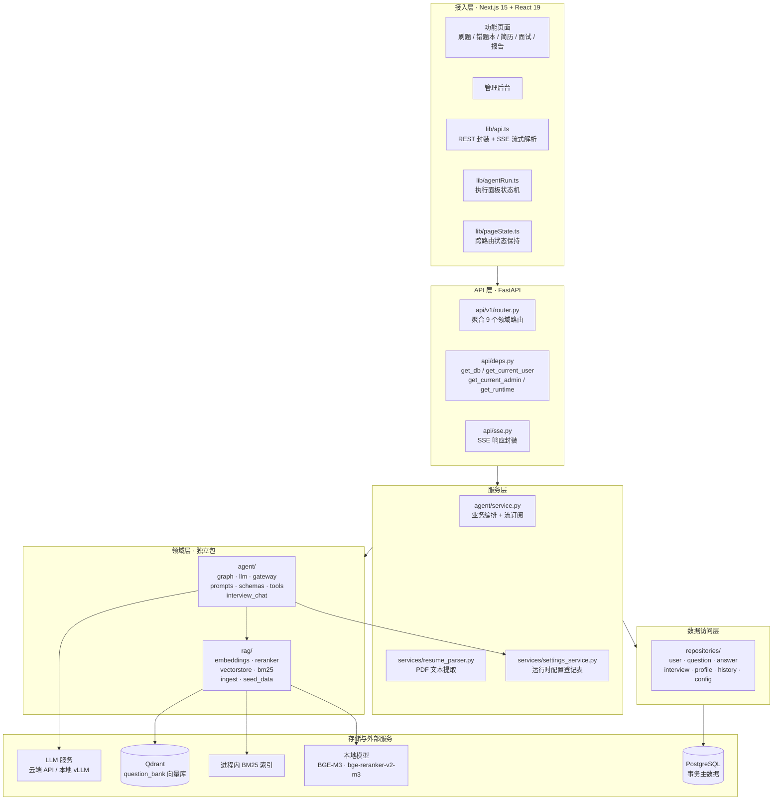
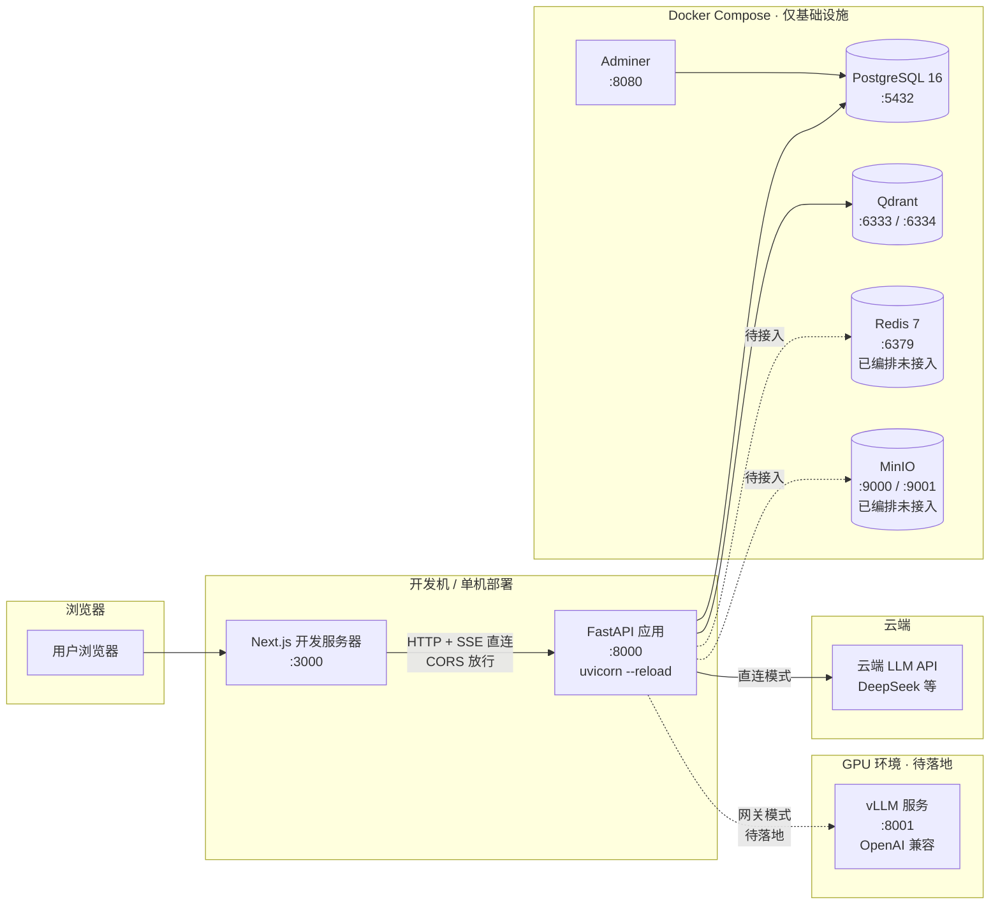
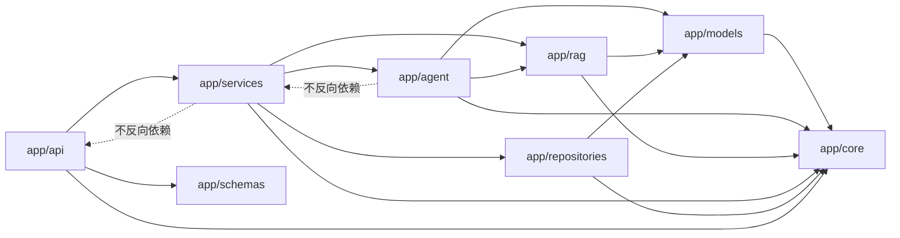
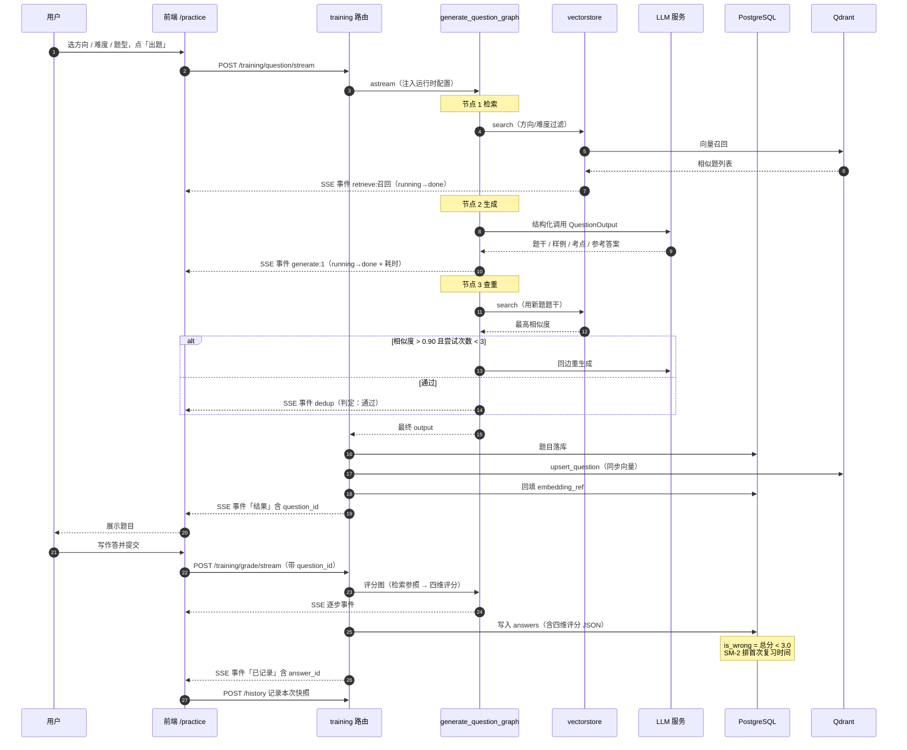
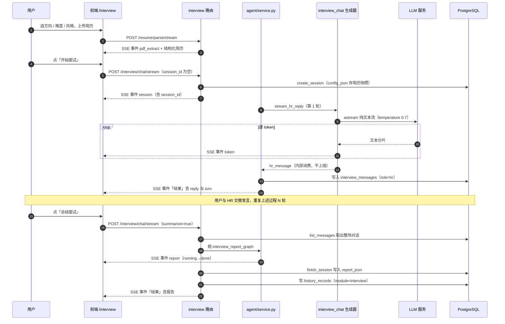
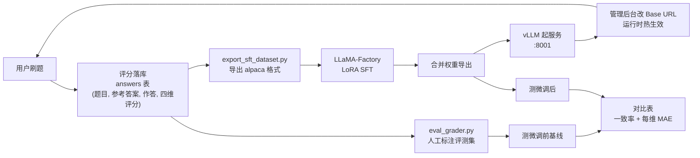

# 02 · 总体架构设计

> 本篇回答「系统由哪些部分组成、它们怎么连接、数据怎么流动」。所有图形均为 Mermaid，可直接在支持 Mermaid 的阅读器中渲染。

---

## 1. 架构总览

### 1.1 一句话概括

**一个单进程 FastAPI 后端按领域分包（模块化单体）+ 一个 Next.js 前端直连后端 + 一组容器化的基础设施 + 两个本地部署的判别模型。**

### 1.2 三个设计原则

| 原则 | 含义 | 带来的好处 |
|---|---|---|
| **模块化单体** | 按业务领域分包（auth / training / resume / interview / report / admin），但不拆成微服务 | 一期开发与调试成本最低；包边界清晰，将来要拆随时可拆 |
| **Agent 与 RAG 是独立包** | `app/agent/` 与 `app/rag/` 不依赖 `app/api/`，只被 `app/services/` 调用 | Agent 逻辑可脱离 HTTP 层单独测试与复用；离线脚本（微调导出、评测、压测）能直接引用它们 |
| **事务数据与检索数据分离** | 主数据只在 PostgreSQL；Qdrant 只存「可检索的文本片段 + 元数据」，用 `chunk_id` 关联 | 向量库损坏可重建（从 PG 重新入库），不会丢业务数据 |

---

## 2. 分层架构

### 2.1 分层图

### 2.2 文字导读

从上往下读这张图：

1. **前端**通过 `lib/api.ts` 直接调用后端（REST 用于普通请求，SSE 用于 Agent 执行）。前端**不做业务计算**，只负责渲染与状态保持。
2. **API 层**只做两件事：路由分发 + 依赖注入。`deps.py` 里的 `get_runtime` 是关键 —— 它把管理后台配的运行时参数（模型名 / 温度 / 检索开关）读出来注入 Agent。
3. **服务层**是业务编排的所在地。`agent/service.py` 负责调用 LangGraph 图并**把两条流合并**推给前端；`settings_service.py` 是所有可配置项的登记表。
4. **领域层**是两个不依赖 Web 的纯逻辑包。`agent/` 管「怎么调模型、怎么建图」，`rag/` 管「怎么检索」。
5. **数据访问层**统一收口所有数据库操作，并**强制 `user_id` 过滤**（多租户隔离的唯一实现点）。
6. **存储层**：事务数据进 PostgreSQL，可检索文本进 Qdrant，本地模型做嵌入与精排。

> **为什么 `agent` 与 `rag` 要独立成包**：因为离线脚本需要复用它们。微调数据导出脚本要复用 `prompts.GRADE_TEMPLATE`（保证训练与线上 prompt 逐字一致），评测脚本要复用 `llm.get_structured_llm`，压测脚本要复用 `llm.new_session_id`。如果这些逻辑长在 API 层里，离线脚本就只能复制粘贴 —— 而复制粘贴的 prompt 正是「训推不一致」的根源。

---

## 3. 部署架构

### 3.1 部署图

### 3.2 关键部署决策

| 决策 | 内容 | 理由 |
|---|---|---|
| **应用本体不进容器** | `backend/docker-compose.yml` 只编排 PostgreSQL / Qdrant / Redis / MinIO / Adminer，前后端在宿主机上跑 | 开发期改代码热重载最快；容器化的收益在多人协作与生产环境才体现 |
| **前端直连后端，不走 Next rewrites** | 跨域由后端 CORSMiddleware 放行 | **Next 的 rewrite 会把整个 SSE 响应缓冲到请求结束**，逐字流式与分步事件全部失效 —— 这是实测踩过的坑，详见 [11-工程实践与踩坑记录.md](./11-工程实践与踩坑记录.md) 第 3 节 |
| **CORS 用正则而非固定端口列表** | `allow_origin_regex=r"http://(localhost\|127\.0\.0\.1)(:\d+)?"` | Next 开发服务器在 3000 被占用时会自动顺延到 3001/3002，固定列表会让新端口上的每个请求预检都返回 400 |
| **统一用 `127.0.0.1` 而非 `localhost`** | 数据库、Qdrant、MinIO 的默认连接串全部写 IPv4 | Windows 下 `localhost` 会优先解析到 IPv6 的 `::1`，而 Docker 只映射了 IPv4，连 `::1` 会**静默超时 20 秒以上**才回退 |
| **本地模型不阻塞启动** | BGE-M3 与 bge-reranker-v2-m3 在 lifespan 里用后台线程预热 | 两个模型各 2GB+ 权重，首次加载加首次推理约 20–30 秒。放前台会把启动拖到半分钟 |

### 3.3 端口分配

| 服务 | 端口 | 说明 |
|---|---|---|
| Next.js 前端 | 3000 | `npm run dev` |
| FastAPI 后端 | 8000 | `uvicorn app.main:app --reload` |
| PostgreSQL | 5432 | |
| Qdrant | 6333（HTTP）/ 6334（gRPC） | |
| Redis | 6379 | 已编排，代码未接入 |
| MinIO | 9000（API）/ 9001（控制台） | 已编排，代码未接入 |
| Adminer | 8080 | 数据库 Web 客户端 |
| vLLM（规划） | 8001 | OpenAI 兼容端点 |

---

## 4. 模块边界与依赖方向

### 4.1 依赖方向

**规则**：依赖只向下，不向上。`app/agent/` 不知道 HTTP 的存在，`app/repositories/` 不知道 Agent 的存在。这条规则让离线脚本可以只 import `app/agent/` 与 `app/rag/` 而不拉起整个 Web 应用。

### 4.2 各包职责

| 包 | 职责 | 关键约定 |
|---|---|---|
| `app/core/` | 配置、数据库引擎、JWT 与密码哈希 | 配置项唯一来源；`database.py` 只有 7 行 |
| `app/models/` | 11 张 ORM 表 | 全项目**零 `relationship()`**，全部手写查询 |
| `app/schemas/` | Pydantic 请求 / 响应模型 | 与 `agent/schemas.py` 区分：这里管 API 出入参，那里管**模型的结构化输出** |
| `app/api/` | 路由与依赖注入 | `v1/router.py` 聚合 9 个领域路由；`sse.py` 统一 SSE 包装 |
| `app/repositories/` | 数据访问 | **多租户隔离的唯一实现点**，所有用户数据查询强制带 `user_id` |
| `app/services/` | 业务编排 + 配置登记 | `settings_service.SPECS` 是新增配置项的唯一修改点 |
| `app/agent/` | LangGraph 编排、LLM 客户端、网关、prompt、工具 | 9 张图 + 1 个对话生成器；prompt 是「训推一致」的关键资产 |
| `app/rag/` | 嵌入、精排、向量库、稀疏检索、入库 | 稠密 / 稀疏 / 混合三模式检索 |

---

## 5. 三条关键数据流

### 5.1 刷题闭环

> 从「选条件」到「错题排期」的完整链路。这条链路串起了 RAG 检索、LLM 生成、结构化校验、向量同步、SM-2 排期五件事。

**三处值得注意的设计**：

1. **查重是回边而非重新调用整个图** —— `dedup` 节点通过条件边回到 `generate`，`attempts` 累加，最多 3 次。这样中间产物不会推送也不会落库（`updates` 流只取最后一个含 `output` 的节点）。
2. **出题与评分是两次独立请求** —— 不是一次请求出题加评分。这样用户可以反复修改作答再评分，且评分必须带 `question_id` 才能落库（缺失时不落库，宁可不记录也不挂到错的题上）。
3. **向量同步发生在 API 层而非 repository 层** —— 落 PG 与写 Qdrant 是两步，`embedding_ref` 回填建立关联。

### 5.2 面试闭环

> 一问一答真对话，不是一次性生成 N 轮。这条链路的特殊之处是**对话类事件**（token / hr_message）与**步骤类事件**走同一根 SSE 流。

**三处值得注意的设计**：

1. **面试对话不用 StateGraph**。因为一场面试是有上下文的连续对话，每轮都要把全量历史重拼进 messages，用图来表达反而绕。`interview_chat.py` 是一个带会话状态的**异步生成器**。
2. **对话事件不进执行面板**。`token`（逐字分片）与 `hr_message` 若混进执行面板会刷屏。前端用 `CHAT_EVENTS = {token, session, hr_message}` 把这些事件路由到 `onEvent` 回调，只把「模型调用」这类步骤事件留在面板。
3. **历史记录由后端写**，而刷题 / 简历 / 报告由前端写。原因是面试的会话与消息都在服务端，前端拿不到完整对话。

### 5.3 微调闭环（数据飞轮）

> 这条链路的特殊之处是**离线**：不进服务进程，而是用脚本从数据库读数据、训练、再写回服务。

**三个关键约束**：

| 约束 | 原因 |
|---|---|
| 导出数据集的 prompt 必须**逐字复用** `prompts.GRADE_TEMPLATE` | 否则训练时看到的输入与线上推理时不同，模型学的是另一件事（训推不一致） |
| 评测默认**不走向量检索** | 线上评分会先检索题库参照，那是另一个变量。掺进来就分不清微调前后的差异是模型带来的还是检索带来的 |
| 评测读**数据库里的运行时配置**而非 `.env` | 管理员可能已在后台改过模型，`.env` 那份已过期，拿它评测等于测了另一个模型 |

> 完整方案与当前进度见 [09-模型微调方案.md](./09-模型微调方案.md)。

---

## 6. 架构决策记录（ADR）

> 每条决策写清「备选 → 选定 → 理由 → 代价」。这是评审最关心的部分 —— 架构不是选出来的，是权衡出来的。

### ADR-1：模块化单体，不拆微服务

- **备选**：微服务 / 模块化单体
- **选定**：模块化单体（单进程 FastAPI 按领域分包）
- **理由**：一期用户量与团队规模都撑不起微服务的运维成本。分包已经把领域边界划清，将来按包拆服务是机械操作。
- **代价**：无法按模块独立扩容；一个进程内的 bug 可能影响全部接口。

### ADR-2：显式建图（LangGraph），不用黑盒 Agent 框架

- **备选**：LangChain Agent Executor / 自研 ReAct 循环 / LangGraph 显式状态图
- **选定**：LangGraph `StateGraph`
- **理由**：三点不可替代 —— ① **显式图**让「出题 → 查重 → 回边重生成」这类循环能被精确表达；② `get_stream_writer()` 让节点内部能主动推事件，这是可观测功能的基础；③ 条件边让流程分支成为一等公民。
- **代价**：比链式调用写起来啰嗦；图的编译期与运行期概念要学。

### ADR-3：向量库只存可检索片段，不替代事务数据

- **备选**：向量库兼作主存储 / 向量库只做检索索引
- **选定**：只做检索索引。主数据在 PostgreSQL，Qdrant 里的 point id 就是 `question_id`，PG 侧用 `embedding_ref` 回指。
- **理由**：向量库的强项是相似度检索，弱项是事务、关联查询、约束。把业务主数据放进去，等于放弃了关系数据库全部能力。
- **代价**：写入要写两处（PG + Qdrant），必须保证一致 —— 管理后台的增删改都显式同步向量库。好处是向量库可随时从 PG 重建。

### ADR-4：结构化输出用 `response_format=json_object`，不用 function calling

- **备选**：function calling（工具调用）/ `response_format=json_object` / 纯 prompt 要求 JSON 后自行解析
- **选定**：`response_format=json_object` + Pydantic 校验
- **理由**：**DeepSeek 在工具调用模式下不保证 `arguments` 是合法 JSON** —— 模型只要在字符串里写了未转义的引号（例如 `"采用"总分总"结构作答"`），整段 JSON 就废掉，实测约三成概率触发，报告类长文本尤其容易中招。`json_object` 由服务端约束解码，必然返回合法 JSON。
- **代价**：`json_object` 要求 prompt 里出现 "json" 字样，所以要把 Pydantic 的格式说明作为最后一条消息追加进去（多消耗一点 token）。详见 [11-工程实践与踩坑记录.md](./11-工程实践与踩坑记录.md) 第 1 节。

### ADR-5：前端直连后端，不用 Next.js rewrites 代理

- **备选**：Next rewrites 代理 / 前端直连 + 后端 CORS
- **选定**：前端直连
- **理由**：**Next 的 rewrite 会把整个 SSE 响应缓冲到请求结束**才开始交给浏览器，执行面板拿不到「进行中」的分步事件，逐字流式也退化成一次性输出。
- **代价**：需要配置 CORS；生产环境要收紧 origin 白名单。

### ADR-6：评分权重写在 prompt 里，服务端不做加权校验

- **备选**：服务端按四维重算总分 / 信任模型自报的 `total_score`
- **选定**：信任模型自报（权重只写在 prompt 文本中）
- **理由**：省一次校验逻辑与一次可能的纠正调用，实现更简单。
- **代价**：**无法防御模型算错总分**。若要严格保证，应在服务端按 `0.40*正确性 + 0.30*完整性 + 0.15*表达 + 0.15*术语` 重算并比对。这是已知的设计边界，记录在 [13-设计边界与演进规划.md](./13-设计边界与演进规划.md)。

### ADR-7：面试的会话与消息分表，不塞 JSON 字段

- **备选**：会话表用一个 `rounds_json` 大字段存全部对话 / 单独的 `interview_messages` 表
- **选定**：单独建表
- **理由**：读某场面试的对话时不必反序列化整块大 JSON；便于按轮次分页或单条编辑。
- **代价**：多一张表、多一次 join。历史包袱：`interview_sessions` 上原本建的 `rounds_json` 列没删（只放开了 NOT NULL 约束），因为已建表的环境里删列有风险。

### ADR-8：运行时配置存数据库，`.env` 保持唯一事实来源

- **备选**：配置全放 `.env`（改完要重启）/ 配置全放数据库 / 数据库只存「覆盖」
- **选定**：数据库只存管理员改过的值，未改的用 `.env` 默认值
- **理由**：`.env` 仍是唯一事实来源，配置表不会变成第二份真相；同时获得「改完即时生效」的能力。
- **代价**：读配置要穿透两层（缓存 → 库 → 默认值）；缓存是**进程内**的，多 worker 部署下各 worker 不一致。

---

**上一篇**：[01-需求分析.md](./01-需求分析.md) ｜ **下一篇**：[03-技术选型与论证.md](./03-技术选型与论证.md)
