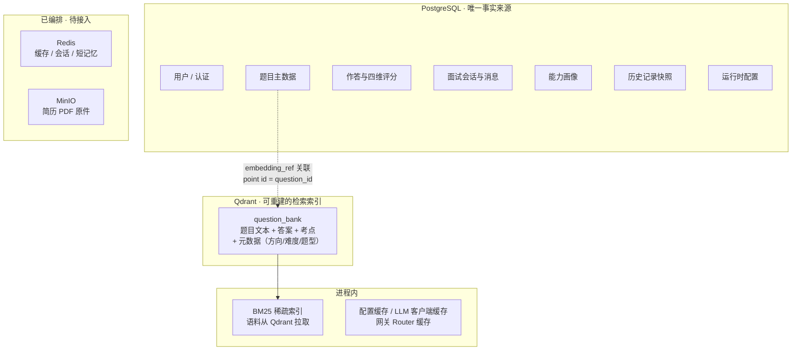

# 03 · 技术选型与论证

> 本篇的核心不是「我们用了什么」，而是**「为什么不用别的」**。每一项选型都给出：备选方案 → 选定结果 → 理由 → 付出的代价。
> 这是评审最看重的部分 —— 技术选型暴露的是判断力，不是知识面。

---

## 1. 选型总表

| 维度 | 候选方案 | 选定 | 核心理由 | 代价 |
|---|---|---|---|---|
| AI 编排 | LangChain Agent / 自研 ReAct / **LangGraph** | LangGraph | 显式状态图 + 节点内可推流事件 + 条件边 | 概念多、写起来啰嗦 |
| RAG 框架 | LlamaIndex / **LangChain** | LangChain | 与 LangGraph 同生态，`vectorstore` 抽象够用 | 抽象层有时碍事，部分地方直接用 `qdrant-client` |
| 向量库 | Milvus / Weaviate / **Qdrant** | Qdrant | 单容器即可跑、过滤能力强、Python 客户端简洁 | 规模化能力弱于 Milvus |
| 后端框架 | Flask / Django / Spring Boot / **FastAPI** | FastAPI | 原生 async（LLM 调用全是 IO 密集）、Pydantic 校验、自动 OpenAPI | 生态相比 Django 小 |
| 数据库 | MySQL / **PostgreSQL** | PostgreSQL | asyncpg 驱动成熟、JSON 与数组类型强、约束表达力好 | 运维复杂度略高于 MySQL |
| 嵌入模型 | 云端 Embedding API / **BGE-M3 本地** | BGE-M3 本地 | 零边际成本、数据不出本机、中文效果好 | 占用显存、冷启动慢 |
| 精排模型 | 不精排 / Cohere Rerank API / **bge-reranker-v2-m3 本地** | 本地精排 | 同上，且精排对最终召回质量提升明显 | 多一次推理延迟 |
| 生成模型 | 单一云端 / 单一本地 / **云端为主 + 本地兜底** | 云端为主，网关可切本地 | 一期算力有限，云端质量最好；网关为本地化留好接口 | 有 API 成本 |
| LLM 网关 | 不用 / Nginx 自建 / **LiteLLM** | LiteLLM | 原生支持多部署路由与自动 fallback | 是原生 SDK，需要写薄适配器接进现有链路 |
| 稀疏检索 | 不实现 / 接 Elasticsearch / **进程内 BM25** | 进程内 BM25 | 题库规模小，省一个中间件；RRF 融合效果已够 | 题库变大后内存与重建成本上升 |
| 微调框架 | PEFT 手写 / Unsloth / **LLaMA-Factory** | LLaMA-Factory | 配置化训练、alpaca 格式开箱即用、导出合并一条命令 | 依赖较重 |
| 前端框架 | Vue / **Next.js** | Next.js 15 + React 19 | App Router 的分层布局适合多模块后台式应用 | App Router 会卸载路由组件，需要自己做状态保持 |
| 认证方案 | Session + Redis / **JWT** | JWT | 无状态、前端直连时不需要处理 Cookie 跨域 | 无法服务端主动失效 |

---

## 2. AI 编排：为什么是 LangGraph

### 2.1 备选对比

| 方案 | 能表达「出题→查重→不过则重生成」吗 | 能推实时步骤事件吗 | 学习成本 |
|---|---|---|---|
| LangChain Agent Executor | 不能，循环由框架内部控制 | 难，事件粒度粗 | 低 |
| 自研 ReAct 循环 | 能，但要自己写状态机 | 能，但要自己设计事件协议 | 中（自研量大） |
| **LangGraph `StateGraph`** | **能，条件边天然表达回边** | **能，`get_stream_writer()` 节点内主动推** | 中 |

### 2.2 选定理由（三点，都可验证）

**理由一：条件边让「重试循环」成为图的拓扑，而不是代码里的 `while`**

出题图是本项目唯一的多跳图：

```
START → retrieve → generate → dedup ─┬─(重复且 attempts<3)→ generate
                                     └─(通过)→ END
```

```python
def _route_after_dedup(state: AgentState) -> str:
    max_attempts = state.get("max_attempts", settings.question_max_attempts)
    if state.get("duplicate") and state.get("attempts", 0) < max_attempts:
        return "generate"
    return END
```

这条回边如果用 `while` 写在函数里，重试次数、中间产物丢弃、事件推送三件事会缠在一起；写成图之后，`attempts` 是 state 字段、中间产物被 `updates` 流自然忽略、事件在节点内推。

**理由二：节点内可以主动推事件（这是可观测功能的基础）**

```python
def _push(event: dict) -> None:
    """把事件实时推给 SSE 流。非图内运行时没有 stream writer，静默忽略。"""
    try:
        get_stream_writer()(event)
    except Exception:
        pass
```

`get_stream_writer()` 让节点在**执行到一半时**就能把「我开始了」「我做完了、耗时多少」推出去。这是「进行中 → 已完成」原地替换体验的技术前提。若用链式调用，只能在整条链结束后一次性拿到结果。

**理由三：不走图的部分也能平滑共存**

面试对话（`interview_chat.py`）**刻意不用 StateGraph**，而是一个带会话状态的异步生成器。这说明选型没有变成教条 —— 图适合多步决策，不适合「把全量历史重拼进 messages 再流式输出」这种场景。两套机制共用同一份事件协议（5 字段，见 [06-可观测设计.md](./06-可观测设计.md)），前端无需区分。

### 2.3 付出的代价

| 代价 | 具体表现 |
|---|---|
| 概念负担 | `StateGraph`、reducer、条件边、stream writer、`stream_mode` 多流 —— 上手曲线陡 |
| 编译期绑定 | 9 张图在模块导入时即编译，配置变更只能通过 state 传，不能改图结构 |
| 无 checkpointer | 当前所有图 `g.compile()` 都不带参数，因此**没有持久化状态**。这是刻意的：一期的会话状态存在 PG 里，不需要图级别的 checkpoint |

---

## 3. RAG 框架：为什么是 LangChain 而非 LlamaIndex

| 对比项 | LangChain | LlamaIndex |
|---|---|---|
| 与 LangGraph 的协同 | 同生态，`Document` / `Retriever` 类型互通 | 需额外适配 |
| 本项目实际用到的能力 | `vectorstore` 抽象、`add_messages`、消息类型 | 更丰富的索引结构（树索引、关键词表索引） |
| 本项目是否需要高级索引 | **不需要** —— 题库一题一个 point，无多级索引需求 | — |

**结论**：本项目对 RAG 框架的需求很浅（只要一个向量检索抽象），因此选择与编排层同生态的 LangChain，避免同时在两套抽象间转换。

**实际使用程度**：比预期更浅。由于需要精细控制候选池大小、元数据过滤、三模式检索与 RRF 融合，`app/rag/vectorstore.py` **直接用 `qdrant-client` 实现检索**，只借用了 LangChain 的消息类型与少量工具。这是一个诚实的观察：框架的价值在生态协同，而不在封装本身。

---

## 4. 向量库：Qdrant（一期）→ Milvus（规模化）

### 4.1 为什么一期选 Qdrant

| 对比项 | Qdrant | Milvus | Weaviate |
|---|---|---|---|
| 单容器启动 | **可以**（一个镜像跑起来就能用） | 需要 etcd + MinIO + 多个组件 | 可以但镜像更大 |
| 元数据过滤 | 强（`FieldCondition` + `MatchValue`，支持 must/should/must_not） | 强 | 强 |
| Python 客户端 | `qdrant-client`，API 简洁 | `pymilvus`，概念多 | `weaviate-client` |
| 部署复杂度 | **低** | 高 | 中 |

本项目的检索**必须带元数据过滤**（按方向 / 难度 / 题型筛），三家都满足。差别在部署复杂度 —— 一期是单机开发，Qdrant 一个容器起得来就是决定性优势。

### 4.2 什么时候该换 Milvus

| 触发条件 | 说明 |
|---|---|
| 向量规模 > 千万级 | Qdrant 单机内存索引开始吃紧 |
| 需要分布式水平扩容 | Qdrant 也支持集群，但 Milvus 的存算分离架构更彻底 |
| 需要多路向量（如题库 + 面经 + 简历三库混合检索） | Milvus 的多 collection 与 partition 管理更成熟 |

**迁移成本评估**：由于本项目把向量库定位为**纯检索索引**（主数据在 PG，point id 就是 `question_id`），迁移只需要改 `app/rag/vectorstore.py` 一个文件，再从 PG 重新入库即可。这是 ADR-3 那个决策带来的直接收益。

---

## 5. 后端框架：为什么是 FastAPI

### 5.1 明确的排除项：Spring Boot / Java

**技术栈已明确放弃 Java 路线**，理由：

| 理由 | 说明 |
|---|---|
| 生态错配 | 本项目的核心依赖（LangGraph、LangChain、sentence-transformers、FlagEmbedding、LLaMA-Factory、vLLM）**全部是 Python 生态**。用 Java 做后端意味着要么放弃这些直接用 HTTP 调 Python 服务，要么维护两套语言 |
| 异步模型 | LLM 调用全是长耗时 IO，FastAPI 的原生 async 直接支撑 SSE 流式；Java 侧要引入 WebFlux 才有等价能力，复杂度更高 |
| 离线脚本复用 | 微调导出、评测、压测三个脚本都要复用 `app/agent/` 里的 prompt 与 LLM 客户端。同语言直接 import，跨语言只能复制 prompt —— 而复制 prompt 正是「训推不一致」的根源 |

这个决策记录在此处，是为了避免后续重复讨论。

### 5.2 FastAPI vs Flask vs Django

| 对比项 | FastAPI | Flask | Django |
|---|---|---|---|
| 原生 async | **是** | 需扩展 | 部分（ASGI 支持较新） |
| 请求校验 | **Pydantic 内建** | 需 marshmallow 等 | DRF Serializer |
| SSE 流式 | **`StreamingResponse` 直接支持** | 需额外配置 | 需额外配置 |
| 自动 API 文档 | **内建 `/docs`** | 无 | 无（需 drf-spectacular） |
| ORM | 自选（本项目用 SQLAlchemy 2.0 async） | 自选 | 内建（但同步为主） |

**决定性因素是 async 与 SSE**。本项目 47 个端点里有 9 个是长连接流式端点，且依赖注入体系（`Depends`）让「当前用户 + 数据库会话 + 运行时配置」三件事可以声明式地注入到每个端点。

**一个观察**：Django 的「内建 ORM」在纯同步场景更省事，但本项目的数据库访问全部是 async（`create_async_engine` + `asyncpg`），Django 的 async ORM 支持成熟度不足。

---

## 6. 数据存储的职责边界



| 存储 | 存什么 | 不存什么 | 理由 |
|---|---|---|---|
| **PostgreSQL** | 全部业务主数据 | — | 事务、约束、关联查询的唯一可靠载体 |
| **Qdrant** | 可检索文本片段 + 元数据 | **业务主数据、关联关系** | 向量库的强项是相似度检索；存主数据等于放弃关系数据库能力 |
| **进程内 BM25** | 分词语料（从 Qdrant 拉取） | — | 题库规模小，省一个中间件；失效时机与 Qdrant 写入绑定 |
| **Redis**（规划） | 缓存、会话、短期记忆 | 主数据 | 已编排容器、已声明依赖，**代码零引用** |
| **MinIO**（规划） | 简历 PDF 原件 | 解析后的文本 | `resumes.original_file_ref` 字段已预留，**当前 PDF 只在内存中抽取文本，不上传** |

> **一个重要的自我约束**：向量库里的数据**可以随时从 PostgreSQL 重建**（`app/rag/ingest.py` 就是从 PG 的 `questions` 表入库）。这保证了向量库损坏不是灾难，而只是重新跑一次入库脚本。

---

## 7. 本地模型：为什么嵌入与精排必须本地部署

### 7.1 三维对比

| 维度 | 云端 Embedding / Rerank API | **本地部署（BGE-M3 + bge-reranker-v2-m3）** |
|---|---|---|
| **成本** | 按 token 计费。本项目每次检索都要嵌入查询、每次精排都要对候选池逐条打分，**调用频次极高** | 一次性下载权重，之后**零边际成本** |
| **隐私** | 简历文本、用户作答会离开本机 | 数据**不出本机**。简历属敏感数据，这一点是硬要求 |
| **延迟** | 受网络与限流影响，且多一次 RTT | 本地推理，**GPU 上毫秒级**；但冷启动需 20–30 秒加载权重 |
| **可离线** | 不可 | 可完全离线运行 |

### 7.2 选定的具体模型

| 模型 | 用途 | 库 | 关键参数 |
|---|---|---|---|
| `BAAI/bge-m3` | 文本嵌入 | `sentence-transformers` | 输出 1024 维，`normalize_embeddings=True` |
| `BAAI/bge-reranker-v2-m3` | 候选精排 | `FlagEmbedding` | 交叉编码器，输出相关性分数 |

### 7.3 付出的代价与对策

| 代价 | 对策 |
|---|---|
| 冷启动 20–30 秒 | lifespan 里**后台线程预热**，各跑一次真实推理（不只是加载权重，把 GPU 首次推理开销也消化掉） |
| 占用显存 | 模型单例（进程内只加载一份），不加锁会出现并发构造出两个实例的严重问题 |
| 国内下载慢 | `app/rag/__init__.py` 全局设死 `HF_HUB_OFFLINE=1` 与 `TRANSFORMERS_OFFLINE=1`，避免每次冷启动向 huggingface.co 发 HEAD 请求白等 20–30 秒 |

> **一个必须记录的工程坑**：预热线程与第一个真实请求会同时进入 `_load()`。不加锁的话两边都会构造一份模型，而**并发构造同一个 HF 模型会得到半初始化实例**，之后所有调用都报 `Cannot copy out of meta tensor; no data!`，且坏实例被缓存后永久生效。解法是类内双重检查锁 + 模块级单例锁，并**刻意不用 `lru_cache`**（它不加锁）。详见 [11-工程实践与踩坑记录.md](./11-工程实践与踩坑记录.md) 第 2 节。

---

## 8. LLM 网关：为什么是 LiteLLM

### 8.1 备选对比

| 方案 | 多部署路由 | 自动 fallback | 接入成本 |
|---|---|---|---|
| 不用（直连单个端点） | 无 | 无 | 零 |
| Nginx / 自研代理 | 需自己写路由与健康检查 | 需自己写 | 高 |
| **LiteLLM** | **内建 `Router`** | **内建 `fallbacks` + `num_retries` + `cooldown`** | 中（需写薄适配器） |

### 8.2 选定的两种形态

| 形态 | 位置 | 配置来源 | 适用场景 |
|---|---|---|---|
| **进程内 Router**（项目主用） | `app/agent/gateway.py` | 管理后台，改完即时生效 | 单实例部署，要可观测、要热切换 |
| Proxy 服务（备选） | `backend/deploy/litellm/config.yaml` | YAML 文件 | 多服务共用，网关独立成容器 |

### 8.3 付出的代价：需要写一个薄适配器

**LiteLLM 是原生 SDK，不是 langchain 组件** —— 它返回的对象与 langchain 的消息接口不兼容。因此 `gateway.py` 里写了 `LiteLLMChat` 薄适配器，**只对齐真正用到的三个方法**：

```python
class LiteLLMChat:
    def __init__(self, router, model: str, params=None): ...
    def bind(self, **kwargs) -> LiteLLMChat:      # 累积参数，不可变语义
        return LiteLLMChat(self._router, self._model, {**self._params, **kwargs})
    def invoke(self, messages) -> _Result: ...
    async def astream(self, messages): ...
```

这样做的收益是**上层 `JsonSchemaLLM` 一行都不用改**。适配器只暴露三个方法，是因为上层的全部真实需求就是这三个 —— 这比实现一个完整的 LangChain `BaseChatModel` 子类成本低得多。

`_Result` 是一个只有 `__slots__ = ("content",)` 的最小对象，因为上层只读 `.content`。

### 8.4 容错设计：配置写坏不会拖垮服务

```python
def parse_deployments(raw: str) -> list[Deployment]:
    if not raw or not raw.strip():
        return []
    try:
        rows = json.loads(raw)
    except json.JSONDecodeError:
        return []
    ...
```

解析失败返回空列表 → `_get_gateway_cached` 返回 `None` → 调用方回落直连。**管理员在后台填错一个逗号，服务照常可用**，只是网关没生效。这个设计的理由很简单：配置错误不应该导致系统不可用。

---

## 9. 稀疏检索：为什么是进程内 BM25

### 9.1 动机：纯向量检索的已知短板

纯语义检索对**算法题名、专有名词、精确字符串**的召回明显偏弱。例如查询「LRU」时，向量检索可能召回一堆「缓存淘汰策略」的泛化题目，但漏掉题干里明确写着「LRU 缓存」的那道题 —— 因为语义空间里它们太近了。

### 9.2 方案对比

| 方案 | 优点 | 缺点 | 结论 |
|---|---|---|---|
| Elasticsearch / OpenSearch | 成熟的 BM25 实现，可扩展 | 多一个重中间件要运维 | 题库规模小，不划算 |
| Qdrant 原生稀疏向量 | 与稠密向量同一个库，一次查询 | 需要在入库时额外生成稀疏向量，Qdrant 侧配置更复杂 | 备选 |
| **进程内 BM25（`rank-bm25`）** | 零中间件，语料从 Qdrant 拉取 | 内存占用随题库线性增长；索引重建有成本 | **选定** |

### 9.3 融合策略：RRF（Reciprocal Rank Fusion，倒数排名融合）

RRF 的核心思想很朴素：**不看两路检索的分数（量纲不同、不可比），只看名次**。

```
score(d) = Σ over 每一路命中 1 / (k + rank(d))
```

本项目取 `k = 60`（RRF 论文的经验值）。两路都命中的文档会累加两次得分，因此被推上去。

**为什么用 RRF 而不是加权求和分数**：稠密检索出的是余弦相似度（0–1），BM25 出的是无上界的词频相关分。直接加权求和需要先做归一化，而归一化方式的选择本身就是一个不稳定的超参。RRF 只用名次，天然规避了这个问题。

**实现要点**：
- 分商用 `jieba.lcut_for_search`（搜索模式，会把长词切出子词，提高召回）
- 语料是 `text + key_points` 的拼接 —— **注意这与稠密路只用 `content` 做嵌入的口径不同**
- 索引失效时机放在 `vectorstore.upsert_question` / `delete_question` 之后，而不是 PG 写入处。理由：BM25 的语料就是从 Qdrant 拉的，**「Qdrant 写完」才是失效的正确时机**；放在 PG 写入处会早一步，索引重建时还看不到新题

> 检索的完整实现见 [05-Agentic-RAG设计.md](./05-Agentic-RAG设计.md) 第 3 节。

---

## 10. 微调框架：为什么是 LLaMA-Factory

| 方案 | 训练配置 | 数据集格式 | 权重合并导出 | 结论 |
|---|---|---|---|---|
| PEFT 手写训练循环 | 自己写 | 自己写 DataLoader | 自己写 | 灵活但要写的代码多，容易出错 |
| Unsloth | 自己写（提供加速算子） | 自己写 | 自己写 | 单卡训练速度快，但生态较新 |
| **LLaMA-Factory** | **一个 YAML** | **alpaca / sharegpt 开箱即用** | **`llamafactory-cli export` 一条命令** | **选定** |

**决定性理由**：本项目的微调目标是「让 1.5B 小模型学会按四维 rubric 输出结构化 JSON」，这是一个**标准的有监督微调任务**，不需要任何自定义训练逻辑。LLaMA-Factory 把「数据集注册 → 训练 → 合并导出」做成三段配置，正好匹配需求。

**代价**：依赖较重（会引入自己的 transformers / peft / datasets 版本约束），需要独立环境。这一点已记录在部署注意事项中。

---

## 11. 前端：为什么是 Next.js 15 + React 19

| 对比项 | Next.js（App Router） | 纯 React + Vite | Vue |
|---|---|---|---|
| 路由 | 文件即路由，`(app)` 路由组适合多模块应用 | 需引入 React Router | 内建 |
| 布局复用 | `layout.tsx` 分层嵌套 | 需自己组织 | 需自己组织 |
| 生产构建 | `next build` 内建 | 需自己配 | Vite |

**选定理由**：本项目是「登录后进入一个多模块控制台」的形态 —— 固定侧栏 + 六个功能页 + 一个管理后台。App Router 的路由组 `(app)` 与 `layout.tsx` 天然表达这个结构。

### 11.1 一个必须记录的代价：App Router 会卸载路由组件

**Next.js App Router 在切换路由时会卸载离开的页面组件，页面的 `useState` 随之丢失。** 用户从「刷题训练」跳到「模拟面试」再跳回来，刚出的题、刚写的答案就没了。

对策是自建 `usePageState(key, initial)` 钩子（`frontend/lib/pageState.ts`）：状态挂在模块级 `Map` 上并镜像到 `sessionStorage`，切走再回来内容还在，刷新也不丢（仅当前标签页）。

这个代价也直接影响了执行面板的设计 —— `useAgentRun` 接入了同一套状态保持，所以轨迹一起保留。

### 11.2 另一个代价：不能用 rewrites 代理

见 ADR-5。这是选型过程中**实测发现**的问题，而不是预判的。

---

## 12. 认证：为什么是 JWT

| 对比项 | Session + Redis | JWT |
|---|---|---|
| 服务端状态 | 需要（Redis） | **无状态** |
| 前端直连时的跨域 | 需要处理 Cookie 的 `SameSite` / `Secure` / 跨域携带 | **只需一个 `Authorization` 头** |
| 主动失效 | 可以（删 session） | **不可以**（无黑名单机制） |
| 依赖 | Redis 必须可用 | 无额外依赖 |

**选定理由**：本项目前端是**直连后端**的（ADR-5），用 Cookie 会同时踩 CORS 与 `SameSite` 两个坑；而 JWT 只需要前端在请求头加一行。且一期不需要「强制下线」能力。

**代价（如实记录）**：JWT payload 只有 `sub`（用户 ID）与 `exp`（过期时间），**没有 `iat`、没有 refresh token、没有 `jti` 黑名单**。这意味着：
- 无法在服务端主动让某个 token 失效
- token 泄漏后在 24 小时内持续有效（有效期 `access_token_expire_minutes = 1440`）
- 没有续期机制，24 小时后必须重新登录

若将来需要「强制下线」或「短 token + 刷新」，应引入 Redis 存黑名单或 refresh token。这已列入演进规划。

---

## 13. 依赖版本与环境

### 13.1 后端核心依赖（`backend/pyproject.toml`）

| 分组 | 依赖 |
|---|---|
| Web | `fastapi>=0.115`、`uvicorn[standard]>=0.30`、`python-multipart>=0.0.9` |
| 校验与配置 | `pydantic>=2.7`、`pydantic-settings>=2.3` |
| 数据库 | `sqlalchemy[asyncio]>=2.0`、`asyncpg>=0.29` |
| 认证 | `python-jose[cryptography]>=3.3`、`passlib[bcrypt]>=1.7` |
| AI 编排 | `langgraph>=0.2`、`langchain>=0.3`、`langchain-openai>=0.2`、`langchain-community>=0.3` |
| 向量与网关 | `qdrant-client>=1.9`、`litellm>=1.40` |
| 文档与网络 | `pypdf>=4.0`、`httpx>=0.27` |
| 已声明未使用 | `redis>=5.0`、`arq>=0.25`、`langfuse>=2.30` |
| 开发（可选） | `ruff>=0.5`、`pytest>=8.0`、`httpx>=0.27` |

Python 要求 `>=3.11`；ruff 配置行宽 100，规则集 `E` / `F` / `I` / `UP`。

### 13.2 一个必须指出的依赖清单缺口

**以下包在实际运行中必需，但没有写进 `pyproject.toml`**，而是靠在调用点延迟 import、由环境手动安装：

| 包 | 用途 |
|---|---|
| `sentence-transformers` | 加载 BGE-M3 |
| `FlagEmbedding` | 加载 bge-reranker-v2-m3 |
| `rank-bm25` | 稀疏检索 |
| `jieba` | 中文分词 |

**这是需要修的真实问题**：换一台机器 `pip install -e .` 之后跑不起来。修正方式是补进 `pyproject.toml`（延迟 import 的设计本身没错 —— 它能避免没装这些包时整个应用 import 失败，但依赖声明应当完整）。另需注意 `sentence-transformers` 依赖 `transformers 4.x`，与 Laya 决策引擎所需的 `transformers 5.x` 存在版本冲突风险，因此本地部署与新增模型应使用独立环境隔离。

### 13.3 前端依赖（`frontend/package.json`）

| 类型 | 依赖 |
|---|---|
| 运行时 | `next 15.1.0`、`react 19.0.0`、`react-dom 19.0.0` |
| 开发 | `typescript ^5.7.2` + 4 个类型包 |

**前端零运行时依赖库** —— 没有 UI 组件库、没有状态管理库、没有图表库。雷达图与执行面板都是手写的。这是一个有意识的取舍：减少依赖，代价是要自己写更多组件代码。

### 13.4 LLM 与部署侧的环境要求

以下工具链**不在 `pyproject.toml` 里**，是环境另外安装的：

| 用途 | 安装方式 |
|---|---|
| vLLM 本地服务 | 需独立环境（`pip install vllm`），要求 CUDA 环境 |
| LoRA 训练 | `pip install llamafactory` |
| LiteLLM Proxy 形态 | `pip install 'litellm[proxy]'` |

---

## 14. 选型的自我评价

**做得好的地方**：

1. **编排层与检索层的选型是一致的**（LangGraph + LangChain 同生态），避免了跨框架类型转换的成本。
2. **两个本地模型的选择直接决定了这个项目能讲「隐私」与「零边际成本」**，而不只是「调用云端 API」。
3. **向量库边界（ADR-3）让迁移成本被压到最低**，这是选型时就能预见的收益。

**可以更好的地方**：

1. **稀疏检索用 `rank-bm25` 进程内索引，是权衡而非最优**。如果题库规模预期会大幅增长，应当直接用 Qdrant 原生的稀疏向量能力（或接 Elasticsearch），避免内存索引随数据线性增长。
2. **依赖清单不完整**（§13.2），这是一个工程疏漏而非设计取舍。
3. **未引入 UI 组件库**降低了依赖，但也意味着前端组件代码量偏大（前端约 4,760 行中很大一部分是在写基础组件）。

---

**上一篇**：[02-总体架构设计.md](./02-总体架构设计.md) ｜ **下一篇**：[04-数据模型设计.md](./04-数据模型设计.md)
