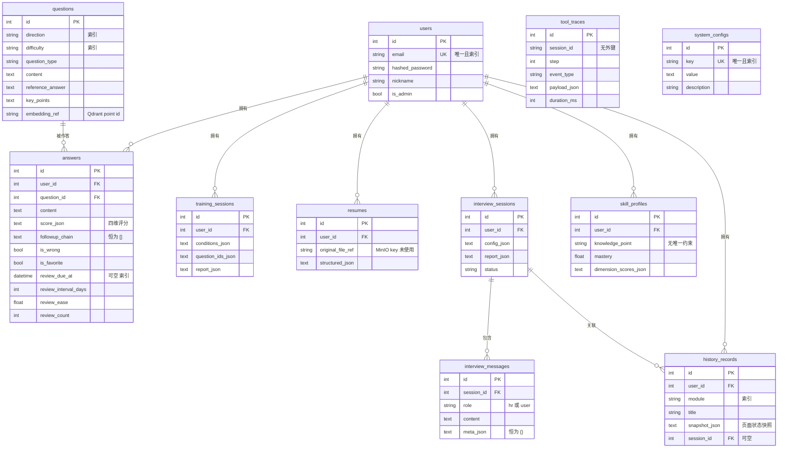

# 04 · 数据模型设计

> 本篇给出 11 张表的完整字段清单、ER 关系、索引策略与迁移方式，并解释几处**看起来奇怪但有意为之**的设计。

---

## 1. ER 图



**读图提示**：`||--o{` 表示一对多。注意三张表（`training_sessions`、`tool_traces`、`resumes`）画进了 ER 图但**目前没有任何读写路径**，属于「表已建好、业务未接线」，详见 [13-设计边界与演进规划.md](./13-设计边界与演进规划.md)。

---

## 2. 公共约定

所有 11 张表都遵循以下约定：

| 约定 | 内容 |
|---|---|
| **主键** | 统一 `id: Mapped[int]`，自增 |
| **时间戳** | 全部带 `created_at` / `updated_at`（`DateTime`，`server_default=func.now()`，`updated_at` 另有 `onupdate=func.now()`） |
| **表名** | 统一复数形式（`users` / `questions` / ...） |
| **无 `relationship()`** | **全项目零使用 SQLAlchemy 关系映射**，全部手写 join 或分次查询 |
| **无 `ondelete`** | 所有外键均未声明级联行为（默认 `RESTRICT` / `NO ACTION`） |

### 为什么不用 `relationship()`

| 原因 | 说明 |
|---|---|
| async 下的懒加载陷阱 | `relationship()` 默认懒加载，在 async session 里访问未加载的关系属性会抛异常。要用就得显式配 `selectinload`，反而更绕 |
| 查询可控性 | 手写 `select()` 能精确控制 join 与字段，避免意外触发 N+1 |
| 序列化边界清晰 | ORM 对象直接返回会被 FastAPI 序列化成整个对象图，手写查询让「返回什么」一目了然 |

**代价**：`answers` 列表要把题目信息带出来时，需要**手动联表**（`_to_out()` 函数），代码量比 `relationship()` 大。这是有意识的取舍。

### 为什么外键都不设 `ondelete`

一期没有「删除用户时级联清理全部数据」的需求（管理员删用户是偶发操作），**不设级联是最安全的默认值** —— 不会因为一次误删而悄悄带走大量关联数据。代价是删除用户前需要手动处理关联记录。若将来需要「账号注销」，应显式设计清理策略而不是依赖数据库级联。

---

## 3. 逐表字段清单

### 3.1 `users` — 用户

```python
class User(Base, TimestampMixin):
    __tablename__ = "users"
```

| 字段 | 类型 | 约束 | 说明 |
|---|---|---|---|
| `id` | int | PK, 自增 | |
| `email` | String(255) | **unique**, **index**, not null | 登录标识 |
| `hashed_password` | String(255) | not null | bcrypt 哈希 |
| `nickname` | String(64) | default `""` | Python 侧默认值（非 `server_default`） |
| `is_admin` | Boolean | default `False` | 管理员可进入后台 |

> `nickname` 用的是 Python 侧 `default=""` 而不是 `server_default`，因此通过原生 SQL 插入的行该字段会是 `NULL`。这是模型层面的一个小不一致，实际不影响（所有写入都走 ORM）。

### 3.2 `questions` — 题库

| 字段 | 类型 | 约束 | 说明 |
|---|---|---|---|
| `id` | int | PK | **同时是 Qdrant 里的 point id** |
| `direction` | String(32) | index, not null | 后端 / 前端 / 算法 |
| `difficulty` | String(16) | index, not null | 入门 / 中级 / 高级 |
| `question_type` | String(16) | not null | 八股 / 算法 / 业务 |
| `content` | Text | not null | 题干 |
| `reference_answer` | Text | default `""` | 参考答案 |
| `key_points` | Text | default `""` | 考察点 |
| `embedding_ref` | String(64) | default `""` | 指向 Qdrant 的 chunk_id（实际就是 `str(id)`） |

> **关键设计**：`questions` 表**没有 `user_id`** —— 题库是跨用户共享的公共资源（模型 docstring 明确写了「题目（题库），可跨用户复用」）。因此 `question` repository 是**唯一不带用户隔离的数据访问模块**，这是正确的，不是疏漏。
>
> 另注意：`direction` 与 `difficulty` 建了索引，因为它们是最常用的过滤条件（也是 Qdrant 侧的 `FieldCondition` 过滤字段）。

### 3.3 `answers` — 作答与评分

> **这张表是整个系统里最重要的表**，它同时服务两条链路。

| 字段 | 类型 | 约束 | 说明 |
|---|---|---|---|
| `id` | int | PK | |
| `user_id` | int | FK → `users.id`, index, not null | |
| `question_id` | int | FK → `questions.id`, index, not null | 关联题目 |
| `content` | Text | not null | 用户作答原文 |
| `score_json` | Text | default `"{}"` | 四维评分完整 JSON |
| `followup_chain` | Text | default `"[]"` | 追问链 —— **从不被赋值，恒为 `"[]"`** |
| `is_wrong` | Boolean | default `False` | 总分 < 3.0 时置 `True` |
| `is_favorite` | Boolean | default `False` | |
| `review_due_at` | DateTime | **nullable**, **index** | 下次复习时间 |
| `review_interval_days` | Integer | default 0 | SM-2 间隔天数 |
| `review_ease` | Float | default 2.5 | SM-2 难度系数 |
| `review_count` | Integer | default 0 | **连续答对次数**（不是总复习次数） |

**一表两用**（模型 docstring 原文）：

1. **错题本**：`is_wrong` / `is_favorite` 标记 + `review_*` 四个字段做 SM-2 排期
2. **微调数据集**：`(题目, 参考答案, 用户作答, 四维评分 JSON)` 就是一条天然 SFT 样本

因此**评分一旦产生就必须落库**，否则两条链路都没有数据源。这也是为什么 `/training/grade/stream` 必须带 `question_id` 才能落库 —— 缺了就宁可不记录，也不能挂到错的题上。

**`review_count` 的语义要点**：它不是「复习了几次」，而是**「连续答对了几次」**。因为 SM-2 在 `quality < 3` 时会把重复次数清零，所以这个字段恰好等于连续答对次数。毕业判定 `review_count >= MASTERED_REVIEWS(=2)` 就依赖这个语义。详见 [07-核心业务模块设计.md](./07-核心业务模块设计.md) 第 5 节。

**`review_due_at` 的时区问题**：用的是 `DateTime`（无时区），代码里写 `datetime.now()`（本地时间），而不是 `now(timezone.utc)`。项目里时区口径不统一（JWT 用 aware UTC、`TimestampMixin` 用 DB 侧 `func.now()`、这里用 naive 本地时间）。单机部署下不影响，但记录为已知问题。

### 3.4 `training_sessions` — 训练会话（未接线）

| 字段 | 类型 | 约束 | 说明 |
|---|---|---|---|
| `id` | int | PK | |
| `user_id` | int | FK → `users.id`, index, not null | |
| `conditions_json` | Text | default `"{}"` | 出题条件 |
| `question_ids_json` | Text | default `"[]"` | 本轮题目 id 列表 |
| `report_json` | Text | default `"{}"` | 训练报告 |

> **状态：表已建，无任何读写路径。** 「一次训练 = 一组题的集合」这个聚合概念目前没有落地 —— 刷题是「一题一评分」的粒度，训练报告直接基于作答记录生成。

### 3.5 `tool_traces` — 工具轨迹（未接线）

| 字段 | 类型 | 约束 | 说明 |
|---|---|---|---|
| `id` | int | PK | |
| `session_id` | String(64) | index, not null | **字符串，且无外键** |
| `step` | int | not null | 步骤序号 |
| `event_type` | String(32) | not null | 模型 / 工具 / 记忆 / 检索 |
| `payload_json` | Text | default `"{}"` | |
| `duration_ms` | int | default 0 | |

> **状态：表已建，无任何读写路径。** 可观测轨迹（traces）目前只通过 SSE 实时推给前端，**不落库**，因此刷新页面后轨迹丢失（保存在前端的 `sessionStorage` 里，仅当前标签页存活）。这是 FR-F3「可回溯」只做到一半的原因。
>
> `session_id` 用 `String(64)` 而非外键，设计意图是它可以容纳三类不同的会话标识（LLM 会话 id、面试会话 id、训练会话 id），但当前没有被使用。

### 3.6 `resumes` — 简历（未接线）

| 字段 | 类型 | 约束 | 说明 |
|---|---|---|---|
| `id` | int | PK | |
| `user_id` | int | FK → `users.id`, index, not null | |
| `original_file_ref` | String(255) | default `""` | MinIO 对象 key |
| `structured_json` | Text | default `"{}"` | 简历结构化结果 |

> **状态：表已建，无任何读写路径。** 简历 PDF **只在上传时于内存中抽取文本**，不落对象存储、不入库。docstring 标注「敏感，需加密存储」，但实际既没存也没加密。
>
> **隐私上的一点安慰**：正因为没落库，简历原件不会残留在服务器上。但代价是用户无法回看自己上传过的简历 —— 面试模块是让前端把解析结果重新提交的（存在 `interview_sessions.config_json` 的 `resume` 字段里）。

### 3.7 `interview_sessions` — 面试会话

| 字段 | 类型 | 约束 | 说明 |
|---|---|---|---|
| `id` | int | PK | |
| `user_id` | int | FK → `users.id`, index, not null | |
| `config_json` | Text | default `"{}"` | direction / difficulty / style / **resume 快照** |
| `report_json` | Text | default `"{}"` | 面试报告 |
| `status` | String(16) | default `"active"` | active / finished |

> `config_json` 里存 `resume` 快照是**刻意设计**：简历本身不落库（见 3.6），所以面试要基于简历提问就只能把解析后的结构化简历存进会话配置。好处是一场面试的配置是自包含的（可完整复现），坏处是同一份简历在每场面试里都存了一份。
>
> **历史包袱**：这张表上原本还有一个 `rounds_json` 列（存整场对话），被 `interview_messages` 表取代后，模型里已不再声明它。`init_db.py` 的迁移只对它执行 `DROP NOT NULL`、**不删列**（已建表的环境里删列有数据风险）。

### 3.8 `interview_messages` — 面试消息

| 字段 | 类型 | 约束 | 说明 |
|---|---|---|---|
| `id` | int | PK | |
| `session_id` | int | FK → `interview_sessions.id`, index, not null | |
| `role` | String(8) | not null | `hr`（AI 面试官）/ `user`（候选人） |
| `content` | Text | not null | 消息正文 |
| `meta_json` | Text | default `"{}"` | 注释说存考察点 / 参考答案 —— **实际写入时未填，恒为 `"{}"`** |

> **为什么单独建表而不塞进会话的 JSON 字段**（docstring 原文理由）：让「加载某场面试的历史对话」不需要反序列化整个大 JSON，也方便按轮次分页或单条编辑。
>
> 实际收益已经体现：轮数统计用一个 `GROUP BY` 就能拿到每场会话的 HR 消息数（`count_hr_by_sessions`），避免了「列表里每场会话查一次」的 N+1。

### 3.9 `skill_profiles` — 能力画像

| 字段 | 类型 | 约束 | 说明 |
|---|---|---|---|
| `id` | int | PK | |
| `user_id` | int | FK → `users.id`, index, not null | |
| `knowledge_point` | String(128) | not null | 知识点名称 |
| `mastery` | Float | default 0.0 | 掌握度 0–1 |
| `dimension_scores_json` | Text | default `"{}"` | 分维度得分 |

> **缺失的约束（真实问题）**：没有 `(user_id, knowledge_point)` 的**唯一约束**，也没有给 `knowledge_point` 建索引。upsert 是**应用层的「先 select 再决定 insert / update」**（`repositories/profile.py`），数据库层没有兜底。并发写入时理论上可以插入重复行。
>
> 修正方式很简单：加一个复合唯一约束。之所以还没加，是因为当前画像只在用户主动点「更新画像」时写入，并发场景不存在。

### 3.10 `history_records` — 历史记录

| 字段 | 类型 | 约束 | 说明 |
|---|---|---|---|
| `id` | int | PK | |
| `user_id` | int | FK → `users.id`, index, not null | |
| `module` | String(16) | **index**, not null | practice / resume / interview / report |
| `title` | String(255) | default `""` | 侧栏显示的标题 |
| `snapshot_json` | Text | default `"{}"` | **恢复现场所需的全部页面状态** |
| `session_id` | int | FK → `interview_sessions.id`, **nullable** | 仅面试类才有 |

**`snapshot_json` 的字段名契约（本项目最容易踩的坑之一）**：

> 快照恢复时是**整块覆盖**前端页面状态对象，**key 对不上就恢复不出来**。因此快照的字段名必须与前端页面状态对象的字段名逐字一致。

面试快照用的是驼峰命名：`sessionId` / `direction` / `difficulty` / `style` / `resumeJson` / `messages` / `report`。这个契约没有类型系统保护，只能靠约定与注释维护。

**写入口有两处，这是刻意的分工**：

| 模块 | 写入方 | 原因 |
|---|---|---|
| practice / resume / report | **前端**拿到结果后 `POST /history` | 前端掌握完整页面状态 |
| interview | **后端**在「总结面试」时写入 | 会话与消息都在服务端，前端拿不到完整对话 |

### 3.11 `system_configs` — 运行时配置

| 字段 | 类型 | 约束 | 说明 |
|---|---|---|---|
| `id` | int | PK | |
| `key` | String(64) | **unique**, **index**, not null | 配置键 |
| `value` | Text | default `""` | 配置值（一律存字符串） |
| `description` | String(255) | default `""` | |

**为什么用 key-value 而不是给 `system_configs` 加字段**（docstring 原文理由）：

> 配置项会随运营加多……改表结构太贵。graph 节点每跑一次读一次，所以改完即时生效，无需重启。

**关键设计：库里只存「覆盖」**

> 默认值不落库 —— 库里没有该 key 就用 `.env` 的默认值，只有管理员真的改过才写库。这样 `.env` 依然是唯一的事实来源，配置表只存「覆盖」。

这条设计让配置系统不会演变成「第二份真相」：任何时候删掉一行配置记录，行为就回到 `.env` 定义的状态（管理后台的「恢复默认」按钮就是这个操作）。

**`value` 统一是 `Text` 字符串**，类型转换由 `settings_service` 负责（`effective_float` / `effective_int` / `effective_bool`）。

---

## 4. 索引设计与查询模式

### 4.1 索引清单

| 表 | 索引字段 | 服务的查询 |
|---|---|---|
| `users` | `email`（唯一） | 登录、注册查重、管理员按邮箱搜索 |
| `questions` | `direction`、`difficulty` | 题库分页筛选、按方向统计题量 |
| `answers` | `user_id`、`question_id`、`review_due_at` | 错题本列表、待复习队列、按题统计 |
| `training_sessions` | `user_id` | 未使用 |
| `tool_traces` | `session_id` | 未使用 |
| `resumes` | `user_id` | 未使用 |
| `interview_sessions` | `user_id` | 面试列表 |
| `interview_messages` | `session_id` | 加载某场面试的对话 |
| `skill_profiles` | `user_id` | 画像列表 |
| `history_records` | `user_id`、`module` | 侧栏按模块筛选历史 |
| `system_configs` | `key`（唯一） | 配置读取（且有进程内缓存，命中率高） |

### 4.2 几个值得注意的查询模式

**（1）错题本的四种统计用一次查询完成**

`repositories/answer.py` 的 `count()` 用一个内部闭包拼 where 条件，拿到总数 / 错题数 / 收藏数 / 待复习数四个数字：

```python
async def _count(extra=None) -> int:
    stmt = select(func.count()).select_from(Answer).where(Answer.user_id == user_id)
    if extra is not None:
        stmt = stmt.where(extra)
    return int((await db.execute(stmt)).scalar_one())
```

**（2）面试轮数用 `GROUP BY` 避免 N+1**

列出面试会话时，每场会话需要显示「聊了几轮」。

```python
async def count_hr_by_sessions(db, session_ids: list[int]) -> dict[int, int]:
    """一次 group by 拿回每个会话的 HR 条数，避免逐会话查询。"""
```

如果不这么做，前端渲染 20 场会话就会触发 20 次查询。

**（3）作答列表手工联表带出题目信息**

`app/api/v1/answers.py` 的 `_to_out()` 把 `question_content` / `question_direction` / `question_difficulty` / `question_type` 一起带出，并把 `score_json` 反序列化成对象、额外算一个 `total_score` 浮点数。这样做让前端拿到即可直接渲染，不需要为每条作答再请求一次题目详情。

---

## 5. 多租户数据隔离

### 5.1 隔离的两种实现方式

**方式一：单条查询 —— 取回后比对**

```python
async def get_by_id(db: AsyncSession, answer_id: int, user_id: int) -> Answer | None:
    """按 id 取一条作答，强制 user_id 过滤。"""
    answer = await db.get(Answer, answer_id)
    if answer is None or answer.user_id != user_id:
        return None
    return answer
```

`interview.get_session`、`history.get_by_id`、`history.delete` 完全同构。

**方式二：列表查询 —— SQL 级过滤**

```python
stmt = select(Answer).where(Answer.user_id == user_id)
```

### 5.2 为什么跨用户访问返回 404 而不是 403

| 状态码 | 语义 | 泄露的信息 |
|---|---|---|
| 403 Forbidden | 「这个资源存在，但你没权限」 | **攻击者可以枚举出哪些 id 真实存在** —— 403 与 404 的差异就是一个存在性预言机 |
| **404 Not Found** | 「没有这个资源」（从当前用户的视角看，确实不存在） | **不泄露任何存在性信息** |

因此所有跨用户访问一律返回 404，错误文案也统一为「不存在或无权访问」（不区分这两种情况）。

### 5.3 隔离的实现位置

**唯一实现点是 `app/repositories/` 层**。API 层调用 repository 时**必须传 `user_id`**，而不是在 API 层自己写过滤条件。这条约定让遗漏过滤的风险集中在一个地方审核。

**唯一的例外是 `question` repository** —— 题库是跨用户共享资源，不带用户过滤。这是正确的设计，已在 3.2 节说明。

### 5.4 一个安全边界

**向量库侧没有用户级隔离**。题库库是全局共享的（正确），但规划中的「用户简历库」需要按 `user_id` 过滤 —— 这部分尚未实现，简历目前是以字符串形式塞进 prompt 的，没有进向量库。这实际上避免了「向量库越权检索」的风险，但代价是简历无法参与语义检索。

---

## 6. 建表与迁移策略

### 6.1 为什么不用 Alembic

| 方案 | 优点 | 缺点 | 本项目情况 |
|---|---|---|---|
| Alembic | 版本化迁移、可回滚、团队协作友好 | 需要维护迁移链；一期表结构还在快速变动 | 单一开发环境，不需要多人协作的迁移管理 |
| **手写幂等 DDL（选定）** | 零依赖、可重复执行、一眼看懂做了什么 | 无版本历史、无自动回滚 | 结构简单，够用 |

### 6.2 迁移的三类操作

`backend/init_db.py` 先执行 `Base.metadata.create_all`（只建缺失的表），然后执行三段**幂等** DDL：

```python
_COLUMN_MIGRATIONS = (
    ("users", "is_admin", "BOOLEAN NOT NULL DEFAULT FALSE"),
    ("interview_sessions", "status", "VARCHAR(16) NOT NULL DEFAULT 'active'"),
    # 错题本 / 间隔重复（SM-2）的调度状态
    ("answers", "review_due_at", "TIMESTAMP"),
    ("answers", "review_interval_days", "INTEGER NOT NULL DEFAULT 0"),
    ("answers", "review_ease", "DOUBLE PRECISION NOT NULL DEFAULT 2.5"),
    ("answers", "review_count", "INTEGER NOT NULL DEFAULT 0"),
)

_INDEX_MIGRATIONS = (("ix_answers_review_due_at", "answers", "review_due_at"),)

_COLUMN_RELAX = (("interview_sessions", "rounds_json"),)
```

| 类型 | 条数 | 作用 | 执行语句 |
|---|---|---|---|
| 加列 | 6 | 已有表新增字段 | `ALTER TABLE ... ADD COLUMN IF NOT EXISTS` |
| 加索引 | 1 | 待复习队列查询 | `CREATE INDEX IF NOT EXISTS` |
| 放宽约束 | 1 | `rounds_json` 去掉 NOT NULL | `ALTER TABLE ... ALTER COLUMN ... DROP NOT NULL` |

### 6.3 为什么必须有手工迁移

**`Base.metadata.create_all` 只建缺失的表，不会给已有表加列。** 这是 SQLAlchemy 的明确行为。所以像 `users.is_admin`、`answers` 的四个 SM-2 字段这类「在已有表上新增的列」，必须写进迁移列表，否则在已有数据库上跑 `init_db.py` 不会生效，启动后一查就报 `column does not exist`。

### 6.4 `rounds_json` 的取舍

`interview_sessions.rounds_json` 原本建的是 `NOT NULL`。它被 `interview_messages` 表取代后，模型里已不再声明这个字段，但**列仍然存在于已建表的数据库里**。如果不放开 NOT NULL，新会话插入时不会带这个字段，就会报 `NotNullViolation`。

处理方式是**只去掉 NOT NULL，不删列不删数据**：

```python
# rounds_json 已被 interview_messages 取代，模型里不再声明它。
# 这张表原本建的是 NOT NULL，不放开的话新会话插入会报 NotNullViolation。
# 只去掉 NOT NULL、不删列不删数据。
```

这是「不破坏已有数据」原则的体现 —— 删列是不可逆操作，而留着一个空列几乎没有成本。

### 6.5 幂等性

所有 DDL 都用 `IF NOT EXISTS` 或 `IF EXISTS` 形式，因此 `python init_db.py` **可以反复执行**，输出永远是「数据库表已创建 / 更新」。这让它既能用于首次建库，也能用于升级已有库。

---

## 7. 数据模型层面的已知边界

> 完整清单见 [13-设计边界与演进规划.md](./13-设计边界与演进规划.md)，此处只列与本篇相关的。

| 边界 | 影响 | 补齐方向 |
|---|---|---|
| `training_sessions` / `tool_traces` / `resumes` 三张表无读写路径 | 训练会话聚合、轨迹持久化、简历归档三件事都没有落地 | 分别对应「训练会话管理」「Langfuse 轨迹归档」「简历存 MinIO」三个规划项 |
| `answers.followup_chain` 恒为 `"[]"` | 追问链没有留痕，无法回看「这题追问了几轮、问了什么」 | 追问时把结果 append 进去 |
| `skill_profiles` 无复合唯一约束 | 并发下可插入重复行 | 加 `(user_id, knowledge_point)` 唯一约束 |
| `system_configs` 缓存是进程内全局 `dict` | 多 worker 部署时各 worker 缓存不一致，「改完即时生效」只在单进程成立 | 迁移到 Redis 或加 TTL |
| 时区口径不统一 | `review_due_at` 用 naive 本地时间，跨时区部署会错 | 统一为 UTC aware |
| 全项目无 `relationship()` | 需要手写联表，代码量偏大 | 有意识的取舍，不计划改 |

---

**上一篇**：[03-技术选型与论证.md](./03-技术选型与论证.md) ｜ **下一篇**：[05-Agentic-RAG设计.md](./05-Agentic-RAG设计.md)
