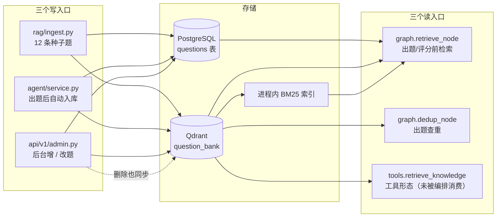
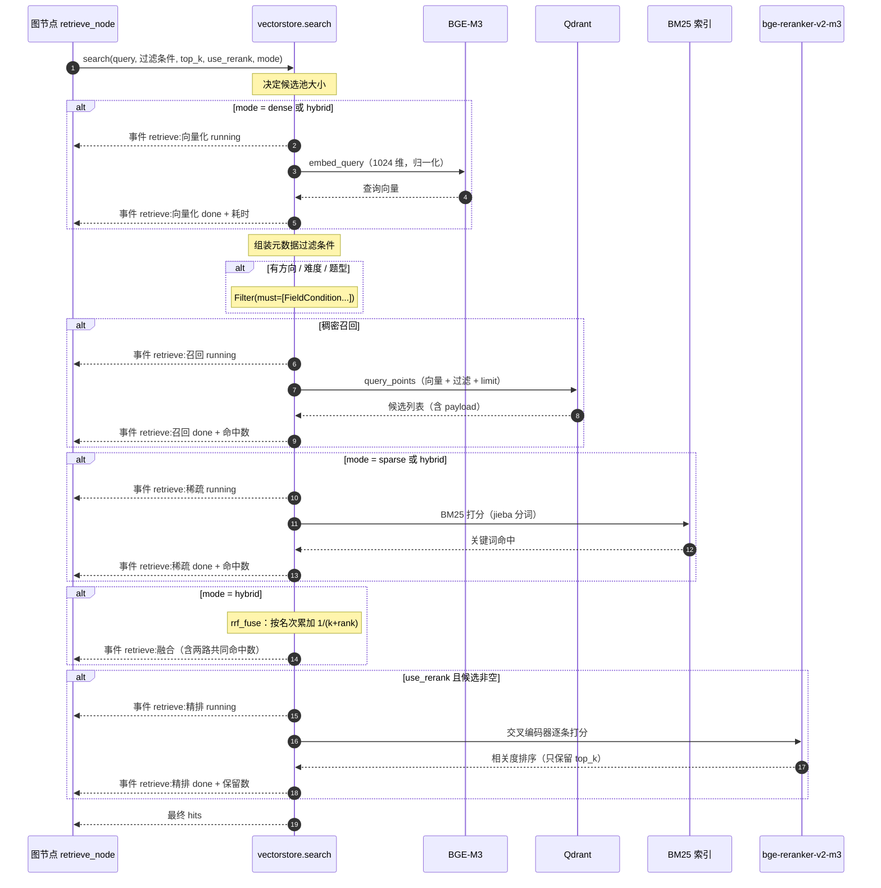
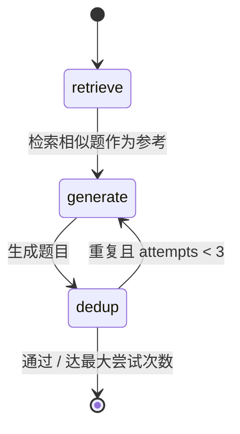
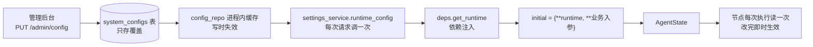

# 05 · Agentic RAG 设计

> 本篇是整套方案技术密度最高的一篇，覆盖三件事：**检索怎么工作**、**Agent 怎么编排**、**评分怎么保证可解释与可解析**。

---

## 1. 术语速览

> 按「偏科普」的阅读要求，先把本篇反复出现的术语用一句话解释清楚。

| 术语 | 一句话解释 |
|---|---|
| **RAG**（检索增强生成） | 让模型先「查资料」再回答，而不是凭记忆答。查到的资料会拼进 prompt 当参照 |
| **Agentic RAG** | 不是「查一次答一次」，而是由 Agent 自主决定**什么时候查、查什么、要不要重试** |
| **Embedding**（嵌入） | 把一段文本映射成一个高维向量，语义相近的文本向量也相近 |
| **稠密检索** | 用 Embedding 向量做相似度搜索，强在理解语义，弱在对精确词（如 `LRU`、`CAS`）不敏感 |
| **稀疏检索** | 基于词频的传统检索（BM25 是代表），强在字面精确匹配，弱在语义泛化 |
| **Rerank**（精排） | 召回一批候选后，用一个更精确但也更慢的模型重新排序。通常「召回 2 倍、精排保留 1 倍」 |
| **RRF**（倒数排名融合） | 把两路检索结果按**名次**融合，不按分数 —— 因为两路的分数量纲不同，不可比 |
| **StateGraph** | LangGraph 的核心抽象：节点 + 边组成的状态图，节点读写共享 state |
| **rubric**（评分量表） | 明确的评分维度与分值定义，让主观评分变得可复现 |
| **结构化输出** | 让模型按固定 JSON 结构返回，而不是自由文本。这样才能被程序可靠解析 |

---

## 2. 三个知识库的落地状态

PRD 第 7 章规划了三个知识库。**实际只有第一个落地** —— 这一点在申报材料里如实说明，不夸大。

| 知识库 | 用途 | 状态 | 说明 |
|---|---|---|---|
| **① 题库库** | 出题参考、评分参照、查重 | **已落地** | Qdrant collection `question_bank`（1024 维 COSINE）+ PG `questions` 表 + 进程内 BM25 索引 |
| **② 面经企业库** | 模拟面试时检索「这家公司爱问什么」 | **未落地** | 零代码。无第二个 collection、无种子数据 |
| **③ 用户简历库** | 按 `user_id` 隔离的简历语义检索 | **未落地为向量库** | 简历解析结果以**字符串形式塞进 prompt**，没有进 Qdrant、没有 `user_id` 过滤检索 |

### 2.1 题库库的数据流



**关键点**：写入必须**同时写 PG 与 Qdrant**。管理后台删题时如果不删 Qdrant 里的 point，检索会命中一道已删除的题 —— 这是本项目早期踩过的坑。`delete_question` 与 `upsert_question` 都由 `api/v1/admin.py` 显式调用。

**截至当前的题库规模**：种子数据 **12 道题**（后端 6 / 前端 3 / 算法 3），加上用户出题过程中自动入库的题目。规模很小，这是「进程内 BM25」这个选型成立的前提。

---

## 3. 检索链路

### 3.1 向量库 Schema

| 项 | 值 |
|---|---|
| Collection 名 | `question_bank` |
| 向量维度 | 1024（BGE-M3 dense 维度） |
| 距离度量 | COSINE |
| 向量配置 | 单个未命名稠密向量（无命名向量、无 Qdrant 原生稀疏向量） |
| **Point ID** | **= PostgreSQL 的 `question_id`（整数）** |
| Chunk 策略 | **一题一个 point，无切分** |

Point 的 payload 字段（7 个）：

```python
payload={
    "question_id": question_id,
    "direction": direction,
    "difficulty": difficulty,
    "question_type": question_type,
    "text": content,
    "answer": answer,
    "key_points": key_points,
}
```

**`PointStruct.id = question_id` 这个设计带来一个便利**：编辑题目时（管理后台改题）**不需要先删后插**，同 id 直接 upsert 覆盖即可。删除也只需按 id 删一个 point。

### 3.2 检索流程图



### 3.3 三种检索模式

`search(mode=...)` 支持三种模式，**这是本项目已经落地的成果**（不是规划）：

| 模式 | 行为 | 适用场景 |
|---|---|---|
| `dense`（默认） | 只用 BGE-M3 稠密向量 | 语义相近的泛化查询 |
| `sparse` | 只用 BM25 关键词 | 精确术语、算法题名（如「LRU」「B+ 树」） |
| `hybrid` | 两路各取 `top_k`，RRF 融合后再截断 | 通用场景，兼顾语义与字面 |

**模式可通过管理后台切换**（`retrieval_mode` 配置项，`dense` / `sparse` / `hybrid` 三选一），改完即时生效。这让「同一问题、不同召回策略」的对比演示成为可能。

### 3.4 候选池策略（一个容易忽略的细节）

```python
dense_limit = top_k if mode == "hybrid" else (top_k * 2 if use_rerank else top_k)
```

| 场景 | 稠密候选池大小 | 理由 |
|---|---|---|
| 单路 + 不精排 | `top_k` | 直接用，不需要多余候选 |
| 单路 + 精排 | `top_k * 2` | **精排需要一个更大的候选池才有意义** —— 只给 top_k 条让它重排，等于没提升 |
| 混合模式 | `top_k` | 两路各取 top_k，融合本身就是一次筛选 |

### 3.5 RRF 融合

```python
def rrf_fuse(dense, sparse, top_k, k=60):
    scores[key] += 1.0 / (k + rank + 1)   # 按名次累加，不按分数
```

**为什么按名次而不按分数**：稠密路出的是余弦相似度（0–1），稀疏路出的是 BM25 分数（无上界）。直接加权求和需要先做归一化，而归一化方式本身就是个不稳定的超参。RRF 只用「排第几」，天然免调参。

**`k=60` 的作用**：压低头部名次的权重差距。k 越小，第 1 名与第 2 名的得分差越大；k=60 让头部名次之间过渡平滑，避免单一检索路的第 1 名独裁。

**两路都命中的文档会累加两次得分** —— 所以「语义像 + 字面也像」的结果会被推到最前，这正是混合检索的期望行为。

### 3.6 三路口径不一致（一个需要记录的实现事实）

| 路径 | 用的文本 |
|---|---|
| 稠密嵌入 | **只嵌 `content`**（题干） |
| BM25 语料 | **`text + key_points`**（题干 + 考察点） |
| Rerank | **只用 `text`** 字段 |

三路用的文本口径不同。这不是 bug，但会让「为什么某道题被召回 / 没被召回」变得难以解释。理想做法是统一口径（例如都包含 `key_points`），这已记录为可优化项。

### 3.7 检索事件的 id 命名

检索内部会推 5 类步骤事件，前端按 id 原地替换：

| step id | 推的时机 |
|---|---|
| `retrieve:向量化` | BGE-M3 嵌入前后 |
| `retrieve:召回` | Qdrant 向量检索前后 |
| `retrieve:稀疏` | BM25 打分前后 |
| `retrieve:融合` | RRF 融合完成 |
| `retrieve:精排` | 重排前后 |

> `app/rag/bm25.py` 里另有一个 `retrieve:稀疏召回` 的事件 id（用于 `bm25.search(on_event=...)`），但主链路（`vectorstore.search`）调 BM25 时**不传 `on_event`**，因此实际发出的是 `retrieve:稀疏`。

---

## 4. LangGraph 编排

### 4.1 九张图总览

| # | 图变量 | 节点（名 → 函数） | 边 |
|---|---|---|---|
| 1 | `generate_question_graph` | `retrieve` / `generate` / `dedup` | `START→retrieve→generate→dedup` + **条件边 `dedup → generate 或 END`** |
| 2 | `grade_graph` | `retrieve` / `grade` | `START→retrieve→grade→END` |
| 3 | `followup_graph` | `followup` | `START→followup→END` |
| 4 | `parse_resume_graph` | `parse` | `START→parse→END` |
| 5 | `parse_jd_graph` | `parse` | `START→parse→END` |
| 6 | `diagnose_graph` | `diagnose` | `START→diagnose→END` |
| 7 | `interview_question_graph` | `question` | `START→question→END` |
| 8 | `interview_report_graph` | `report` | `START→report→END` |
| 9 | `training_report_graph` | `report` | `START→report→END` |

> **注意**：第 4 与第 5、第 8 与第 9 的节点**同名**（都是 `parse` / `report`），但属于不同的 `StateGraph` 实例，互不影响。
>
> **第 1 张是唯一的「多跳图」**（含条件回边），其余 8 张都是「单链图」（START → 一到两个节点 → END）。这说明本项目的 Agent 复杂度集中在出题环节（检索 + 生成 + 校验循环），其余环节以「检索 → 生成」或纯生成为主。
>
> **所有 9 张图编译时都不带 checkpointer**，即**没有图级别持久化状态**。会话状态存在 PostgreSQL 里（面试消息表），不需要 LangGraph 的 checkpoint 能力。

### 4.2 出题图（唯一的循环图）



```python
def _route_after_dedup(state: AgentState) -> str:
    max_attempts = state.get("max_attempts", settings.question_max_attempts)
    if state.get("duplicate") and state.get("attempts", 0) < max_attempts:
        return "generate"
    return END
```

| 环节 | 做什么 | 关键参数 |
|---|---|---|
| `retrieve` | 用「薄弱点 / 方向」作查询检索相似题，作为**避免重复的参照** | `top_k=5`，不精排 |
| `generate` | 结构化生成 `QuestionOutput`（题干 / 样例 / 考察点 / 参考答案） | 温度取运行时配置（默认 0.0） |
| `dedup` | 用新题题干再检索一次，看最高相似度 | 阈值 `0.90`，最多 `3` 次 |

**查重节点的 done 事件 payload 信息量最大**，直接体现了可观测的价值：

```python
{"阶段": "查重", "最高相似度": round(top, 4), "阈值": threshold,
 "判定": "与题库重复，重新生成" if duplicate else "通过"}
```

用户能直接看到「这次生成的题与库里某题相似度 0.93，超过阈值 0.90，所以重新生成了」。

**一处文本口径差异（如实记录）**：出题结果落库时会把 `samples`（输入输出样例）拼到 `content` 后面，但 `dedup_node` 查重时用的是**未拼 `samples` 的 `content`**。两处文本口径不一致，理论上存在「落库后的文本与查重时的文本不同」的边界情况。

### 4.3 评分图

```
START → retrieve → grade → END
```

| 环节 | 行为 |
|---|---|
| `retrieve` | 查询用题干，**默认开启精排**（`default_rerank = bool(state.get("question"))` —— 只有评分流程才精排），取 `top_k=5` |
| `grade` | 结构化生成 `GradeOutput`（四维分数 + 理由 + 总分 + 优点 + 建议 + 参考答案） |

精排只在评分流程开启的设计意图是：评分需要**高质量参照**（要拿参考答案去比对），所以值得多花一次重排的开销；出题流程只需要「知道有没有重复」，不需要精排。

### 4.4 简历诊断图

```
START → diagnose → END
```

但**在进入图之前**，`/resume/diagnose` 端点会先串行调用两次图（`parse_resume_graph` 与 `parse_jd_graph`）把简历和 JD 结构化，再把两者一起喂给 `diagnose_graph`。所以整个诊断流程是**三次 LLM 调用**：

```
解析简历 → 解析 JD → 对比诊断
```

拆开的好处是前两步的产物可复用（简历结构化结果直接用于面试模块）。代价是延迟叠加。

### 4.5 两张报告图

| 图 | 输入 | 输出的雷达维度 |
|---|---|---|
| `interview_report_graph` | 整场面试对话（拼成文本） | **技术深度 / 项目经验 / 表达沟通 / 问题解决** |
| `training_report_graph` | 题目 + 作答 + 评分 + 追问 | **正确性 / 完整性 / 表达 / 术语** |

**两张报告的雷达维度刻意不同**：面试考察的是综合表现（项目经验、沟通表达），刷题考察的是答题质量（正确性、术语准确）。复用同一套维度会让两者都失真。

---

## 5. 四维评分设计

### 5.1 评分量表（`prompts.GRADE_RUBRIC` 原文）

```
四维评分量表（各维 0-5 分）：
- 正确性（权重 0.40）：结论是否正确、有无硬伤
- 完整性/深度（权重 0.30）：是否覆盖要点、能否深入机制
- 表达与结构（权重 0.15）：逻辑是否清晰、是否结构化表达
- 术语准确性（权重 0.15）：专业术语使用是否准确
加权总分 = 0.40*正确性 + 0.30*完整性 + 0.15*表达 + 0.15*术语
```

### 5.2 输出结构（`GradeOutput`）

```python
class DimensionScore(BaseModel):
    score: int = Field(description="0-5 分")
    reason: str = Field(description="评分理由")

class GradeOutput(BaseModel):
    correctness: DimensionScore      # 正确性
    completeness: DimensionScore     # 完整性 / 深度
    clarity: DimensionScore          # 表达与结构
    terminology: DimensionScore      # 术语准确性
    total_score: float               # 加权总分，0-5
    strengths: str                   # 优点
    suggestions: str                 # 改进建议
    reference_answer: str            # 参考答案
```

**`reason` 字段是「可解释性」的实现载体** —— 每个维度都必须给出扣分或得分的理由，这是「禁止返回裸分数」这条约束的技术落地。

**字段名与中文维度的映射**：`clarity` = 表达与结构，`completeness` = 完整性 / 深度。这个映射需要记住，因为 schema 用英文、量表用中文。

### 5.3 一个必须说明的设计边界

**四维权重只存在于 prompt 文本中，服务端不做加权校验。**

| 项 | 现状 |
|---|---|
| 权重定义位置 | `prompts.GRADE_RUBRIC`（一段中文文本） |
| `total_score` 来源 | **模型自报** |
| 服务端校验 | 无。落库时只做 `float(score.get("total_score") or 0.0)` |

**影响**：如果模型算错了加权总分（例如把 0.40 记成 0.30），服务端不会发现，错的总分会一路传到错题判定与 SM-2 排期。

**修正方式**（已记录为优化项）：在 `grade_node` 里按四维重算总分并与模型自报值比对，差异超过阈值时以服务端计算值为准（或触发重试）。

### 5.4 评分与间隔重复的天然对齐

四维量表是 0–5 分，而 SM-2 间隔重复算法的输入 `quality` 也恰好是 0–5。因此**两者可以直接对接，不需要任何映射表**：

```python
quality = int(round(total_score))
```

这也是为什么选 0–5 而不是 0–100 作为维度分值的实际收益 —— 决策在评分量表设计时就做了，收益在错题本实现时才兑现。

---

## 6. 结构化输出的可靠性设计

> 这是本项目最有技术含量的一处设计，也是踩坑最深的一处。

### 6.1 问题：DeepSeek 的 function calling 不保证 JSON 合法

**现象**：用 function calling（工具调用）模式做结构化输出时，约**三成概率**拿到 `None`，上层报 `'NoneType' object has no attribute 'model_dump'`。报告类长文本尤其容易触发。

**根因**：工具调用模式下，模型把参数写在 `arguments` 字符串里，而这个字符串**不保证是合法 JSON**。模型只要在字符串值里写了未转义的引号，整段 JSON 就废掉。例如：

```
"采用"总分总"结构作答"     ← 内层引号没转义，整段 JSON 解析失败
```

langchain 拿到解析失败的结果后返回 `None`，于是 `model_dump()` 崩掉。这个失败不是偶发抖动，是**长文本生成的固有风险** —— 文本越长，出现未转义引号的概率越高。

### 6.2 解法：`response_format=json_object`

```python
class JsonSchemaLLM:
    def __init__(self, llm: ChatOpenAI, schema) -> None:
        self._llm = llm.bind(response_format={"type": "json_object"})
        self._schema = schema
        self._instructions = PydanticOutputParser(
            pydantic_object=schema
        ).get_format_instructions()

    def invoke(self, messages):
        result = self._llm.invoke([*messages, HumanMessage(content=self._instructions)])
        return self._schema.model_validate_json(result.content)
```

**为什么 `json_object` 能解决**：它不是让模型「尽量输出 JSON」，而是由**服务端约束解码** —— 在生成过程中就限制 token 选择，保证输出必然是合法 JSON。这是解码层面的保证，不是提示词层面的请求。

### 6.3 代价与补偿

| 代价 | 补偿方式 |
|---|---|
| `json_object` 要求 prompt 里出现 "json" 字样 | 把 `PydanticOutputParser` 生成的**格式说明作为最后一条 `HumanMessage` 追加**进去（说明文本里天然含 "json" 字样） |
| 多一条消息的 token 开销 | 相比三成的失败率，这个开销可以忽略 |
| 不吃 `bind` 链 | `bind` 是累积语义，所以它能与会话头 `bind(extra_headers=...)` 叠加，互不干扰 |

### 6.4 双层防护

| 层级 | 防护机制 |
|---|---|
| **解码层** | `response_format=json_object` 保证拿到的是合法 JSON |
| **校验层** | `schema.model_validate_json()` 用 Pydantic 校验字段齐备与类型正确 |
| **重试层** | 节点层 `_invoke_structured` 捕获 `ValidationError` 后**重试 1 次**（共 2 次调用），仍失败则抛 `RuntimeError("模型返回的结构化结果不合法（字段缺失或类型不符），请重试")` |

三层各管一件事：解码层管「是不是 JSON」，校验层管「字段对不对」，重试层管「偶发失败要不要再来一次」。

| 组件 | 用途 | 是否走 `JsonSchemaLLM` |
|---|---|---|
| 出题 / 评分 / 追问 / 简历解析 / JD 解析 / 诊断 / 面试提问 / 两张报告 | 需要固定结构 | **是** |
| 面试 HR 对话 | 自由文本（要流式逐字输出） | **否** —— 走裸 `llm.astream` |

面试对话不走结构化输出，因为它要的是**逐字流式的自然语言**，而且对话内容本身就是自由文本。

---

## 7. 运行时配置注入

### 7.1 注入链路



### 7.2 注入的 12 个参数

| 参数 | 来源配置项 | 默认值 |
|---|---|---|
| `llm_model` | `llm_model` | `deepseek-v4-flash` |
| `llm_base_url` | `llm_base_url` | `https://opencode.ai/zen/go/v1` |
| `llm_api_key` | `llm_api_key` | `.env` 的 `DEEPSEEK_API_KEY` |
| `llm_session_id` | **每请求新生成**（`uuid4().hex`） | — |
| `llm_gateway` | 4 个网关配置项组装成 dict | `{"enabled": False, ...}` |
| `temperature` | `llm_temperature` | `0.0` |
| `top_k` | `retrieval_top_k` | `5` |
| `retrieval_mode` | `retrieval_mode` | `dense` |
| `use_rerank` | `retrieval_use_rerank` | `True` |
| `dup_threshold` | `question_dup_threshold` | `0.9` |
| `max_attempts` | **不走配置表**，直接取 `.env` 的 `question_max_attempts` | `3` |

### 7.3 合并顺序：业务入参优先

```python
initial = {**runtime, **initial}   # runtime 作底，业务入参覆盖
```

这个顺序是刻意的：运行时配置是**默认值**，业务入参是**本次请求的显式指定**。例如前端指定了 `top_k=8`，就应该用 8 而不是后台配的 5。

### 7.4 `llm_session_id` 的双重作用

每次请求生成一个新的 uuid4 并透传给 LLM 服务，作用有二：

1. **网关路由亲和** —— 某些网关按会话 id 做路由，保证同一会话的请求落到同一部署
2. **prompt 缓存亲和** —— 同一会话内 `system prompt` + 评分量表这部分前缀固定，可命中服务端的前缀缓存，降低首 token 延迟

**注意**：会话头（`extra_headers`）**不进 LLM 客户端的缓存键**。因为它每次请求都变，进了缓存键会让客户端缓存彻底失效（每次都构造新客户端，丢失连接池复用）。解法是用 `bind(extra_headers=...)` 按调用附加。

### 7.5 三层缓存与失效

| 缓存 | 位置 | 键 | 失效方式 |
|---|---|---|---|
| 配置缓存 | `repositories/config.py` 模块级 dict | 配置 key | `set()` / `delete()` 时显式 `invalidate(key)` |
| LLM 客户端缓存 | `agent/llm.py` `@lru_cache(64)` | `(model, base_url, api_key, temperature)` | 键变化即自然失效；无 TTL |
| 网关 Router 缓存 | `agent/llm.py` `@lru_cache(8)` | 配置文本本身 | 同上 |

**三者都是「写时显式失效、不做 TTL 轮询」**。这是正确的选择：TTL 会导致「改了配置但一段时间内仍生效」，而显式失效是即时的。

**但三者都是进程内缓存** —— 多 worker 部署下各 worker 缓存不共享，「改完即时生效」只在单进程下成立。这是已知边界。

**`llm_api_key` 必须在缓存键里**：否则「只换了密钥」不会构造新客户端，仍用旧密钥请求。这个细节的注释写得很清楚。

---

## 8. 记忆设计

### 8.1 当前的实现方式

**本项目的「记忆」实现得很朴素，如实说明**：

| 类型 | PRD 规划 | 实际实现 |
|---|---|---|
| 短期记忆（会话内） | Redis + 会话状态 | **PostgreSQL 表**：`interview_messages` 全量按序取出，每轮重新拼进 messages 送模型 |
| 长期记忆（跨会话画像） | PostgreSQL + 向量 | `SkillProfile` 表存在，但**不被 Agent 读取**，只在报告页 upsert / 查询 |
| 知识记忆 | 向量库 | 题库库已落地（见 §2） |

**没有的东西**：

- ❌ 无 LangGraph checkpointer（9 张图全部 `g.compile()` 不带参数）
- ❌ 无 Redis 接入（依赖已声明、容器已编排，代码零引用）
- ❌ 无跨会话的长期记忆注入

### 8.2 面试对话的记忆拼装

```python
def build_messages(...):
    return [
        SystemMessage(INTERVIEW_CHAT_SYSTEM),
        HumanMessage(build_interview_chat_prompt(...)),   # 本场配置 + 结构化简历
    ] + 历史消息（role == "hr" → AIMessage，其余 → HumanMessage）
```

每轮都把**全量历史**重新拼进去。这在面试场景下是必要的（HR 要记得候选人之前说过什么），代价是 token 消耗随轮数线性增长。若将来对话轮数变多，需要引入滑动窗口或摘要压缩。

### 8.3 演进方向

| 方向 | 价值 |
|---|---|
| 引入 checkpointer | 图状态可恢复，支持中断续跑 |
| 接入 Redis | 会话状态不必每轮重查数据库；为「强制下线」提供存储 |
| 画像注入 prompt | 出题时带上「该用户薄弱在哪」，让出题真正个性化 —— 这是 PRD 的设计意图，目前未实现 |

---

## 9. 工具集现状

### 9.1 现状与事实澄清

`app/agent/tools.py` **不是空壳文件**，里面有一个真实工具：

```python
@tool
def retrieve_knowledge(query: str, direction: str = "", difficulty: str = "",
                       question_type: str = "") -> str:
    """检索题库知识库，返回相似题目的题干、参考答案与考点。"""
    hits = vectorstore.search(query, direction or None, difficulty or None,
                              question_type or None, top_k=5, use_rerank=True)
    ...

ALL_TOOLS = [retrieve_knowledge]
```

**但 `ALL_TOOLS` 在全仓库没有任何引用点。** 检索是在 `retrieve_node` 里**直接调用 `vectorstore.search`** 实现的，不经过工具注册表。所以：

| 项 | 事实 |
|---|---|
| 有工具吗 | 有 1 个（`retrieve_knowledge`） |
| 被 Agent 消费吗 | **没有**。`ALL_TOOLS` 零引用 |
| 有 ReAct 工具循环吗 | **没有**。没有任何图有 tool 节点 |
| PRD 规划几个工具 | 8 个（`generate_question` / `grade_answer` / `generate_followup` / `retrieve_knowledge` / `parse_resume` / `parse_jd` / `save_memory` / `read_memory`） |

### 9.2 为什么这样也能工作

因为本项目的流程是**确定性的多步流水线**，不是「让模型自主决定调哪个工具」。每个节点的职责在图上就定好了（`retrieve` 节点就是检索，`grade` 节点就是评分），不需要模型在运行时选择。

**这是一个合理的一期取舍**：确定性编排比 ReAct 循环更可控、更省 token、更容易调试。代价是失去了「Agent 自主决策」的灵活性。

### 9.3 演进：第一个真正的 ReAct 循环落点

规划中的「管理端智能助手」（管理员用自然语言做批量操作）是引入工具循环的最佳场景。届时要注意一个已知坑：**不要用 `bind_tools`**，而要手写 JSON ReAct —— 因为 DeepSeek 工具调用的 arguments 不保证合法 JSON（见 §6.1），而管理工具恰好要传长文本。做法是让模型每轮输出 `json_object` 格式的 `{thinking, tool, arguments, reply}`，服务端执行工具后把结果塞回对话再问一轮，`tool: null` 即结束。

---

## 10. Prompt 资产清单

Prompt 在本项目里不只是「提示词」，而是**需要被离线脚本复用的关键资产**（微调数据集导出必须逐字复用它们）。

| 模板 | 作用 | 关键结构 |
|---|---|---|
| `SYSTEM_PROMPT` | 全局系统提示，所有结构化调用都带 | 声明「必须遵循四维量表，禁止返回裸分数」 |
| `GRADE_RUBRIC` | 四维量表文本，被 `GRADE_TEMPLATE` 占位注入 | 见 §5.1 |
| `GENERATE_QUESTION_TEMPLATE` | 出题 | 4 个条件 + 已有相似题 + 5 条要求（题干清晰、**必须实质区别**、算法题须含输入输出样例与约束、给考察点、给规范参考答案） |
| `GRADE_TEMPLATE` | 评分 | 题目 / 参考答案 / 用户作答 / rubric 四段 |
| `FOLLOWUP_TEMPLATE` | 追问 | 针对薄弱点 / 遗漏点 / 表述模糊处 |
| `PARSE_RESUME_TEMPLATE` | 简历结构化 | 姓名 / 教育 / 技能 / 项目经历 / 工作实习 / 总结 |
| `PARSE_JD_TEMPLATE` | JD 结构化 | 岗位名称 / 职责 / 必备技能 / 加分技能 |
| `DIAGNOSE_TEMPLATE` | 简历 vs JD 诊断 | 匹配度 0–100 / 亮点 / 短板 / 缺失技能 / 分点建议 |
| `INTERVIEW_QUESTION_TEMPLATE` | 基于简历深挖提问 | 考察「是否真实参与项目」+ 参考答案与考察点 |
| `INTERVIEW_REPORT_TEMPLATE` | 面试报告 | 总分 0–100 / 总体评价 / 逐轮评价 / 改进建议 / 雷达四维 |
| `INTERVIEW_CHAT_SYSTEM` | HR 对话系统提示 | 8 条行为约束：一次只问一个、紧贴简历项目、先一句反馈再过渡、答得浅就追问、答得好就换角度、专业不像客服、**不主动打分**、候选人想结束则礼貌收尾 |
| `build_interview_chat_prompt()` | 拼「本场配置 + 结构化简历」 | 指示「先一句话自我介绍，再抛第一问」 |
| `TRAINING_REPORT_TEMPLATE` | 训练报告 | 总体评价 / 薄弱点 / 改进建议 / 雷达四维 |

### 10.1 两个温度来源

| 路径 | 温度 | 理由 |
|---|---|---|
| 结构化输出（出题 / 评分 / 报告等） | 运行时配置 `llm_temperature`，**默认 0.0** | 评分要稳定可复现，不能有随机性 |
| 面试 HR 对话 | **硬编码 0.7** | 对话要自然多样，不能每次都一个腔调 |

同一系统里两个温度是刻意的，不是不一致。

---

## 11. 一篇小结：这个 Agent 系统的技术含量在哪

| 技术点 | 为什么有含量 |
|---|---|
| 三模式检索 + RRF 融合 | 不是「调个向量库」，而是理解稠密/稀疏互补性与量纲不可比问题后做的工程选择 |
| 条件回边实现查重循环 | 把控制流表达为图拓扑，而非嵌套 if/while |
| `response_format` 替代 function calling | 从「约三成失败率」这个实测现象出发定位到解码层根因，而不是加提示词祈祷 |
| 四维量表与 SM-2 的量纲对齐 | 评分量表设计的决策在错题本实现时兑现收益 |
| 运行时配置贯穿到节点 | 让「部署」与「检索策略对比」成为可演示的实验，而不是改代码重部署 |
| 事件协议贯穿图内与非图执行 | 面试对话（非 StateGraph）与其余流程共用同一份协议，前端无需区分 |

---

**上一篇**：[04-数据模型设计.md](./04-数据模型设计.md) ｜ **下一篇**：[06-可观测设计.md](./06-可观测设计.md)
