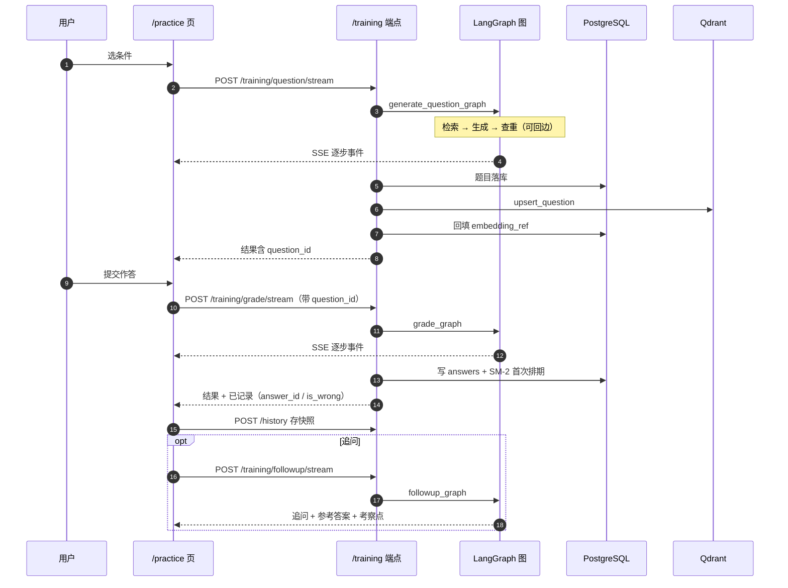
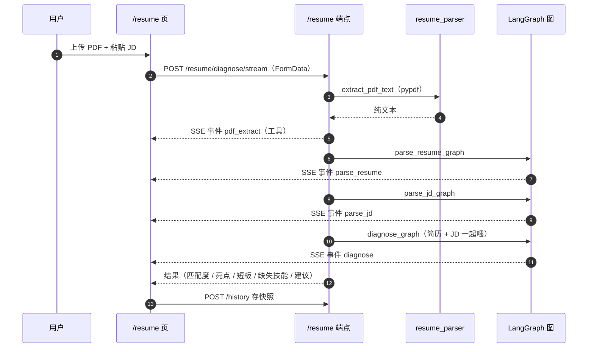
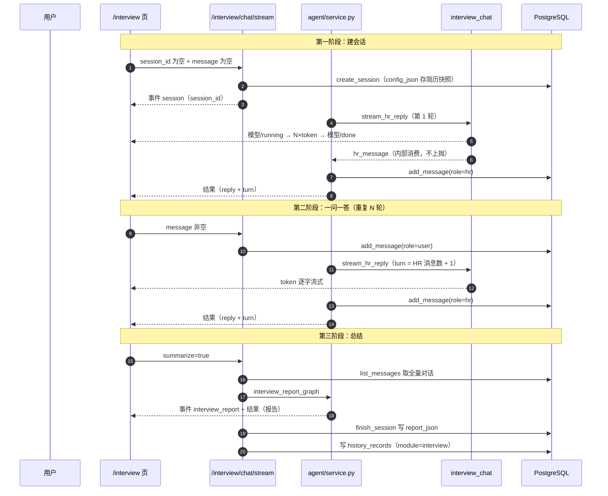
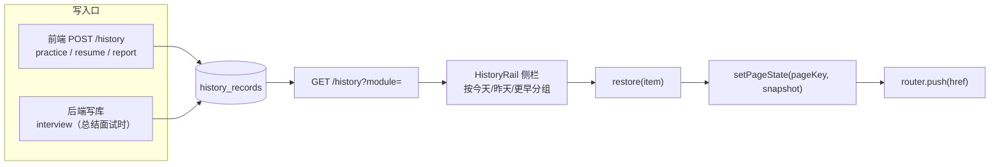
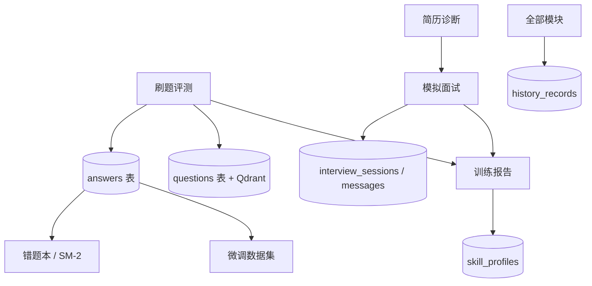

# 07 · 核心业务模块设计

> 逐模块给出「用途 → 流程 → 关键设计决策 → 端点」。每节末尾标注**容易误解或有坑的地方**。

---

## 1. 刷题评测模块

### 1.1 用途

按方向 / 难度 / 题型生成题目 → 用户作答 → 四维评分 → 针对薄弱点追问 → 自动沉淀为错题并排复习计划。

### 1.2 流程



### 1.3 关键设计决策

| 决策 | 内容 | 理由 |
|---|---|---|
| **出题与评分分两次请求** | 不是一个端点做完 | 用户可以反复修改作答再评分；评分必须显式带 `question_id` 才能落库 |
| **评分落库要求 `question_id`** | 缺失时**不落库** | 宁可不记录，也不能把评分挂到错的题上 |
| **出题自动入库** | 新生成的题自动写 PG + Qdrant 并回填 `embedding_ref` | 题库会随用户使用自然增长，形成知识沉淀 |
| **只有 `/stream` 落库** | 非流式 `/training/grade` 不落库 | **两条路径行为不一致，是已知边界**（见 §1.4） |

### 1.4 需要注意的地方

**（1）非流式与流式评分的语义差异**

| 端点 | 落库 | `question_id` 要求 |
|---|---|---|
| `POST /training/grade` | **否** | 无 |
| `POST /training/grade/stream` | **是** | 必须 |

非流式版本定位是「给 curl / 测试用」，因此没接数据库依赖。但同名的两个端点行为不同，容易踩坑。

**（2）出题落库与查重的文本口径差异**

落库时会把 `samples`（输入输出样例）拼到 `content` 后面：

```python
content = output.get("content", "")
samples = output.get("samples", "")
if samples:
    content = f"{content}\n\n{samples}"
```

但 `dedup_node` 查重时用的是**未拼 `samples` 的 `content`**。两处口径不一致。

**（3）`answers.followup_chain` 从不被赋值**，恒为 `"[]"`。追问的结果只推给前端展示，没有回写数据库，因此无法回看「这题追问了几轮、问了什么」。

---

## 2. 简历优化模块

### 2.1 用途

上传简历 PDF + 粘贴目标岗位 JD → 得到匹配度、亮点、短板、缺失技能清单、分点优化建议。

### 2.2 流程



### 2.3 关键设计决策

| 决策 | 内容 | 理由 |
|---|---|---|
| **PDF 解析用 `pypdf`** | 逐页 `extract_text()` | 纯 Python、无系统依赖；PyMuPDF 更快但要装二进制 |
| **不做 OCR** | 扫描件返回 400「无法从 PDF 提取文本，可能是扫描件」 | 一期不引入 OCR 依赖；明确报错好过静默返回空文本 |
| **解析拆成三次调用** | 解析简历 → 解析 JD → 对比诊断 | 前两步的产物可复用（简历结构化结果直接用于面试模块） |
| **简历不落库** | 只在内存中抽取文本 | 避免了敏感数据持久化；代价是无法回看历史简历 |

### 2.4 需要注意的地方

**（1）延迟叠加**：三次串行 LLM 调用，总延迟约为单次的 3 倍。SSE 事件让用户看到进度，但总时长确实更长。

**（2）`pdf_extract` 事件在 API 层推**，不在图内（step id 为 `pdf_extract`，事件类型为 `工具`）。这是唯一一个在 API 层而非节点内推的步骤事件。

**（3）简历解析结果通过 `original_file_ref` 字段指向 MinIO 对象 key，但该字段从未被赋值** —— 因为 PDF 根本没上传对象存储。`resumes` 表整体无读写路径。

**（4）简历如何传给面试模块**：前端在发起面试时把解析好的结构化简历重新提交，服务端存进 `interview_sessions.config_json` 的 `resume` 字段。所以一场面试的配置是**自包含**的（可完整复现），代价是同一份简历在每场面试里都存了一份。

---

## 3. 模拟面试模块

### 3.1 用途

基于简历深挖提问的真对话模拟：HR 说一句 → 候选人回一句 → HR 接着追问，想结束时点「总结面试」生成报告。

### 3.2 这是一个「非图」模块

**面试对话刻意不用 StateGraph**，`app/agent/interview_chat.py` 是一个**带会话状态的异步生成器**：

```python
async def stream_hr_reply(resume, direction, difficulty, style, history,
                          model, base_url, api_key, session_id, gateway, turn=1):
```

docstring 的理由：面试是一场有上下文的连续对话，每轮要把全量历史重拼进 messages，用图来表达反而绕。

**两套机制共存**：其余 9 个模块用图，面试对话用生成器，但**共用同一份事件协议**（5 字段），前端无需区分。

### 3.3 一问一答的完整流程



### 3.4 三合一入口的设计

`POST /interview/chat/stream` 一个端点承担三种语义，靠参数区分：

| 参数 | 语义 |
|---|---|
| `session_id` 为空 | **开新面试**：建会话，返回 HR 的开场白与第一个问题 |
| `message` 非空 | **发言人**：写入用户消息，生成 HR 的下一轮回复 |
| `summarize=true` | **总结面试**：生成报告、标记会话完成、写历史记录 |

这样做而不是拆三个端点，是因为三者共用同一套会话鉴权、配置读取、事件推送逻辑。代价是端点的参数组合语义需要在文档与前端注释里维护。

### 3.5 事件序列（对话类模块的特殊之处）

```
{id: "hr_reply:1", type: "模型", status: "running", payload: {...}, duration_ms: null}
{type: "token", id: "hr_reply:1", payload: {text: "你"}}
{type: "token", id: "hr_reply:1", payload: {text: "好"}}
... （N 个 token 事件）
{id: "hr_reply:1", type: "模型", status: "done", payload: {...}, duration_ms: 3120}
{type: "hr_message", payload: {content: "你好，先...", turn: 1}}   ← 服务端消费，不上抛前端
```

**这就是为什么需要 `CHAT_EVENTS` 分流**：一次 HR 回复会产生几十上百个 `token` 事件，如果它们混进执行面板，轨迹会被冲得看不见。前端用 `CHAT_EVENTS = {token, session, hr_message}` 把这些路由到 `onEvent` 回调拼成气泡，只把 `模型` / `检索` 这类步骤事件留在面板。

### 3.6 需要注意的地方

**（1）异常路径不发 `hr_message`**：`stream_hr_reply` 在异常时推一条 `错误` 事件然后 `return`，不会发 `hr_message`。因此服务端也就不会往库里写 HR 消息。

**（2）温度硬编码 0.7**：面试对话走 `astream_chat(temperature=0.7)`，**不读运行时配置的温度**（那个默认 0.0）。这个差异是刻意的 —— 评分要稳定，对话要自然。但意味着管理后台改温度时**对面试对话无效**。

**（3）`interview_messages.meta_json` 恒为 `"{}"`**：注释说这个字段存「提问的考察点、参考答案等」，但实际写入时没有填。所以逐轮参考答案无法回看。

**（4）面试报告与训练报告的雷达维度不同**：

| 报告 | 雷达四维 |
|---|---|
| 面试报告 | 技术深度 / 项目经验 / 表达沟通 / 问题解决 |
| 训练报告 | 正确性 / 完整性 / 表达 / 术语 |

**（5）`/interview/question/stream` 与 `/interview/report/stream` 两个独立端点，前端面试页并未调用。** 面试页只走 `/interview/chat/stream` 三合一入口。这两个端点在 `frontend/lib/api.ts` 里已定义但未被使用，属于保留给其他调用方的接口。

---

## 4. 训练报告与能力画像

### 4.1 训练报告

`training_report_graph` 输入题目、作答、评分、追问，输出：

| 字段 | 说明 |
|---|---|
| `summary` | 总体评价 |
| `weak_points` | 薄弱点列表 |
| `suggestions` | 改进建议列表 |
| `radar` | 能力雷达：正确性 / 完整性 / 表达 / 术语，各 0–100 |

### 4.2 能力画像（`SkillProfile`）

| 端点 | 行为 |
|---|---|
| `POST /report/profile` | upsert 一条画像：`(knowledge_point, mastery, dimension_scores_json)` |
| `GET /report/profile` | 列出该用户的全部画像，作为雷达图数据源 |

**upsert 的实现方式是应用层「先 select 再决定 insert / update」**：

```python
# repositories/profile.py
existing = 按 (user_id, knowledge_point) 查询
if existing: 更新
else: 新建
```

数据库层**没有 `(user_id, knowledge_point)` 唯一约束**兜底，并发写入时理论上可插入重复行。当前画像只在用户主动触发时写入，并发场景不存在，所以没有暴露问题。

### 4.3 一个明确的缺口：画像不被 Agent 读取

| 项 | 现状 |
|---|---|
| 画像写入 | 已完成（接口 + 表） |
| 画像查询展示 | 已完成（雷达图） |
| **画像注入 Agent** | **未实现**。出题时不会带上「该用户薄弱在哪」 |

PRD 的设计意图是「长期能力画像」驱动个性化出题，目前只做到了「记录与展示」，没做到「反馈进生成」。同时**刷题 / 面试后也不会自动更新画像** —— 需要前端显式调用 `POST /report/profile`。

这两点合起来意味着：**能力画像是「用户主动维护的展示面板」，而不是「系统自动学习的用户模型」**。这是本项目最重要的一个未闭环环节，已列为演进规划的高优先级项。

---

## 5. 错题本与间隔重复

### 5.1 用途

答错的题按 SM-2 算法排下次复习时间；到期后提醒复习；连续答对若干次才移出错题本。

### 5.2 SM-2 算法实现

```python
# app/repositories/answer.py
WRONG_SCORE_THRESHOLD = 3.0   # 总分低于此值判为错题
_MIN_EASE = 1.3
_DEFAULT_EASE = 2.5
MASTERED_REVIEWS = 2          # 连续答对多少次算「已掌握」

def sm2_next(quality, interval_days, ease, repetitions) -> tuple[int, float, int]:
    """SM-2 间隔重复调度，返回 (下次间隔天数, 新 ease, 新重复次数)。"""
    quality = max(0, min(5, quality))
    if quality < 3:
        return 1, ease, 0                       # 没记住：明天再来，重复次数清零

    if repetitions == 0:
        new_interval = 1
    elif repetitions == 1:
        new_interval = 6
    else:
        new_interval = max(1, round(interval_days * ease))

    new_ease = ease + (0.1 - (5 - quality) * (0.08 + (5 - quality) * 0.02))
    new_ease = max(_MIN_EASE, new_ease)
    return new_interval, new_ease, repetitions + 1
```

### 5.3 参数表

| 参数 | 值 | 说明 |
|---|---|---|
| `quality` | 0–5 整数 | **直接取四维加权总分四舍五入** |
| 判定阈值 | `< 3` 视为没记住 | 间隔重置为 1 天，重复次数归零 |
| 首次间隔 | 1 天 | `repetitions == 0` |
| 第二次间隔 | 6 天 | `repetitions == 1` |
| 之后间隔 | `round(上次间隔 × ease)` | 指数增长 |
| ease 初始值 | 2.5 | |
| ease 更新 | `ease + (0.1 - (5-q)*(0.08 + (5-q)*0.02))` | 答得越好增长越多 |
| ease 下限 | **1.3** | 防止间隔增长停滞 |
| 错题阈值 | 总分 `< 3.0` | 常量 `WRONG_SCORE_THRESHOLD` |
| 毕业要求 | **连续答对 2 次** | 常量 `MASTERED_REVIEWS` |

### 5.4 一个必须理解的语义：`review_count` 是「连续答对次数」

因为 SM-2 在 `quality < 3` 时会**把 repetition 清零**，所以 `review_count` 恰好等于连续答对次数。毕业判定 `review_count >= 2` 就依赖这个语义。

### 5.5 毕业规则：为什么不能改成「答对一次就移出」

代码注释原文：

> 注意不要「答对一次就移出错题本」—— 那会让刚排的复习计划永远不会触发（待复习队列是按 `is_wrong` 过滤的）。改为**连续答对 MASTERED_REVIEWS 次**才毕业，这样中间的复习节点都能正常到期。

**这个 bug 的逻辑推演**：

```
待复习队列的查询条件：is_wrong = True AND review_due_at <= now
       ↓
如果「答对一次」就置 is_wrong = False
       ↓
那么第一次复习答对后，这条记录立刻从待复习队列里消失
       ↓
SM-2 排出的后续复习节点（6 天、15 天、37 天……）永远不会被触发
       ↓
间隔重复退化成了「复习一次就结束」，算法等于没实现
```

**这是本项目犯过并修复的一个 bug**，记录在此是为了防止回归。

### 5.6 相关端点

| 端点 | 行为 |
|---|---|
| `GET /answers` | 列表，支持 `only_wrong` / `only_favorite` / `limit` 过滤 |
| `GET /answers/stats` | 四个统计数：总数 / 错题 / 收藏 / 待复习 |
| `GET /answers/due` | **到期待复习**（`is_wrong=True` 且 `review_due_at <= now`） |
| `PATCH /answers/{id}` | 改错题 / 收藏标记 |
| `POST /answers/{id}/review` | 复习一次，按 SM-2 重排；`quality` 不传则用上次的 `total_score` 四舍五入 |

**`PATCH` 的一个细节**：手动把一条记录标为错题时，如果它还没有复习排期，会补一个「明天复习」：

```python
if is_wrong and answer.review_due_at is None:
    answer.review_due_at = datetime.now() + timedelta(days=1)
    answer.review_interval_days = 1
```

### 5.7 需要注意的地方

**（1）`review_due_at` 用 naive 本地时间**（`datetime.now()`），而 JWT 用 aware UTC、`TimestampMixin` 用 DB 侧 `func.now()`。时区口径不统一，单机部署无影响。

**（2）前端错题本页无执行面板**：错题本的 5 个端点全部非流式（不涉及 LLM 调用），因此该页面没有 `AgentPanel`。这是正确的 —— 面板只在有 Agent 执行的页面出现。

---

## 6. 历史记录与页面状态保持

### 6.1 两个不同的问题

这两个功能经常被混为一谈，但它们解决的是完全不同的问题：

| 功能 | 解决的问题 | 生存范围 |
|---|---|---|
| **历史记录**（`history_records` 表） | 「我想回到上周做的那次简历诊断」 | **跨会话、跨设备**（存在服务端） |
| **页面状态保持**（`usePageState`） | 「我刚切到别的页面又切回来，内容怎么没了」 | **当前标签页**（存在 `sessionStorage`） |

### 6.2 历史记录的数据流



### 6.3 `snapshot_json` 的字段名契约（最容易踩的坑）

> 恢复时是**整块覆盖**前端页面状态对象，**key 对不上就恢复不出来**。因此快照的字段名必须与前端页面状态对象的字段名逐字一致。

面试快照用的是**驼峰命名**：

```python
snapshot = {
    "sessionId": session_id,
    "direction": ..., "difficulty": ..., "style": ...,
    "resumeJson": ..., "messages": ..., "report": ...,
}
```

**这个契约没有类型系统保护**，只能靠约定与注释维护。修改前端页面状态对象的字段名时，如果忘了同步改后端写快照的地方，症状是「历史记录点进去页面空白」而不是报错。

### 6.4 `restore()` 的时序契约

```ts
restore(item) {
  setPageState(MODULE_META[item.module].pageKey, item.snapshot);  // 先写状态
  router.push(MODULE_META[item.module].href);                     // 再跳转
}
```

**顺序不能反**。如果先跳转，页面会立即挂载并读取到「空」的初始状态；等状态写入时组件已经渲染完了（虽然 `usePageState` 有订阅机制能补上，但会有一次闪空）。

### 6.5 模块元信息映射

```ts
const MODULE_META = {
  practice:  { href: "/practice",  label: "刷题训练", ico: "▸", pageKey: "practice"  },
  resume:    { href: "/resume",    label: "简历诊断", ico: "≡", pageKey: "resume"    },
  interview: { href: "/interview", label: "模拟面试", ico: "◉", pageKey: "interview" },
  report:    { href: "/report",    label: "能力报告", ico: "◈", pageKey: "report"    },
};
```

`module` 枚举在服务端也有一份校验：`POST /history` 的 `module` 必须是这四个之一，否则 400 `未知模块：{payload.module}`。

### 6.6 页面状态保持的实现

```ts
const PREFIX = "offermind:page:";
const memory = new Map<string, unknown>();          // 模块级内存
const subscribers = new Map<string, Set<() => void>>();  // 跨组件同步

export function usePageState<T>(key: string, initial: T) { ... }
```

| 层 | 作用 |
|---|---|
| 模块级 `Map` | 同一次页面会话内存活（切路由时组件卸载但模块级变量保留） |
| `sessionStorage` 镜像 | 刷新页面后仍能恢复（仅当前标签页，关掉即清空） |
| `subscribers` | 多个组件用同一个 key 时保持同步；`restore()` 的外部写入能通知到已挂载的组件 |

**为什么用 `sessionStorage` 而不是 `localStorage`**：语义是「本次会话内保留」。用 `localStorage` 会让「上周填了一半的作答」在下次打开时突然出现，反而困扰。

### 6.7 需要注意的地方

**（1）`initial` 被刻意排除在 `useEffect` 依赖之外**（带 eslint-disable 注释）。因为 `initial` 通常是对象字面量，每次渲染都是新引用，放进依赖会导致无限循环。

**（2）`useAgentRun(storageKey)` 也接了同一套机制**，所以执行面板的轨迹与页面主体状态一起被保留。key 形式是 `${storageKey}:traces`。

---

## 7. 管理后台

### 7.1 用途

用户管理、题库管理（同步向量库）、模型与检索的运行时配置。侧栏入口只对 `is_admin` 用户显示，后端全部挂在 `get_current_admin` 之下，非管理员一律 403。

### 7.2 三大功能区

**（1）用户管理**

| 端点 | 行为 |
|---|---|
| `GET /admin/users?keyword=` | 列表 + 按邮箱 / 昵称模糊搜索 |
| `PATCH /admin/users/{id}` | 改昵称 / 管理员标记 / 重置密码 |
| `DELETE /admin/users/{id}` | 删除用户 |

**两条自我保护的硬规则**（后端拦截，返回 400）：

- 不能**取消自己**的管理员权限
- 不能**删除自己**

理由很直接：前者会让系统瞬间失去最后一个管理员（如果只有一个），后者会让你把自己锁在门外。

**（2）题库管理**

| 端点 | 行为 |
|---|---|
| `GET /admin/questions` | 分页 + 关键词 + 方向筛选 |
| `POST /admin/questions` | 建题：PG 落库 → 向量化 upsert Qdrant → 回填 `embedding_ref` |
| `PUT /admin/questions/{id}` | 改题：PG 更新 → **同 point id 覆盖** Qdrant |
| `DELETE /admin/questions/{id}` | 删题：PG 与 Qdrant **同步删** |

**删除必须同步向量库**，否则检索会命中一道已删除的题 —— 用户会看到一道在题库里已经不存在的题被当成参照。这是「向量库与主库双写」这个架构选择的必然要求（见 [02-总体架构设计.md](./02-总体架构设计.md) ADR-3）。

**改题不需要先删后插**：因为 Qdrant 的 point id 就是 `question_id`，同 id 直接 upsert 覆盖。

**（3）模型与检索配置**

| 端点 | 行为 |
|---|---|
| `GET /admin/config` | 配置快照，每项带 `default` / `value` / `overridden` / `kind` / `options` |
| `PUT /admin/config` | 批量更新；未知 key 返回 400 |
| `DELETE /admin/config/{key}` | **恢复某项为 `.env` 默认**（删掉库里的覆盖记录） |
| `GET /admin/llm/options` | 列出可选模型（含服务商预置） |
| `GET /admin/stats` | 概览：用户数 / 题目数 / 管理员数 / 近 7 天新增 / 各方向题量 |

### 7.3 12 项运行时配置

| key | label | 默认值 | kind | 说明 |
|---|---|---|---|---|
| `llm_base_url` | 模型端点 Base URL | `.env` 值 | text | 需带 `/v1` |
| `llm_api_key` | 模型 API Key | `.env` 值 | **secret** | 不回显，留空 = 沿用已存值 |
| `llm_model` | 主生成模型 | `.env` 值 | select | 预置 5 个选项 |
| `llm_temperature` | 生成温度 | `0.0` | number | 面试对话另有固定 0.7 |
| `retrieval_top_k` | 检索召回条数 | `5` | number | |
| `retrieval_mode` | 检索模式 | `dense` | select | dense / sparse / hybrid |
| `retrieval_use_rerank` | 启用精排 | `1` | bool | |
| `question_dup_threshold` | 出题查重阈值 | `0.9` | number | |
| `llm_gateway_enabled` | 启用 LLM 网关 | `0` | bool | |
| `llm_gateway_deployments` | 网关部署列表 | `[]` | textarea | JSON 数组 |
| `llm_gateway_primary` | 网关主部署 | `""` | text | 留空取列表第一个 |
| `llm_gateway_fallbacks` | 失败回退规则 | `{}` | textarea | 如 `{"cloud-deepseek":["local-qwen"]}` |

另有 3 条服务商预置（非配置项）：`opencode-go`、`opencode-zen`、`deepseek`。

### 7.4 关键设计决策

| 决策 | 内容 | 理由 |
|---|---|---|
| **新增配置项只改一处** | `settings_service.SPECS` 登记表 | 后台表单根据 `SPECS` 自动生成，不需要改前端 |
| **`.env` 是唯一事实来源** | 库里只存「覆盖」 | 删掉配置记录就回到默认值，不会出现两份真相 |
| **`secret` 类不回显** | `snapshot()` 中 `default` 与 `value` 都置空，只给 `has_value` | **后台页面是发给浏览器的**，密钥一旦进响应体就等于泄给任何能打开这个页面的管理员会话 |
| **空值 = 不修改** | `kind == "secret"` 且值为空时跳过 | 让管理员可以在不回显密钥的前提下改其他配置 |
| **配置读取带进程内缓存** | `set` / `delete` 时显式失效 | 即时生效；无 TTL |
| **拦截自我降权 / 自我删除** | 后端返回 400 | 防止把自己锁在系统外 |

### 7.5 需要注意的地方

**（1）`GET /admin/llm/options` 在 `admin.py` 中被定义了两次**（第 230 行与第 298 行）。FastAPI 按装饰顺序注册，**后注册的同方法同路径会覆盖前者**，所以生效的是第二个版本（多返回一个 `base_url` 字段），第一个版本是**死代码**。

这个重复定义导致「路由装饰器总数 48 个，实际有效端点 47 个」。建议删除第一处以免误导。

**（2）配置缓存是进程内全局 `dict`**。多 worker 部署（`uvicorn --workers N`）下各 worker 缓存不共享，「改完即时生效」只在单进程成立。同理 LLM 客户端缓存与网关 Router 缓存也是进程内的。

**（3）`/docs` 与 `/openapi.json` 未做任何保护**，默认全部端点暴露在 Swagger UI 中。开发期方便，生产环境应收起。

---

## 8. 模块间关系小结



**四条数据流值得注意**：

1. **`answers` 一表两用**：错题本的数据源也是微调数据集的数据源
2. **简历 → 面试 是前端中转的**：解析结果由前端重新提交，不是服务端自动传递
3. **`skill_profiles` 是终点不是起点**：画像被写入与展示，但不回流到出题
4. **`history_records` 由两个不同的写入方写**：前端写三个模块，后端写面试

---

**上一篇**：[06-可观测设计.md](./06-可观测设计.md) ｜ **下一篇**：[08-接口设计.md](./08-接口设计.md)
