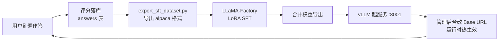

# 09 · 模型微调方案

> ## ⚠️ 实现状态声明（请先读这一段）
>
> 本篇描述的是**一个已完成的微调链路设计 + 一套待执行的实验计划**。当前状态：
>
> | 环节 | 状态 |
> |---|---|
> | 数据集导出脚本 | ✅ 已完成 |
> | 评测脚本 | ✅ 已完成 |
> | LoRA 训练配置 | ✅ 已完成 |
> | 评测集标注模板生成 | ✅ 已完成 |
> | **SFT 数据集导出** | ❌ **未执行**（`finetune/data/grader_sft.jsonl` 不存在） |
> | **人工标注评测集** | ❌ **未完成**（`gold.jsonl` 仅 2 条，设计目标 ≥100 条） |
> | **LoRA 训练** | ❌ **未执行**（无训练产物） |
> | **微调前后对比数据** | ❌ **不存在** |
>
> **特别声明**：`backend/finetune/eval/test_before.json` 与 `test_after.json` **是演示 `--compare` 输出格式的占位产物，不是实测结果**。其中 `test_after.json` 的指标与其自身的 `rows` **在数学上不自洽**（`rows` 里的预测值全为 0，却声称一致率 0.75、MAE 0.8），且它声称的模型 `qwen2.5-1.5b-grader` 从未被训练出来。**本方案不引用这两份文件中的任何数字。**
>
> 因此，本篇的对比表只给出**表格骨架与执行方法**，不填任何数字。

---

## 1. 为什么需要微调

### 1.1 课程主题的要求

课程名称是「大模型**部署与微调**」。项目原本的缺口很明确：**主生成模型 100% 走云端 API，没有任何微调**。本地只部署了 BGE-M3 与 bge-reranker-v2-m3 两个**判别**模型（做嵌入与重排），它们不做生成。

### 1.2 为什么不是「为了微调而微调」

微调在本项目里有一个**真实的产品动机**，而不是硬凑课程要求：

| 动机 | 说明 |
|---|---|
| **成本** | 评分是调用频次最高的 LLM 任务（每次作答都要评分）。用一个 1.5B 的本地小模型替代云端大模型，边际成本趋近于零 |
| **延迟** | 本地小模型没有网络往返，首 token 延迟有下降空间 |
| **隐私** | 评分需要把「题目 + 参考答案 + 用户作答」发给模型。本地推理意味着这些数据不出本机 |
| **可控性** | 微调后的模型更可能稳定遵循四维 rubric 的输出格式，减少结构化输出失败 |

### 1.3 数据飞轮：数据集不需要另找

**这是本项目在「微调」主题上最自然的落点**：系统自己在产出训练数据。



**「不用另找数据集」这句话的具体含义**：`answers` 表里每一行的 `(question, reference_answer, content, score_json)` 四元组，正好构成一条 SFT 样本 —— 输入是评分 prompt（题目 + 参考答案 + 用户作答 + 四维量表），输出是四维评分 JSON。

**用户每做一次评分，训练集就长一条。**

---

## 2. 为什么选评分器做微调对象

不是随便挑的任务。评分器有三个别处没有的条件：

| 条件 | 说明 |
|---|---|
| **有 ground truth** | 四维 rubric 是明确的量表，**人工能标**，指标可量化（一致率 + MAE）。而「参考答案好不好」「面试问题问得妙不妙」这类任务没有客观标准 |
| **数据自己长出来** | 系统每次评分都往 `answers` 表写一条，无需额外采集 |
| **输出可校验** | 结构化 JSON，格式对不对用 Pydantic 一验就知道，不是「感觉还行」 |

**结论（`finetune/README.md` 原文）**：这是整个项目里**唯一能拿出「微调前 vs 微调后」对比表**的地方。

---

## 3. 数据集构建

### 3.1 脚本位置

> **注意路径**：三个离线脚本都在 **`backend/scripts/`**，不在 `finetune/scripts/`（该目录不存在）。

| 脚本 | 作用 |
|---|---|
| `scripts/export_sft_dataset.py` | 导出 SFT 数据集 |
| `scripts/eval_grader.py` | 评分器评测与前后对比 |
| `scripts/bench_llm.py` | LLM 压测（见 [10-模型部署与网关.md](./10-模型部署与网关.md)） |

三个脚本都在开头做 `sys.path.insert(0, ...)` 以便直接 `python scripts/xxx.py` 运行。

### 3.2 训推一致性：prompt 必须逐字复用

**这是整个微调环节最关键的一条约束**：

```python
def build_grade_prompt(question: str, reference: str, answer: str) -> str:
    """构造与线上完全一致的评分 prompt。"""
    return prompts.GRADE_TEMPLATE.format(
        question=question,
        reference=reference or "无",
        answer=answer,
        GRADE_RUBRIC=prompts.GRADE_RUBRIC,
    )
```

导出脚本**直接 `import` 线上的 `app.agent.prompts` 并复用同一个模板**，而不是复制一份文本。

**为什么这条如此重要**：如果训练时模型看到的输入是 A 模板，推理时线上喂的是 B 模板（哪怕只差一个标点或一个空行），模型就是在为另一个任务做优化 —— 训推不一致会让微调效果大打折扣甚至完全无效。用 `import` 而不是复制，从工程上消除了这个风险。

**代价**：导出脚本因此依赖应用代码，不能脱离项目独立运行。这是一个值得的耦合。

### 3.3 alpaca 格式

```python
def to_alpaca(prompt: str, score: dict) -> dict:
    return {
        "system": prompts.SYSTEM_PROMPT,
        "instruction": prompt,
        "input": "",                                  # 占位，保持非空语义
        "output": json.dumps(score, ensure_ascii=False),
    }
```

| 字段 | 内容 |
|---|---|
| `system` | `prompts.SYSTEM_PROMPT`（**同样复用线上**） |
| `instruction` | 完整评分 prompt |
| `input` | 空字符串（alpaca 格式要求，保持非空语义） |
| `output` | 四维评分 JSON 字符串（`ensure_ascii=False`） |

LLaMA-Factory 通过 `finetune/dataset_info.json` 注册这个数据集：

```json
{
  "offermind_grader": {
    "file_name": "data/grader_sft.jsonl",
    "formatting": "alpaca",
    "columns": { "prompt": "instruction", "response": "output", "system": "system" }
  }
}
```

### 3.4 样本有效性校验

```python
_REQUIRED_FIELDS = ("correctness", "completeness", "clarity", "terminology", "total_score")
```

`normalize_score(raw)` 的校验逻辑：

1. 五个必备字段是否齐备
2. `correctness` / `completeness` / `clarity` / `terminology` 四维**必须是含 `score` 与 `reason` 的 dict**
3. 任一不满足 → 返回 `None`，该样本被丢弃

**为什么校验这么严**：训练数据里混进格式错误的样本，会让模型学到错误的输出格式。宁可少几百条，不可脏一条。

### 3.5 去噪：剔除全 0 / 全 5 的样本

```python
# 全 0 分或全 5 分的样本信息量低（模型学不到区分度），可选剔除
if drop_degenerate:
    ...
```

`--drop-degenerate` 标志会剔除**四维全为 0 或全为 5** 的样本。理由：这些样本对「如何区分好坏」没有贡献 —— 模型从「全部 0 分」里学不到怎么给一个 3 分的作答打分。

### 3.6 统计口径与分布直方图

脚本打印的处理统计：

| 字段 | 含义 |
|---|---|
| `total_answers` | `answers` 表总行数 |
| `skipped_no_score` | 无评分 JSON 的跳过数 |
| `skipped_bad_score` | 评分格式不合法的跳过数 |
| `skipped_no_question` | 关联题目缺失的跳过数 |
| `skipped_degenerate` | 被 `--drop-degenerate` 剔除的数 |
| `kept` | 最终样本数 |

**总分分布直方图**（0–5 共 6 个桶，ASCII 条形）：

```python
bucket = int(round(json.loads(s["output"])["total_score"]))
dist[bucket] = dist.get(bucket, 0) + 1
...
bar = "█" * min(40, count)
print(f"  {bucket} 分 {count:4d} {bar}")
```

**为什么这个直方图重要**：**如果分布全挤在中档（例如全在 3 分），说明数据没有区分度，微调学不出东西**。这是一个「训练之前就能发现问题」的自检机制 —— 不用等到训完看到 loss 不降才意识到数据有问题。

### 3.7 数据来源的一个限制

导出脚本用**该题自己的参考答案**作为评分参照，而不是线上检索召回的参照题：

> 线上评分用的是向量检索召回的参照题；导出时没法重跑检索（要起 Qdrant + BGE-M3），所以用**该题自己的参考答案**代替。

这是一个合理的简化（离线脚本不该依赖基础设施），但意味着**训练数据里的 `reference` 字段与线上推理时不完全一致**。这一点与 §3.2 的「prompt 逐字一致」并不矛盾 —— 模板一致，只是填入 `reference` 的内容来源不同。若要完全对齐，需要在导出时也起检索链路。

### 3.8 CLI

| 参数 | 默认值 | 说明 |
|---|---|---|
| `--out` | `finetune/data/grader_sft.jsonl` | 输出文件 |
| `--limit` | `None` | 最多处理多少条作答 |
| `--drop-degenerate` | 关闭 | 剔除四维全 0 或全 5 的样本 |
| `--stats-only` | 关闭 | 只统计，不写文件 |

无样本时不写文件，并提示「先去刷题页做几次评分」。

---

## 4. 人工标注评测集（唯一无法自动化的一步）

### 4.1 生成标注模板

```bash
python scripts/eval_grader.py --make-template 50
```

从数据库里 `random.sample` 抽 N 条作答，生成待标注模板写入 `finetune/data/gold.jsonl`。模板里的 `human_scores` 四维全为 `None`、`human_total` 为 `None`。

### 4.2 人工填写

标注者需要为每条样本填写：

```json
{
  "answer_id": 4,
  "question": "...",
  "reference": "...",
  "answer": "三次握手就是先握手再握手最后握手，具体细节记不清了。",
  "human_scores": { "correctness": 3, "completeness": 3, "clarity": 4, "terminology": 3 },
  "human_total": 3.0
}
```

### 4.3 为什么这一步不可省

> 这 50–200 条人工标注是整个微调环节里**唯一无法自动化的一步**，也是答辩时最有说服力的东西 —— 它证明你的指标**不是自己跟自己比**。

**这句话的技术含义**：如果没有人工标注的 ground truth，能算出来的只有「微调后模型与云端模型的一致率」。但那只能说明「小模型模仿大模型模仿得像不像」，**不能说明它打分打得对不对**。只有对齐人工标注，指标才有意义。

**当前进度：`gold.jsonl` 仅 2 条**，且其中一条的作答内容是 `"测试作答 score=4.4"`、评分理由是 `"测试"`，属于开发期造的测试数据。**距离可用的评测集（≥100 条标注）还有很大差距。**

---

## 5. LoRA 训练配置

### 5.1 配置全文要点（`finetune/train_lora.yaml`）

| 分组 | 项 | 值 | 依据（配置里的注释） |
|---|---|---|---|
| **模型** | `model_name_or_path` | `Qwen/Qwen2.5-1.5B-Instruct` | 中文强、1.5B 单卡可训、量化后能塞进消费级显卡，且体积小到能用 vLLM 起本地服务 |
| | `trust_remote_code` | `true` | |
| **阶段** | `stage` | `sft` | 有监督微调 |
| | `finetuning_type` | `lora` | |
| **LoRA** | `lora_rank` | `16` | 1.5B 模型用 r=16 足够 |
| | `lora_alpha` | `32` | |
| | `lora_dropout` | `0.05` | |
| | `lora_target` | `all` | **让注意力 + MLP 都参与，结构化输出任务上比只调 q_proj/v_proj 明显好** |
| **数据集** | `dataset` | `offermind_grader` | 对应 `dataset_info.json` 的注册名 |
| | `dataset_dir` | `finetune` | |
| | `template` | `qwen` | |
| | `cutoff_len` | `4096` | **评分 prompt 含题干 + 参考答案 + 作答 + 量表，通常 1500–2500 token；4096 留足余量** |
| | `max_samples` | `null` | 样本少的时候全量过一遍比抽样更能收敛 |
| **输出** | `output_dir` | `finetune/output/qwen2.5-1.5b-grader` | |
| | `save_steps` / `logging_steps` | `100` / `5` | |
| **超参** | `per_device_train_batch_size` | `2` | |
| | `gradient_accumulation_steps` | `8` | **等效 batch = 2 × 8 = 16**；数据量小时梯度累积是稳定训练的关键 |
| | `learning_rate` | `1.0e-4` | |
| | `num_train_epochs` | `3.0` | |
| | `lr_scheduler_type` | `cosine` | |
| | `warmup_ratio` | `0.1` | |
| | `bf16` | `true` | |
| | `gradient_checkpointing` | `true` | |
| **验证** | `val_size` | `0.1` | |
| | `eval_strategy` / `eval_steps` | `steps` / `50` | |

### 5.2 三个参数选择值得说明

**（1）为什么是 1.5B 而不是 7B**

| 考虑 | 1.5B | 7B |
|---|---|---|
| 单卡可训 | ✅ | 需要更大显存 |
| 量化后能进消费级显卡 | ✅ | 较勉强 |
| 能用 vLLM 起本地服务 | ✅ | ✅ 但显存要求高 |
| 任务难度 | 评分是**格式约束 + 量表遵循**任务，不是知识密集型任务 | 7B 的优势在这个任务上不明显 |

评分任务的核心是「按固定量表输出固定格式的 JSON」，而非「掌握更多知识」—— 后者才是大参数量的优势所在。因此 1.5B 是合理的选择。

**（2）为什么 `lora_target: all`**

只调 `q_proj` / `v_proj` 是最省参数的常见做法，但在**结构化输出**任务上效果明显不如全 target。因为结构化输出要求模型同时改变「注意力模式」与「前馈层的输出分布」，只动注意力层不够。

**（3）为什么 `cutoff_len` 是 4096**

评分 prompt 由四段组成（题目 + 参考答案 + 用户作答 + 量表），实测通常 1500–2500 token。4096 留了充足余量。若设置过小会**静默截断**，导致模型看不到完整的参考答案或量表 —— 这种错误不会报错，只会让效果变差。

### 5.3 训练命令

```bash
pip install llamafactory
llamafactory-cli train finetune/train_lora.yaml
```

### 5.4 导出与起服务

```bash
# 合并 LoRA 权重并导出
llamafactory-cli export finetune/train_lora.yaml \
  --export_dir finetune/output/qwen2.5-1.5b-grader-merged

# 用 vLLM 起 OpenAI 兼容服务
vllm serve finetune/output/qwen2.5-1.5b-grader-merged --port 8001
```

---

## 6. 评测方案

### 6.1 指标定义

| 指标 | 定义 | 为什么这么定 |
|---|---|---|
| **一致率**（agreement） | 与人工评分**相差 ≤1 分**算一致 | 评分是主观量表，要求精确相等过于苛刻 |
| **完全相同**（exact） | 差 0 分 | 衡量严格一致的程度 |
| **MAE** | 平均绝对误差 | 看整体偏移方向与幅度 |

```python
DIMENSIONS = ("correctness", "completeness", "clarity", "terminology")
DIM_LABELS = {"correctness": "正确性", "completeness": "完整性",
              "clarity": "表达结构", "terminology": "术语准确"}
TOLERANCE = 1
```

统计维度：四个分维度 + 总分。**总分不统计 `exact`**（打印时显示 `—`）。

### 6.2 三条设计决策

**决策一：默认不走向量检索 —— 隔离「模型」这一个变量**

> 评测要回答的是「模型本身变好了吗」。线上评分会先检索题库参照，那是另一个变量；把它掺进来，微调前后的差异就说不清是模型还是检索带来的。所以默认直接用 gold 集里标注的参考作答喂给模型，隔离出模型这一个变量。

这是**实验设计的基本功**：一次只改一个变量。如果评测时开着检索，微调后指标提升可能来自「检索碰巧召回了更好的参照题」，而不是模型变强了。

> **一处不一致（如实记录）**：脚本 docstring 里写「需要看端到端表现时加 `--with-retrieval`」，但**该参数并未实现**。实际可用的参数只有 `--make-template` / `--gold` / `--out-dir` / `--label` / `--model` / `--base-url` / `--api-key` / `--temperature` / `--compare`。

**决策二：读数据库的运行时配置，不读 `.env`**

```python
async def resolve_runtime() -> dict:
    """读数据库里的运行时配置（即线上实际在用的端点/密钥/模型）。
    必须读库而不是读 .env：管理员在后台改过模型的话，.env 那份是过期的，
    拿它评测等于测了另一个模型，对比表就没意义了。"""
```

**为什么这条关键**：如果管理员已经把线上模型从 A 换成了 B，而评测脚本读 `.env` 里的 A，那测出来的「微调前基线」根本不是线上真实的表现。对比表就成了两个错误数字的比较。

**决策三：整轮评测共用一个 `session_id`**

```python
# 网关据此做路由，且同一会话内 system prompt + 评分量表
# 这部分前缀能命中 prompt 缓存
session_id = new_session_id()   # 整轮评测只生成一次
```

好处有二：网关的会话亲和路由生效；评分 prompt 的固定前缀（system + 量表）能命中服务端前缀缓存，降低评测耗时与成本。

### 6.3 CLI 与三种用法

| 用法 | 命令 |
|---|---|
| 生成标注模板 | `python scripts/eval_grader.py --make-template 50` |
| 跑评测 | `python scripts/eval_grader.py --gold finetune/data/gold.jsonl --label before` |
| 出对比表 | `python scripts/eval_grader.py --compare finetune/eval/before.json finetune/eval/after.json` |

**评测只取 `human_total is not None` 的条目** —— 未标注的样本自动跳过。

**对比表的判定逻辑**：

```python
delta_mae = mb["mae"] - ma["mae"]
verdict = "↑ 改善" if delta_mae < 0 else ("↓ 变差" if delta_mae > 0 else "持平")
...
print(f"{improved}/5 个维度 MAE 下降")
```

对比 5 行：四个分维度 + 总分。

---

## 7. 对比表骨架（数字待实测填入）

> **本表所有数字均为待填项。** 执行 §8 的完整流程后，用 `--compare` 的输出填入。

### 7.1 微调前 vs 微调后

| 维度 | 一致率（before → after） | 完全相同（before → after） | MAE（before → after） | 判定 |
|---|---|---|---|---|
| 正确性 | 待实测 → 待实测 | 待实测 → 待实测 | 待实测 → 待实测 | — |
| 完整性 | 待实测 → 待实测 | 待实测 → 待实测 | 待实测 → 待实测 | — |
| 表达结构 | 待实测 → 待实测 | 待实测 → 待实测 | 待实测 → 待实测 | — |
| 术语准确 | 待实测 → 待实测 | 待实测 → 待实测 | 待实测 → 待实测 | — |
| **总分** | 待实测 → 待实测 | — | 待实测 → 待实测 | — |

### 7.2 需要一并记录的实验元信息

一份可信的对比表必须带上这些信息，否则数字无法解读：

| 项 | 值 |
|---|---|
| 评测集规模 | 待定（目标 ≥100 条人工标注） |
| 标注者 | 待定（几个人标的？是否交叉标注？） |
| 微调前模型 | 待定（由 `--label before` 时数据库里的 `llm_model` 决定） |
| 微调后模型 | `qwen2.5-1.5b-grader`（LoRA 合并后） |
| 底座模型 | `Qwen/Qwen2.5-1.5B-Instruct` |
| 训练样本数 | 待定（`export_sft_dataset.py` 的 `kept` 值） |
| 训练轮数 | 3 epoch |
| 温度 | 0.0 |
| 是否走检索 | 否（隔离变量） |

**关于「人工标注的一致性」**：如果由多人标注，应当测量**标注者之间的一致性**（inter-annotator agreement）。否则「与人工评分的一致率」这个指标本身的可信度就无法评估。这是本方案建议补上的一环。

---

## 8. 待执行清单（8 步）

> 这是把本篇从「设计」变成「结果」的完整操作序列。每一步都标注了产出物。

| # | 步骤 | 命令 | 产出物 |
|---|---|---|---|
| 1 | **攒数据**：正常用刷题功能，评分自动落库 | `python scripts/export_sft_dataset.py --stats-only` | 统计打印（看攒了多少条） |
| 2 | **导出 SFT 数据集** | `python scripts/export_sft_dataset.py --drop-degenerate` | `finetune/data/grader_sft.jsonl` + **总分分布直方图** |
| 3 | **生成标注模板** | `python scripts/eval_grader.py --make-template 100` | `finetune/data/gold.jsonl`（`human_scores` 为 `None`） |
| 4 | **人工标注**（唯一不可自动化的一步） | 手工编辑 `gold.jsonl` | 填好 `human_scores` 与 `human_total` 的 gold 集 |
| 5 | **测微调前基线** | `python scripts/eval_grader.py --gold finetune/data/gold.jsonl --label before` | `finetune/eval/before.json` |
| 6 | **训练** | `llamafactory-cli train finetune/train_lora.yaml` | `finetune/output/qwen2.5-1.5b-grader/` |
| 7 | **导出合并权重并起服务** | `llamafactory-cli export ...` + `vllm serve ... --port 8001` | 本地 OpenAI 兼容端点 |
| 8 | **测微调后 + 出对比表** | `--label after --model ... --base-url http://127.0.0.1:8001/v1 --api-key EMPTY` 然后 `--compare` | `finetune/eval/after.json` + 对比表 |

**第 2 步之后必须先看直方图**：如果分布全挤在中档，说明数据没有区分度，此时应当先去刷更多样化的作答（覆盖高分与低分），而不是继续往下走。

**第 4 步是整个流程的瓶颈**：100 条人工标注需要真实的人力投入。建议至少两人交叉标注一部分，用于评估标注一致性。

---

## 9. 落地路径：微调后如何接入线上

**不需要改任何代码。** 把管理后台的**模型端点 Base URL** 改成 vLLM 的地址即可：

```
模型配置 → 模型端点 Base URL  →  http://127.0.0.1:8001/v1
         → 主生成模型        →  qwen2.5-1.5b-grader-merged
         → 模型 API Key      →  EMPTY
```

配置是**运行时热生效**的（见 [05-Agentic-RAG设计.md](./05-Agentic-RAG设计.md) 第 7 节），不用重启服务。

**可以做到「一键对比」**：把 Base URL 在「云端」与「本地」之间来回切，就能在同一个界面上对比两套模型的评分表现 —— 这是运行时热配置这个设计带来的直接收益。

**也可以走网关**：在管理后台启用 LLM 网关，把云端配为主部署、本地配为 fallback，这样云端限流或超时时自动降级到本地（见 [10-模型部署与网关.md](./10-模型部署与网关.md)）。

---

## 10. 风险与对策

| 风险 | 影响 | 对策 |
|---|---|---|
| **训练数据量不足** | 模型学不到四维量表的细微区分度 | 先刷足够多的题再导出；数据量 < 数百条时不建议开始训练 |
| **数据分布无区分度** | 直方图全挤在中档 → 微调学不出东西 | **导出时看直方图**，分布集中就先补充多样化样本 |
| **人工标注噪声** | ground truth 本身不准 → 指标失真 | 多人交叉标注 + 测量标注者一致性；对有争议的样本讨论定标 |
| **过拟合** | 训练集表现好、评测集表现差 | `val_size=0.1` + `eval_steps=50` 观察验证集 loss；3 epoch 已经偏多，数据量小时应减少 |
| **训推不一致** | 微调效果大打折扣甚至无效 | **prompt 逐字复用 `prompts.GRADE_TEMPLATE`**（已通过 import 从工程上保证） |
| **`cutoff_len` 截断** | 模型看不到完整量表 → 静默劣化 | 4096 已留足余量；数据量大时抽样检查 token 长度分布 |
| **结构化输出格式退化** | 小模型可能输出不合法的 JSON | 线上有 `response_format=json_object` 兜底；评测时统计格式失败率 |
| **依赖冲突** | LLaMA-Factory 与项目环境（`transformers 4.x`）冲突 | **独立 conda 环境**跑训练，不装进主环境 |
| **无 GPU** | 训练与本地部署都无法进行 | 这是当前的实际约束，也是「框架完成、数据待跑」的直接原因 |

---

## 11. 一篇小结

**这套方案的技术含量在哪**：

| 设计点 | 为什么有价值 |
|---|---|
| **数据飞轮** | 训练数据来自产品自身的运行产出，不需要另找数据集 —— 这是「产品的副产品即训练资料」的完整闭环 |
| **训推一致性用 import 保证** | 不是「记得同步 prompt」，而是从工程上让「不同步」不可能发生 |
| **评测隔离检索变量** | 实验设计基本功：一次只改一个变量，否则指标提升无法归因 |
| **评测读库不读 `.env`** | 认识到「配置会漂移」，避免测了一个已经不在线上跑的模型 |
| **分布直方图作为前置自检** | 在训练之前（而不是之后）发现数据无区分度 |
| **为什么选评分器** | 三条筛选条件（有 ground truth / 数据自产 / 输出可校验）把「哪些任务适合做微调评测」讲清楚了 |

**当前的诚实状态**：链路设计完整、代码件齐备、执行清单明确，但**实验本身还没跑**。这需要 GPU 资源与人工标注投入。本方案不为此提供任何虚假数据。

---

**上一篇**：[08-接口设计.md](./08-接口设计.md) ｜ **下一篇**：[10-模型部署与网关.md](./10-模型部署与网关.md)
