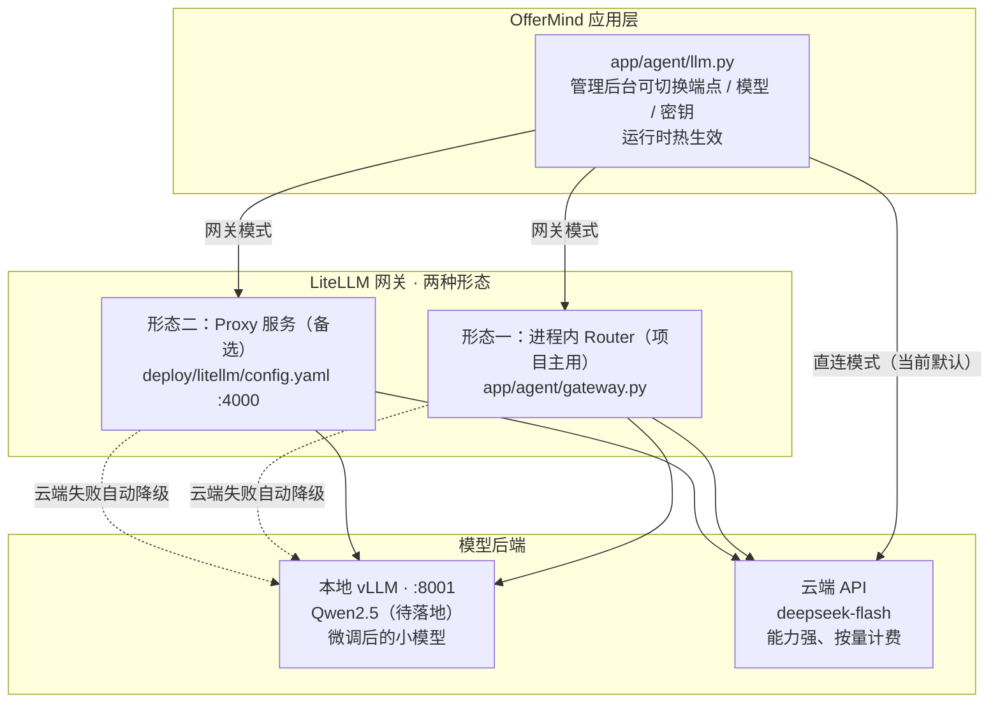

# 10 · 模型部署与网关

> ## ⚠️ 实现状态声明（请先读这一段）
>
> 本篇包含两块内容，**实现状态完全不同**，请勿混淆：
>
> | 内容 | 状态 |
> |---|---|
> | **LiteLLM 进程内网关**（`app/agent/gateway.py`） | ✅ **已实现并验证**（网关进程内运行、配置解析失败回落实测通过） |
> | **压测方法学**（`scripts/bench_llm.py`） | ✅ **已完成并使用过** |
> | **云端 LLM 基线实测数据** | ✅ **已有真实数据**（`benchmark/cloud-test.json`） |
> | **vLLM 本地部署脚本**（`deploy/vllm/serve.sh` / `serve.ps1`） | ✅ 已写好 |
> | **在真实 GPU 上部署本地生成模型** | ❌ **未落地**（从未实际起过 vLLM 服务） |
> | **本地三档量化对比数据**（FP16 / AWQ / GPTQ） | ❌ **不存在** |
>
> **因此本篇的「本地部署」部分描述的是方案与就绪的脚本，不是已完成的部署。** 本地部署的落地列入 [13-设计边界与演进规划.md](./13-设计边界与演进规划.md) 的演进规划，本篇只给出方案与执行方法，**不提供任何本地实测数字**。

---

## 1. 部署要解决什么问题

### 1.1 项目的原始缺口

课程主题是「大模型**部署**与微调」。项目原本的状态是：**主生成模型 100% 走云端 API**，本地只部署了 BGE-M3 与 bge-reranker-v2-m3 两个**判别**模型（做嵌入与重排）——它们不做生成。

所以「部署」这一半的缺口是具体的：**没有任何一个生成本地跑得起来**。

### 1.2 完整目标架构



**整个设计的核心是「应用层不感知后端是云端还是本地」** —— `llm.py` 只管发 OpenAI 兼容协议请求，切不切换、路由到哪，由配置决定。

---

## 2. LiteLLM 进程内网关（已实现）

### 2.1 为什么需要一个网关

| 诉求 | 没有网关时的问题 |
|---|---|
| **失败自动降级** | 云端限流 / 超时 / 5xx 时用户直接看到报错 |
| **多部署并存** | 想同时接云端与本地，只能改代码 |
| **切换成本** | 换服务商要改 `.env` 并重启 |

### 2.2 一个关键的技术判断：LiteLLM 是原生 SDK，不是 langchain 组件

这是本项目接网关时最重要的一个认识。LiteLLM 的 `Router` 返回对象**与 langchain 的消息接口不兼容**。有两种接入方式：

| 方式 | 成本 |
|---|---|
| 实现一个完整的 LangChain `BaseChatModel` 子类 | 要实现 `_generate` / `_stream` / `_agenerate` / `_astream`、消息转换、回调体系……大量与需求无关的接口 |
| **写一个只对齐真实用法的薄适配器** | 只需三个方法 |

**选定后者**。`LiteLLMChat` 只暴露三个方法：

```python
class LiteLLMChat:
    def __init__(self, router, model: str, params=None):
        self._router = router
        self._model = model
        self._params = dict(params or {})

    def bind(self, **kwargs) -> LiteLLMChat:
        """累积参数，不可变语义。"""
        return LiteLLMChat(self._router, self._model, {**self._params, **kwargs})

    def invoke(self, messages) -> _Result:
        response = self._router.completion(**self._request(messages))
        return _Result(response.choices[0].message.content or "")

    async def astream(self, messages):
        stream = await self._router.acompletion(stream=True, **self._request(messages))
        async for chunk in stream:
            text = getattr(chunk.choices[0].delta, "content", None)
            if text:
                yield _Result(text)
```

**这三个方法就是上层的全部真实需求** —— `JsonSchemaLLM` 用 `bind()` + `invoke()`，面试对话用 `astream()`。因此**上层 `JsonSchemaLLM` 一行都不用改**，网关是纯插入式的。

### 2.3 两个实现细节

**（1）`_Result` 是最小对象**

```python
class _Result:
    __slots__ = ("content",)
```

因为上层只读 `.content`。不构造任何多余属性，也不用 dataclass（`__slots__` 更轻）。

**（2）消息转换：未知类型统一当 user**

```python
def _msg_to_dict(message) -> dict:
    """System→system、AI→assistant、Human→user，其它类型统一当 user。"""
```

**为什么「其它类型统一当 user」而不是丢弃**：如果遇到 `ToolMessage` 之类的类型直接跳过，会导致模型收到的对话缺了一轮，且**这种丢失是静默的** —— 模型可能给出看起来合理但基于不完整上下文的回答，极难排查。统一降级为 user 至少保证了「消息不丢」。

### 2.4 路由与容错配置

```python
class LlmGateway:
    def __init__(self, deployments, fallbacks=None, primary="",
                 num_retries=2, timeout=120.0):
        from litellm import Router
        if not deployments:
            raise ValueError("网关至少要有一个部署")
        self.primary = primary or deployments[0].name     # 留空取第一个
        self._router = Router(
            model_list=[d.to_litellm() for d in deployments],
            fallbacks=fallbacks or [],
            num_retries=num_retries,
            timeout=timeout,
        )
```

| 参数 | 值 | 作用 |
|---|---|---|
| `primary` | 留空则取部署列表第一个 | 主部署 |
| `fallbacks` | 如 `{"cloud-deepseek": ["local-qwen"]}` | 主部署失败时的降级目标 |
| `num_retries` | `2` | 重试次数 |
| `timeout` | `120` 秒 | 单次请求超时 |

### 2.5 一个诚实的说明：`tiers` / `weight` 已建模但未参与路由

```python
@dataclass
class Deployment:
    name: str
    model: str
    api_base: str = ""
    api_key: str = ""
    weight: float = 1.0
    tiers: tuple = ("all",)       # simple / complex —— 按任务难度分流时用
```

代码注释明确写了 `tiers`（simple / complex）是「按任务难度分流时用」，但**当前 Router 只靠 `primary` + `fallbacks`，没有消费 `tiers` 与 `weight`**。

**这是设计超前于实现的一处**：数据结构已为「简单任务走本地、难任务走云端」预留了字段，但路由逻辑尚未实现。这个能力列入演进规划。

### 2.6 容错设计：配置写坏不会拖垮服务

**这是网关最重要的一条设计**。配置全部来自管理后台的文本输入，管理员随时可能填错。

```python
def parse_deployments(raw: str) -> list[Deployment]:
    if not raw or not raw.strip():
        return []
    try:
        rows = json.loads(raw)
    except json.JSONDecodeError:
        return []                                  # 非法 JSON → 空列表
    if not isinstance(rows, list):
        return []
    out = []
    for row in rows:
        if not isinstance(row, dict) or not row.get("name") or not row.get("model"):
            continue                               # 缺 name/model 的行静默跳过
        out.append(Deployment(...))
    return out
```

**回落链条**：

```
部署列表解析失败 → 返回空列表
       ↓
_get_gateway_cached 发现 deployments 为空 → 返回 None
       ↓
get_llm 里 `if router_gateway is not None` 不成立
       ↓
继续走直连 ChatOpenAI（原有逻辑）
```

**结果**：管理员在后台的部署列表 JSON 里少写一个逗号，**系统照常可用**，只是网关没生效。

**设计理由**：配置错误不应该导致服务不可用。这个取舍的代价是「配置错误不会被显式报错」—— 管理员不会收到「你的 JSON 写错了」的提示，只会发现「好像没走网关」。若要改进，应在管理后台的配置保存处做 JSON 校验并即时反馈。

同样的风格也用在 `parse_fallbacks` 上：非 dict / 非法 JSON 一律返回 `[]`。

### 2.7 配置热更新

| 配置项 | 默认值 | 作用 |
|---|---|---|
| `llm_gateway_enabled` | `0`（**默认关闭**） | 是否启用网关 |
| `llm_gateway_deployments` | `"[]"` | 部署列表 JSON |
| `llm_gateway_primary` | `""` | 主部署名，留空取第一个 |
| `llm_gateway_fallbacks` | `"{}"` | 回退规则 JSON |

**网关默认关闭** —— 不开网关时走原有的直连逻辑，行为与接网关前完全一致。这保证了「引入网关」这个动作是零风险的。

**缓存**：`_get_gateway_cached` 用 `@lru_cache(maxsize=8)`，**键是配置文本本身**（`deployments_json` / `fallbacks_json` / `primary`）。配置一变，缓存键就变，自然失效。这是「用值本身做缓存键」的巧妙用法 —— 不需要显式失效逻辑。

管理后台改配置 → `config_repo.set()` 让配置缓存失效 → 下次请求读到新配置文本 → 网关缓存键变化 → 构造新 Router。整条链路**改完即时生效，无需重启**。

### 2.8 配置示例（管理后台里填的内容）

**部署列表**：

```json
[
  {"name": "cloud-deepseek", "model": "openai/deepseek-flash",
   "api_base": "https://opencode.ai/zen/go/v1", "api_key": "sk-***"},
  {"name": "local-qwen", "model": "openai/Qwen2.5-7B-Instruct",
   "api_base": "http://127.0.0.1:8001/v1", "api_key": "EMPTY"}
]
```

**回退规则**：

```json
{"cloud-deepseek": ["local-qwen"]}
```

含义：云端失败（超时 / 限流 / 5xx）时自动降级到本地，用户不会看到报错。

---

## 3. 两种网关形态对比

| 形态 | 位置 | 配置来源 | 适用场景 | 状态 |
|---|---|---|---|---|
| **进程内 Router** | `app/agent/gateway.py` | 管理后台，**改完即时生效** | 单实例部署，要可观测、要热切换 | **项目主用，已实现** |
| **Proxy 服务** | `backend/deploy/litellm/config.yaml` | YAML 文件，改动需重启 | 多服务共用，网关独立成容器 | 配置已写好，未启用 |

### 3.1 Proxy 形态配置要点

```yaml
model_list:
  - model_name: cloud-deepseek
    litellm_params:
      model: openai/deepseek-flash
      api_base: https://opencode.ai/zen/go/v1
      api_key: os.environ/OPENCODE_API_KEY
      extra_headers:
        User-Agent: OfferMind/0.1
      extra_body:
        thinking:
          type: disabled
    model_info:
      mode: chat
      tier: complex          # 自定义标记：难任务走这里

  - model_name: local-qwen
    litellm_params:
      model: openai/Qwen2.5-1.5B-Instruct
      api_base: http://127.0.0.1:8001/v1
      api_key: EMPTY
    model_info:
      mode: chat
      tier: simple

router_settings:
  fallbacks:
    - cloud-deepseek: ["local-qwen"]
  num_retries: 2
  timeout: 120
  routing_strategy: usage-based-routing-v2
  allowed_fails: 3
  cooldown_time: 30

litellm_settings:
  drop_params: true
```

**Proxy 形态比进程内形态多出的能力**：`routing_strategy`（基于用量的路由）、`allowed_fails` + `cooldown_time`（失败次数超限后冷却，避免持续打一个挂掉的部署）。

用法：

```bash
pip install 'litellm[proxy]'
litellm --config deploy/litellm/config.yaml --port 4000
# 然后把管理后台的 Base URL 指向 http://127.0.0.1:4000/v1
```

### 3.2 一处需要修正的不一致

**YAML 里的 `local-qwen` 指向 `Qwen2.5-1.5B-Instruct`，而 `serve.sh` 默认起的是 `Qwen2.5-7B-Instruct`** —— 两处模型名不一致。

这不是 bug（两个配置是独立的，可以指向不同模型），但容易误导：读者会以为「按 README 起服务，然后按 YAML 配网关」就能对上，实际上模型名不匹配。应当统一，或在两处都注明。

---

## 4. vLLM 本地部署方案（待落地）

> ## ❌ 本节描述的是**方案与已就绪的脚本**，不是已完成的部署
>
> 从未在真实 GPU 上起过 vLLM 服务，因此**没有任何本地实测数据**。

### 4.1 为什么用 vLLM 而不是 transformers

| 对比项 | transformers 直接推理 | **vLLM** |
|---|---|---|
| 吞吐 | 单请求串行，吞吐低 | **PagedAttention + 连续批处理把吞吐拉高一个数量级** |
| 显存利用 | KV cache 预分配，碎片化 | **PagedAttention 按页管理 KV cache，显存利用率高** |
| 前缀缓存 | 无 | **`--enable-prefix-caching`** |
| OpenAI 兼容 API | 需自己包 FastAPI | **`vllm serve` 直接提供** |

**`--enable-prefix-caching` 对本项目的负载特别有效**：评分与面试的 prompt 都是「system prompt + 评分量表 / 对话系统提示**前缀固定**，只有尾部（题目、作答、对话历史）变化」的形态。开前缀缓存后这部分前缀不需要重复计算，**首 token 延迟能明显下降**。

这也正是压测要对比的一项。

### 4.2 三档量化启动参数

`deploy/vllm/serve.sh`（Linux / WSL）与 `deploy/vllm/serve.ps1`（Windows）逻辑一致：

```bash
QUANT="${1:-fp16}"
PORT="${PORT:-8001}"
MODEL="${MODEL:-Qwen/Qwen2.5-7B-Instruct}"

case "$QUANT" in
  fp16) QUANT_ARGS=(--dtype bfloat16) ;;
  awq)  QUANT_ARGS=(--quantization awq --dtype float16) ;;
  gptq) QUANT_ARGS=(--quantization gptq --dtype float16) ;;
  *)    echo "未知量化方式：$QUANT（可选 fp16 / awq / gptq）" >&2; exit 1 ;;
esac

exec vllm serve "$MODEL" \
  --served-model-name "$(basename "$MODEL")" \
  --host 0.0.0.0 \
  --port "$PORT" \
  "${QUANT_ARGS[@]}" \
  --max-model-len 8192 \
  --gpu-memory-utilization 0.90 \
  --enable-prefix-caching \
  --disable-log-requests
```

| 档位 | 差异参数 | 显存口径（脚本注释） |
|---|---|---|
| `fp16` | `--dtype bfloat16` | 7B 约需 **16GB**（权重 + KV cache） |
| `awq` | `--quantization awq --dtype float16` | 降到约 **6GB**，质量损失通常 1% 以内 |
| `gptq` | `--quantization gptq --dtype float16` | 同量级（脚本未给具体数字） |

**公共参数**：

| 参数 | 值 | 作用 |
|---|---|---|
| `--served-model-name` | 模型路径的 basename | 客户端请求时用的模型名 |
| `--host` | `0.0.0.0` | 允许外部访问 |
| `--port` | `8001`（`PORT` 可覆盖） | 注意与后端 8000 区分 |
| `--max-model-len` | `8192` | 覆盖评分 prompt（1500–2500 token）绰绰有余 |
| `--gpu-memory-utilization` | `0.90` | 留 10% 余量给系统 |
| `--enable-prefix-caching` | — | **本项目的关键收益点** |
| `--disable-log-requests` | — | 避免压测时日志刷屏 |

### 4.3 用法

```bash
bash deploy/vllm/serve.sh                    # 默认 FP16 起 Qwen2.5-7B
bash deploy/vllm/serve.sh awq                # AWQ 4bit
bash deploy/vllm/serve.sh gptq               # GPTQ

# 起微调后的模型
MODEL=finetune/output/qwen2.5-1.5b-grader-merged bash deploy/vllm/serve.sh awq
```

Windows 用 `deploy/vllm/serve.ps1 -Quant awq`。

### 4.4 一个使用上的注意点

**`serve.sh awq` / `serve.ps1 -Quant awq` 不会自动换成量化 checkpoint。** `MODEL` 默认是 `Qwen/Qwen2.5-7B-Instruct`（一个非量化的仓库），而 `--quantization awq` 要求加载的是**预量化的 AWQ 权重**。因此：

```bash
# 必须自己指定一个 AWQ 预量化仓库
MODEL=Qwen/Qwen2.5-7B-Instruct-AWQ bash deploy/vllm/serve.sh awq
```

否则 vLLM 会因找不到量化权重而报错。脚本的 `case` 分支只负责「传什么参数」，不负责「找什么模型」。

### 4.5 切换到本地模型

起好 vLLM 后，把管理后台的 **模型端点 Base URL** 改成 `http://127.0.0.1:8001/v1` 即可：

| 配置项 | 改成 |
|---|---|
| `llm_base_url` | `http://127.0.0.1:8001/v1` |
| `llm_model` | vLLM 的 `--served-model-name`（即模型 basename） |
| `llm_api_key` | `EMPTY`（vLLM 默认不校验） |

**配置运行时热生效，不用改代码、不用重启服务。**

**这就是「部署」与「微调」两块拼图咬合的地方**：微调产出的权重 → vLLM 起服务 → 改一个 Base URL → 线上就开始用微调后的模型评分。

---

## 5. 压测方法学（已实现并有实测数据）

### 5.1 三个设计决定

`scripts/bench_llm.py` 的设计取舍（docstring 原文）：

| 决定 | 理由 |
|---|---|
| **固定 prompt 长度**（`--prompt-chars`） | 不同输入长度的延迟**没有可比性**。统一输入规模才能横向对比不同模型/不同量化档 |
| **区分首 token（TTFT）与总延迟** | 首 token 决定**体感**快慢，总时长决定**吞吐**，混在一起看不出问题 |
| **同时报 P50 / P95 / P99** | **只看均值会漏掉排队和限流的尾巴** —— 均值正常但 P99 爆表，用户体验是「偶尔卡死」 |

**「既报并发也报串行」**：串行延迟反映单请求质量，并发下的 P99 反映排队与限流。只看一个数会得出错误结论。

### 5.2 实现要点

**分位数用线性插值，不依赖 numpy**：

```python
def percentile(values: list[float], p: float) -> float:
    if not values: return 0.0
    ordered = sorted(values)
    if len(ordered) == 1: return ordered[0]
    index = (len(ordered) - 1) * p
    low = int(index)
    high = min(low + 1, len(ordered) - 1)
    return ordered[low] + (ordered[high] - ordered[low]) * (index - low)
```

**固定 prompt 构造**（按中文字符数截断，跨端点可比）：

```python
def build_prompt(target_chars: int) -> str:
    base = "请评价下面这段技术描述的专业程度，并指出可以改进的地方。"
    filler = "在分布式系统中，服务之间的调用需要处理超时、重试与幂等性问题。"
    text = base
    while len(text) < target_chars:
        text += filler
    return text[:target_chars]
```

**首 token 延迟的测量**：用流式请求，逐行读 SSE，**第一行 `data:` 到达即记 TTFT**：

```python
async with client.stream("POST", url, json=body, headers=headers) as resp:
    async for line in resp.aiter_lines():
        if not line.startswith("data:"): continue
        data = line[5:].strip()
        if data == "[DONE]": break
        if ttft is None:
            ttft = (time.perf_counter() - started) * 1000
```

**并发模型**：`asyncio.Semaphore(concurrency)` + `asyncio.gather(...)`，`wall` 为整体墙钟，`qps = 成功数 / wall`。

**请求头**：带 `User-Agent: OfferMind/0.1` 与 `x-opencode-session`（复用 `app.agent.llm.new_session_id`）。

### 5.3 参数清单

| 参数 | 默认值 |
|---|---|
| `--base-url` / `--api-key` / `--model` | `None`（→ 从数据库读运行时配置） |
| `--concurrency` | `10` |
| `--total` | `30` |
| `--prompt-chars` | `200` |
| `--max-tokens` | `128` |
| `--no-stream` | 关闭（开启则无首 token 指标） |
| `--timeout` | `180.0` |
| `--label` | `cloud` |
| `--out-dir` | `benchmark` |

**`--base-url` 或 `--model` 缺任一个时，从数据库读运行时配置补齐** —— 理由同评测脚本：**默认打线上正在用的端点，读库而不是 `.env`**（管理员可能改过）。

### 5.4 输出结构（落盘 `benchmark/<label>.json`）

```json
{
  "label": "cloud-test",
  "model": "deepseek-flash",
  "base_url": "https://opencode.ai/zen/go/v1",
  "config": { "concurrency": 4, "total": 8, "prompt_chars": 200, "max_tokens": 64 },
  "stats": {
    "requests": 8, "concurrency": 4, "succeeded": 8, "failed": 0,
    "error_rate": 0.0, "wall_s": 8.96, "qps": 0.89,
    "latency_ms": { "p50": 3741.6, "p95": 5451.7, "p99": 5550.7, "mean": 4092.8 },
    "ttft_ms": { "p50": 2752.8, "p95": 4278.4 },
    "errors": []
  }
}
```

**注意**：脚本**只产出 TTFT 的 P50 与 P95，没有 TTFT 的 P99**。

### 5.5 已实测的云端基线

> 数据来源：`backend/benchmark/cloud-test.json`。这是**全项目唯一一份真实的压测结果**。

**压测条件**：模型 `deepseek-flash`，并发 4、总请求 8、prompt 200 字符、`max_tokens` 64。

| 指标 | 值 |
|---|---|
| 请求数 / 成功 / 失败 | 8 / 8 / 0 |
| **错误率** | **0.0%** |
| 总耗时（墙钟） | 8.96 s |
| **吞吐（QPS）** | **0.89 req/s** |
| **总延迟 P50** | **3741.6 ms** |
| 总延迟 P95 | 5451.7 ms |
| 总延迟 P99 | 5550.7 ms |
| 总延迟均值 | 4092.8 ms |
| **首 token P50** | **2752.8 ms** |
| 首 token P95 | 4278.4 ms |

**这组数字怎么读**：

| 观察 | 含义 |
|---|---|
| TTFT P50 = 2752.8 ms | **刚好卡在 PRD 要求的「首 token < 3s」门槛内**，但余量很小（差 247 ms） |
| TTFT P50 占总延迟 P50 的 74% | **大部分时间花在「等第一个 token」上** —— 这正是本地部署 + 前缀缓存最可能赢的地方 |
| P99 / P50 = 1.48 | 尾部放大近 1.5 倍，说明存在排队或网络抖动 |
| QPS = 0.89（并发 4） | 单请求约 4.5 秒，并发 4 只换来 0.89 QPS —— **吞吐被单请求延迟限制，不是被并发度限制** |

**样本量的诚实说明**：只有 8 个请求，**P95 / P99 的置信度有限**（P99 实际是第 8 个样本附近的值）。这组数据适合作为**基线参考**，不足以作为容量结论。要在答辩中引用，建议先加大 `--total` 与 `--concurrency` 重跑。

### 5.6 本地部署要打的目标

`deploy/README.md` 里的判断：

> 这组数字就是本地部署要打的目标：**首 token 延迟**和**单位成本**是本地部署最可能赢的两项。

| 维度 | 云端 | 本地（预期） | 谁赢 |
|---|---|---|---|
| 首 token 延迟 | 2752.8 ms（P50，含网络往返） | 无网络往返 + 前缀缓存 | **本地可能赢** |
| 单位成本 | 按 token 计费 | 一次性硬件投入后趋近于零 | **本地赢** |
| 峰值质量 | 大模型 | 小模型（1.5B–7B） | **云端赢** |
| 并发吞吐 | 受账户限流约束 | 受显存与批处理能力约束 | 取决于规模 |
| 数据隐私 | 数据出本机 | 数据不出本机 | **本地赢** |

---

## 6. 待实测的对比表骨架

> **本表所有数字均为待填项。** 执行 §7 之后填入。

### 6.1 三档量化的「显存–延迟–质量」三角

| 档位 | 显存占用 | 总延迟 P50 | 总延迟 P99 | 首 token P50 | QPS | 评分质量（MAE） |
|---|---|---|---|---|---|---|
| 云端基线 | — | 3741.6 ms ✅ | 5550.7 ms ✅ | 2752.8 ms ✅ | 0.89 ✅ | 待实测 |
| vLLM FP16 | 待实测（预期 ~16GB） | 待实测 | 待实测 | 待实测 | 待实测 | 待实测 |
| vLLM AWQ 4bit | 待实测（预期 ~6GB） | 待实测 | 待实测 | 待实测 | 待实测 | 待实测 |
| vLLM GPTQ | 待实测 | 待实测 | 待实测 | 待实测 | 待实测 | 待实测 |

**「质量」那一维同样是量化对比的必需项**，不只看延迟与显存：

```bash
python scripts/eval_grader.py --gold finetune/data/gold.jsonl --label vllm-awq \
    --base-url http://127.0.0.1:8001/v1 --api-key EMPTY --model Qwen2.5-7B-Instruct
```

这样才能回答「AWQ 省了多少显存、慢/快了多少、质量掉了多少」这个完整的三角问题。

### 6.2 需要一并记录的实验元信息

| 项 | 值 |
|---|---|
| GPU 型号与显存 | 待定 |
| vLLM 版本 | 待定 |
| `--max-model-len` / `--gpu-memory-utilization` | 8192 / 0.90 |
| 是否开前缀缓存 | 是 |
| 压测参数 | 待定（建议 `--total` ≥ 100，`--concurrency` ≥ 8 以提高分位数置信度） |

---

## 7. 待执行清单

| # | 步骤 | 命令 | 产出物 |
|---|---|---|---|
| 1 | **准备 GPU 环境**并装 vLLM（独立环境，不装进主环境） | `pip install vllm` | — |
| 2 | **拉起 FP16 服务** | `bash deploy/vllm/serve.sh fp16` | `:8001` 上的 OpenAI 兼容端点 |
| 3 | **压测 FP16** | `python scripts/bench_llm.py --base-url http://127.0.0.1:8001/v1 --api-key EMPTY --model Qwen2.5-7B-Instruct --label vllm-fp16` | `benchmark/vllm-fp16.json` |
| 4 | **换 AWQ 重起后压测** | `MODEL=<AWQ 仓库> bash deploy/vllm/serve.sh awq` + 同上 `--label vllm-awq` | `benchmark/vllm-awq.json` |
| 5 | **换 GPTQ 重起后压测** | 同上 `--label vllm-gptq` | `benchmark/vllm-gptq.json` |
| 6 | **量质量那一维** | `python scripts/eval_grader.py --label vllm-awq --base-url ...` | 各档的 MAE |
| 7 | **填对比表** | 手工汇总 | §6.1 的完整表格 |

**注意第 4 / 5 步的模型名**：AWQ / GPTQ 档必须用 `MODEL=` 指定**预量化仓库**，否则 vLLM 找不到量化权重（见 §4.4）。

---

## 8. 已知边界与风险

| 边界 / 风险 | 影响 | 处理 |
|---|---|---|
| **本地部署未落地** | 「部署」这一半目前只有脚本与方案，没有实测 | 本篇已如实标注；列入演进规划 |
| **无本地实测数据** | 无法回答「本地到底比云端快多少」 | 执行 §7 的清单 |
| **`tiers` / `weight` 未参与路由** | 「按任务难度分流」尚未实现，实际只靠 `primary` + `fallbacks` | 列入演进规划 |
| **网关配置错误静默回落** | 管理员填错 JSON 不会收到提示，只会发现「没走网关」 | 建议在配置保存处加 JSON 校验与即时反馈 |
| **YAML 与 serve.sh 的模型名不一致** | 读者按 README 操作可能与 YAML 配不上 | 统一模型名或两处都注明 |
| **`serve.sh awq` 不自动换量化仓库** | 直接跑会报错 | 已在 §4.4 说明；建议脚本里加显式提示 |
| **压测样本量偏小** | P95 / P99 置信度有限 | 重跑时加大 `--total` |
| **`benchmark/` 与 `finetune/eval/` 被 gitignore** | 结果文件不入库，换机器后丢失 | 若要长期留存，应改为提交或另存到文档目录 |
| **vLLM / transformers / torch 不在 `pyproject.toml`** | 环境需要额外配置 | 属部署侧工具链，建议写进部署文档的依赖清单 |

---

## 9. 一篇小结

**这套方案的技术含量在哪**：

| 设计点 | 为什么有价值 |
|---|---|
| **薄适配器而非完整子类** | 认识到「只对齐真实用法的三个方法」就够了，避免为一个接口写大量无用实现 |
| **配置写坏静默回落** | 明确「配置错误不应导致服务不可用」这条原则，并落地到解析函数 |
| **用配置文本做缓存键** | 不需要显式失效逻辑，值变了键就变了 |
| **压测方法学三原则** | 固定输入长度、分离 TTFT 与总延迟、报分位数而非均值 —— 这三条让数字**可信且可解释** |
| **把 TTFT 与总延迟分开报** | 从「TTFT 占 P50 的 74%」这个观察直接推出「本地部署最可能在哪赢」 |
| **质量与延迟放同一张表** | 量化对比不能只看延迟，否则会得出「AWQ 全面优于 FP16」的错误结论 |

**当前的诚实状态**：网关已实现并有实测支撑，云端基线数据真实可用；本地部署就绪但未落地，因此**没有本地数据**。本方案不为本地部署提供任何虚假数字。

---

**上一篇**：[09-模型微调方案.md](./09-模型微调方案.md) ｜ **下一篇**：[11-工程实践与踩坑记录.md](./11-工程实践与踩坑记录.md)
