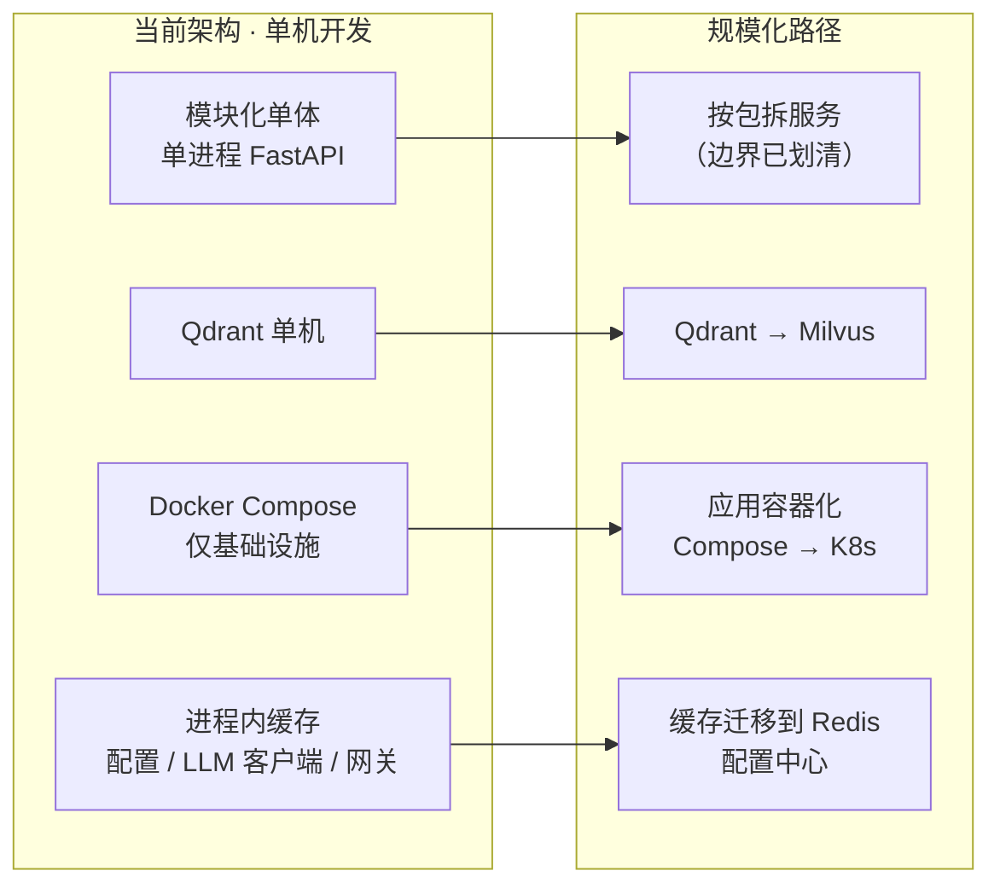

# 13 · 设计边界与演进规划

> 本篇分两部分：**先把「当前做到哪」说清楚**（设计边界），**再说「下一步怎么补」**（演进规划）。
> 这样组织是因为：一个清楚自己边界的方案，比一个把所有事都写成"已完成"的方案更可信。

---

## 1. 当前设计边界

> 每条按「**边界 → 影响 → 补齐路径**」写。这些不是「缺陷清单」，而是「有意识划定的当前范围」。

### 1.1 数据层

| 边界 | 影响 | 补齐路径 |
|---|---|---|
| `training_sessions` / `tool_traces` / `resumes` **三张表建了但无读写路径** | 「训练会话聚合」「轨迹持久化」「简历归档」三件事未落地 | 分别对应下面的「训练会话管理」「Langfuse 轨迹归档」「简历存 MinIO」三项 |
| `answers.followup_chain` **从不被赋值**，恒为 `"[]"` | 无法回看「这题追问了几轮、问了什么」 | 追问时把结果 append 进去 |
| `skill_profiles` **无 `(user_id, knowledge_point)` 唯一约束** | upsert 靠应用层 select-then-write，并发下理论上可插入重复行 | 加复合唯一约束（一行 DDL） |
| 所有外键**无 `ondelete`** | 删除用户不会级联清理其数据 | 有意识的取舍（防误删）；若需「账号注销」应显式设计清理策略 |
| 全项目**零 `relationship()`** | 需要手写联表，代码量偏大 | 有意识的取舍（避免 async 懒加载陷阱），不计划改 |
| **时区口径不统一**：`review_due_at` 用 naive 本地时间、JWT 用 aware UTC、`TimestampMixin` 用 DB 侧 `func.now()` | 跨时区部署时复习排期会错 | 统一为 UTC aware |
| **不用 Alembic**，迁移靠手写幂等 DDL | 无版本历史、无自动回滚 | 表结构稳定后引入 Alembic |

### 1.2 检索层

| 边界 | 影响 | 补齐路径 |
|---|---|---|
| 三个知识库**只有题库库落地** | 面经企业库零代码；简历库未进向量库（简历以字符串塞 prompt，无 `user_id` 过滤检索） | 见 §3 的 P1 项「RAG 面经企业库」 |
| 一题一个 point，**无 chunk 切分** | 长题干无法分段检索；题目规模大时单点信息密度高 | 当前题目长度下不构成问题；若引入面经（长文本）则需要分块策略 |
| **三路检索的文本口径不一致**：embedding 只嵌 `content`、BM25 用 `content + key_points`、rerank 只用 `text` | 「为什么某题被召回 / 没被召回」难以解释 | 统一口径（例如都包含 `key_points`） |
| 稀疏检索用 **`rank-bm25` 进程内索引** | 内存占用随题库线性增长；索引重建有成本 | 题库变大后改用 Qdrant 原生稀疏向量或接 Elasticsearch |
| **无查询改写 / HyDE** | 模糊提问（如「缓存那个问题」）的召回质量受限 | 见 §3 的 P2 项 |
| 元数据过滤是**精确匹配**（`MatchValue`） | 无法做「难度 ≥ 中级」这类范围过滤 | 当前筛选维度都是枚举值，够用 |

### 1.3 Agent 与编排层

| 边界 | 影响 | 补齐路径 |
|---|---|---|
| 9 张图**全部不带 checkpointer** | 无图级别持久化状态，不支持中断续跑 | 一期的会话状态存在 PG，不需要；若要「中断恢复」再引入 |
| **无 ReAct 工具循环** —— `tools.py` 有真实工具 `retrieve_knowledge`，但 `ALL_TOOLS` 全仓库零引用 | Agent 不具备「自主选择工具」的能力，流程是确定性流水线 | 见 §3 的 P2 项「管理端智能助手」（第一个真正的 ReAct 落点） |
| **四维权重只写在 prompt 文本里**，服务端不做加权校验，`total_score` 由模型自报 | 模型算错总分不会被发现，错会传到错题判定与 SM-2 排期 | 在 `grade_node` 里按四维重算总分并与模型自报值比对 |
| **记忆只有 PostgreSQL 回放**：无 checkpointer、无 Redis、无跨会话画像注入 | 面试每轮重拼全量历史，token 消耗随轮数线性增长；出题不会参考用户薄弱点 | 见 §3 的 P1 项「画像自动更新 + 注入」 |
| **PRD 规划的 8 个工具只有 1 个**，且未被编排消费 | 与 PRD 的工具集设计有差距 | 同「管理端智能助手」 |
| 非流式路径用 `asyncio.to_thread` 包同步调用 | 线程池有开销，且 `to_thread` 无法被真正中断 | 可接受；一期不作为优化目标 |

### 1.4 可观测层

| 边界 | 影响 | 补齐路径 |
|---|---|---|
| 轨迹**不落 `tool_traces` 表**，只走 SSE | 刷新标签页即丢（前端 `sessionStorage` 只能保住当前标签页） | 见 §3 的 P0 项「Langfuse 轨迹归档」 |
| `langfuse` 依赖已声明但**代码零引用** | 无成本看板、无轨迹回看 | 同上 |
| **无 OTel trace** | 无法做跨服务的全链路追踪 | 与 Langfuse 一并接入 |
| SSE **无心跳帧** | 长静默期（模型久不吐 token）可能被中间代理断开 | 生产部署前补 `: ping\n\n` 心跳注释帧 |
| 事件 id 与 payload 字段**无 schema 约束** | 新增事件类型时缺少类型检查 | 前端已有 `StreamEvent` 类型，可考虑用 zod 做运行时校验 |

### 1.5 部署与运维层

| 边界 | 影响 | 补齐路径 |
|---|---|---|
| **本地生成模型未落地** —— vLLM 启动脚本已就绪，但从未在真实 GPU 上起过服务 | 「部署」这一半目前只有方案与脚本，无实测数据 | 见 §3 的 P0 项 |
| 网关的 **`tiers` / `weight` 字段已建模但 Router 未使用** | 「简单任务走本地、难任务走云端」尚未实现，实际只靠 `primary` + `fallbacks` | 在 `LlmGateway` 里按任务类型选择部署 |
| **网关配置错误静默回落直连** | 管理员填错 JSON 不会收到提示，只会发现「没走网关」 | 在配置保存处加 JSON 校验与即时反馈 |
| `deploy/litellm/config.yaml` 的 `local-qwen` 指 **1.5B**，而 `serve.sh` 默认起 **7B** | 两处模型名不一致，读者容易配不上 | 统一模型名或两处注明 |
| `serve.sh awq` / `serve.ps1 -Quant awq` **不自动换量化仓库** | 直接跑会因找不到量化权重报错 | 在脚本里加显式提示 |
| **应用本体不进容器**（docker-compose 只编排基础设施） | 无法一键部署整个应用 | 见 §4 规模化路径 |
| 配置缓存 / LLM 客户端缓存 / 网关 Router 缓存**均为进程内** | 多 worker 部署下各 worker 不一致，「改完即时生效」只在单进程成立 | 迁移到 Redis 或改用外部配置中心 |

### 1.6 安全与合规层

| 边界 | 影响 | 补齐路径 |
|---|---|---|
| JWT payload 只有 `sub` + `exp`，**无 `iat` / 无 refresh token / 无 `jti` 黑名单** | 无法主动失效；token 泄漏后 24 小时内持续有效；无续期机制 | 引入 Redis 存黑名单，或改「短 access + refresh」 |
| **简历 / 报告未加密存储**（`resumes` 表 docstring 标注「需加密存储」，实际既没存也没加密） | 简历不上传对象存储，实际上避免了持久化风险，但无法回看历史简历 | 见 §3 的 P2 项「简历存 MinIO」（需一并做加密） |
| **传输未启用 TLS**（开发环境为 HTTP） | 中间人可读 | 生产部署时上 HTTPS |
| **无日志脱敏中间件** | 日志可能含敏感信息 | 加统一脱敏 |
| **无限流、无配额、无超时熔断** | 无法防止单用户刷爆 API 额度 | 见 §3 的 P2 项 |
| **无提示注入防护、无输出内容审核** | 用户可通过 prompt 注入影响模型行为 | 见 §3 的 P2 项 |
| **无采集告知 / 删除权 / 数据导出** | 不合规（若面向真实用户） | 见 §3 的 P2 项 |
| `/docs` 与 `/openapi.json` **未做保护** | 全部端点暴露在 Swagger UI 中 | 生产环境关闭或加鉴权 |
| **无统一异常处理器** | 内部错误（如数据库异常）会把原始信息透给客户端 | 加 `@app.exception_handler` |
| **无请求 ID / 访问日志中间件** | 无法关联同一次请求的多条日志 | 加 RequestID 中间件 |

### 1.7 工程卫生

| 边界 | 影响 | 补齐路径 |
|---|---|---|
| **`sentence-transformers` / `FlagEmbedding` / `rank-bm25` / `jieba` 未写进 `pyproject.toml`**（靠延迟 import 手动安装） | **换机器 `pip install -e .` 后跑不起来** | 补进依赖清单（这是需要修的真实问题） |
| `vllm` / `transformers` / `torch` / `llamafactory` 也不在依赖清单 | 部署与微调环境需要额外配置 | 写进部署文档的依赖清单 |
| **零单元测试、无 CI** | 回归风险靠人工 | 见 [12-测试与验收.md](./12-测试与验收.md) §6 的改进计划 |
| `/health/ready` **不检查任何依赖** | 就绪探针名不副实 | 接入 DB / Qdrant 连通性检查 |
| `admin.py` 的 `llm_options` **重复定义**（第 229 行是死代码） | 误导读者；端点数统计口径混乱 | 删除第一处定义 |
| `POST /training/grade`（非流式）**不落库**，与流式版本行为不一致 | 容易踩坑 | 要么统一行为，要么在文档与代码注释里显著标注 |
| `frontend/public/design/` **未纳入版本控制**（`git status` 显示为未跟踪） | 若该目录有价值，会丢失 | 决定是提交还是忽略 |

---

## 2. PRD 规划 vs 实际实现对照

> 这张表把「需求文档里写了什么」与「代码里实现了什么」逐项对齐。**它不是扣分项，而是严谨性的体现** —— 说明团队清楚每一项的落地状态。

| PRD 设计 | PRD 内容 | 实际实现 | 差异说明 |
|---|---|---|---|
| **§6.2 工具集** | 8 个工具（`generate_question` / `grade_answer` / `generate_followup` / `retrieve_knowledge` / `parse_resume` / `parse_jd` / `save_memory` / `read_memory`） | **1 个**（`retrieve_knowledge`），且 `ALL_TOOLS` 零引用 | 流程改为确定性编排，节点直接调函数而非经工具注册表。其余 7 个能力都以节点内逻辑的形式存在，只是没做成「工具」 |
| **§6.3 记忆系统** | 三层：短期（Redis + 会话状态）/ 长期（PostgreSQL + 向量）/ 知识（向量库） | **只有「PostgreSQL 回放」** 一层。Redis 零引用；画像不被 Agent 读取 | 面试对话用 `interview_messages` 全量回放；无跨会话记忆 |
| **§7.1 三个知识库** | 题库库 / 面经企业库 / 用户简历库 | **只有题库库** | 面经库零代码；简历库未进向量库 |
| **§7.4 分块策略** | 题目按题干·参考答案·考点分块；简历按项目/技能/教育/工作分块；面经按问题·公司·岗位方向分块 | **无分块**，一题一个 point | 题目长度不需要分块；引入长文本知识库时才需要 |
| **§9 数据模型** | 8 个实体（User / Question / Answer / TrainingSession / Resume / InterviewSession / SkillProfile / ToolTrace） | **11 张表**（多出 `InterviewMessage` / `HistoryRecord` / `SystemConfig`） | 都是实现过程中发现的必要拆分：消息单独建表、历史快照独立成表、配置 key-value 化 |
| **§5 非功能-性能** | 简历解析 / 报告生成「异步，接口 < 1s 返回受理」 | **同步 SSE 长连接流式** | SSE 已能提供「进行中」反馈，异步任务队列（ARQ）在一期属过度设计 |
| **§5 非功能-成本** | LiteLLM 追踪成本；小模型粗筛 + 大模型精判；缓存命中降本 | **均未实现** | Langfuse 已声明未引用；所有任务走同一模型 |
| **§5 非功能-可靠性** | LLM 失败自动 fallback；限流；指数退避重试 | **fallback 已实现**（网关）且配置容错；限流无；重试只 1 次无退避 | 网关是可靠性部分的主要成果 |
| **§5 非功能-合规** | 采集告知、删除权、数据可导出 | **均未实现** | — |
| **§5 非功能-可用性** | 全链路 OTel trace + Langfuse | **均未实现** | — |
| **§10 安全** | 简历/报告静态加密、传输 TLS、日志脱敏、向量库 user_id 隔离、内容安全、成本防护 | **认证 + 用户级数据隔离已实现**（跨用户 404）；其余未实现 | 硬性两项（认证、隔离）做扎实了 |
| **§1.3 非目标** | 一期不做「管理员端」 | **已实现**（用户管理 / 题库管理 / 运行时配置 / 概览统计） | **超出原范围的工作量** |
| **§12 验收** | 7 个模块的验收点 | 见 [01-需求分析.md](./01-需求分析.md) §5 的勾选结果 | 主干全部达成；部分子项有明确缺口 |
| **§3.3 模拟面试** | 面试时长可选（15/30 分钟） | **未实现** | 时长是对话轮数的自然结果，未做硬性控制 |
| **§13 开放问题** | 面试语气/风格是否提供多风格切换 | **已实现**三种 `style`（项目深挖 / 技术栈深挖 / 压力测试） | 已解决 |

### 2.1 三条值得强调的「超额完成」

| 项 | 说明 |
|---|---|
| **管理员端** | PRD 明确列为一期非目标，实际完整实现（且题库管理做了向量库同步这种非平凡的事） |
| **间隔重复（SM-2）** | PRD 未要求。完整的 SM-2 实现（含 `ease` 动态调整、连续答对毕业规则） |
| **混合检索（稠密 + 稀疏 + RRF）** | PRD 只提到 BGE-M3 单路向量。实际实现了 BM25 稀疏路 + RRF 融合 + 三种模式可切换 |

**第三项尤其值得一提**：混合检索在本项目里**不是规划项而是已落地成果**。RRF 融合用的是名次而非分数，规避了「余弦相似度与 BM25 分数不可比」的问题。

---

## 3. 演进规划

### 3.1 总优先级表

| # | 项 | 为什么排这里 | 优先级 | 状态 |
|---|---|---|---|---|
| 1 | **微调数据补齐与训练** | 课程主题的另一半；链路代码件已全部完成，只差执行与数据 | **P0** | 框架完成，数据待跑 |
| 2 | **本地 vLLM 部署落地** | 课程主题的一半；脚本已就绪，只差 GPU 环境与实测 | **P0** | 方案就绪，待落地 |
| 3 | **Langfuse 轨迹归档 + 成本看板** | 依赖已装未用；把轨迹从「刷新即丢」变成可回看 + 成本可量化 | **P0** | 未开始 |
| 4 | **修依赖清单** | 4 个包缺失会让「按文档装环境」失败 | **P0** | 未开始（改动量极小） |
| 5 | **画像自动更新 + 注入 Agent** | 让「长期能力画像」从展示面板变成真正驱动个性化的用户模型 | **P1** | 部分实现 |
| 6 | **RAG 面经企业库** | PRD 规划的第三个知识库；落地后模拟面试的真实性上一个台阶 | **P1** | 未开始 |
| 7 | **混合检索在后台可切换** | **检索内核已实现**，只差把模式开关接到管理后台（其实已有 `retrieval_mode` 配置项） | **P1** | 已可用 |
| 8 | **补纯函数单测 + CI** | 6 个高风险纯函数，测试成本极低 | **P1** | 未开始 |
| 9 | 管理端 prompt 管理 | 提示词从代码搬到数据库，可编辑、可对比、可回滚 | **P2** | 未开始 |
| 10 | 查询改写 / HyDE | 提升模糊提问的召回质量 | **P2** | 未开始 |
| 11 | 管理端智能助手（自然语言批量管理） | **第一个真正的 ReAct 工具循环落点**，填上 `tools.py` 的空缺 | **P2** | 未开始 |
| 12 | 简历存 MinIO（含加密） | 让简历可回看；需一并做静态加密 | **P2** | 未开始 |
| 13 | 限流 / 配额 / 内容安全 / 合规 | 面向真实用户的前置条件 | **P2** | 未开始 |
| 14 | 训练会话管理（接线 `training_sessions`） | 「一次训练 = 一组题」的聚合概念落地 | **P2** | 未开始 |
| 15 | Laya 决策引擎接入（可选增强） | 确定性判断任务上延迟从秒级降到 33ms | **P2** | 未开始（见 §3.4） |

### 3.2 P0 项详解

**（1）微调数据补齐与训练**

| 步骤 | 说明 |
|---|---|
| 积累数据 | 正常使用刷题功能，评分自动落库 |
| 导出并**看直方图** | 若分布全挤在中档，先补充多样化样本 |
| 人工标注 ≥100 条 | 整个环节唯一不可自动化的一步 |
| 训练 + 评测 + 出对比表 | 见 [09-模型微调方案.md](./09-模型微调方案.md) §8 的 8 步清单 |

**产出**：一张真实的「微调前 vs 微调后」对比表。

**（2）本地 vLLM 部署落地**

| 步骤 | 说明 |
|---|---|
| 准备 GPU 环境 | 独立环境装 vLLM |
| 三档分别压测 | FP16 / AWQ / GPTQ |
| 量化那一维也要量 | 用 `eval_grader.py` 测质量，与延迟放同一张表 |

**产出**：一张真实的「显存–延迟–质量」三角对比表。

**（3）Langfuse 轨迹归档 + 成本看板**

| 价值 | 说明 |
|---|---|
| 轨迹可回看 | 从「刷新即丢」变成可按会话 / 用户 / 时间查询 |
| 成本看板 | 每次训练 / 面试消耗多少 token、花多少钱 |
| 延迟分析 | 定位慢在哪一环 |

**落点**：在事件推给前端的同时异步上报一份到 Langfuse；管理后台新增「轨迹与成本」页。

**为什么不直接落 `tool_traces` 表**：该表的设计（`session_id` 无外键、`step` 自增、`payload_json` 存整块）适合「按会话线性回放」这一种查询，不适合成本聚合、延迟分位数、跨模块对比这些分析型查询。

**（4）修依赖清单**

把 `sentence-transformers` / `FlagEmbedding` / `rank-bm25` / `jieba` 补进 `pyproject.toml`。改动量极小但影响很大 —— 当前「按文档搭环境」会失败。

### 3.3 P1 项详解

**（5）画像自动更新 + 注入 Agent**

| 现状 | 目标 |
|---|---|
| 画像写入需要前端显式调用 `POST /report/profile` | 刷题 / 面试完成后**自动**更新画像 |
| 画像只被报告页读取用于展示 | 出题时把「该用户薄弱点」注入 prompt，实现**个性化出题** |

**这是本项目最重要的一个未闭环环节** —— PRD 设计的「长期能力画像」目前只做到了记录与展示，没有反馈进生成。

**（6）RAG 面经企业库**

| 项 | 设计 |
|---|---|
| 数据来源 | 公开面经文本（按公司 / 岗位方向组织） |
| 存储 | 第二个 Qdrant collection（或同 collection 加 `source` 元数据区分） |
| 分块 | **需要分块** —— 面经是长文本，与题目（一题一点）不同 |
| 用途 | 模拟面试时检索「这家公司爱问什么」，提升提问真实度 |
| 数据边界 | 不变：向量库存文本片段 + 元数据，主记录在 PostgreSQL |

**（7）混合检索在后台可切换**

**这一项实际上已经可用**：`retrieval_mode` 配置项（`dense` / `sparse` / `hybrid`）已在管理后台，改完即时生效。剩下的工作是**演示材料**：准备一组「同一问题、不同召回策略」的对比案例。

**（8）补纯函数单测 + CI**

6 个高风险纯函数：`sm2_next` / `rrf_fuse` / `percentile` / `parse_deployments` / `build_grade_prompt` / `_route_after_dedup`。每个不到 20 行测试代码。

### 3.4 P2 项中的两个亮点

**（11）管理端智能助手 —— 第一个真正的 ReAct 工具循环**

管理员用一句话驱动批量操作（「把所有 MySQL 索引相关题改成中级」「删掉语义重复的题」）。模型不碰数据库，只输出「要调哪个工具 + 参数」，执行由服务端接管。

四个关键设计：

| 设计 | 内容 |
|---|---|
| **手写 JSON ReAct，不用 `bind_tools`** | 因为 DeepSeek 工具调用的 arguments 不保证合法 JSON（见 [11-工程实践与踩坑记录.md](./11-工程实践与踩坑记录.md) 坑 1），而 `create_question` 恰好要传长文本。改成模型每轮输出 `json_object` 的 `{thinking, tool, arguments, reply}`，服务端执行后把结果塞回对话再问一轮，`tool: null` 即结束 |
| **写操作走「拟→批→行」闸门** | 写工具必须先出影响面预览，前端渲染确认卡片；服务端固化 `(工具名, 参数, plan_id)`，确认带回 `plan_id` 才执行**且只能执行一次**。确认时不让模型重新生成参数（类比 sudo：授权的是那一次具体操作） |
| **id 必须出自本轮检索** | 服务端记「本轮出现过的 id 集合」，写操作引用集合外的 id 一律拒，防模型瞎编 id |
| **硬护栏** | 服务端拦，不靠提示词：删除类 > 20 条直接拒；写操作全量审计落库 |

**落地按四步走**：只读版 → 单写工具 + 确认闸门 → 批量写 + 审计 → 高危操作。**第一步零风险，可单独演示。**

**（15）Laya 决策引擎接入（可选增强）**

**Laya**（`NandhaKishorM/laya`，Apache-2.0）：非自回归 System 1 决策引擎，单次前向传播对任意文本输出结构化决策（`choice` / `score` / `noul` 三种 typed questions），延迟约 **33ms**、100+ 语言、**不生成文本故无幻觉**。底座 ModernBERT-large（421M）。

**定位**：只做「确定性判断」，**不替代生成式 LLM，也不替代四维评分**。四维 rubric 要求每维给出 `reason`，而 Laya 只输出分数 + 置信度、给不出理由，因此**仅可作为评分的辅助信号，不可作为评分主体**。

| 候选落点 | 现有实现 | Laya 用法 | 收益 | 优先级 |
|---|---|---|---|---|
| 简历技能匹配 | `diagnose_node` 靠 DeepSeek 对比简历与 JD 判断缺失技能 | 对每个必备技能发 `noul`（「简历是否提到 X？」），批量出确定清单 | 从秒级生成变 33ms 判断，且**不漏项** | P1 |
| 追问触发信号 | `followup_node` 无条件追问 | `noul` 判断作答是否含糊 / 未命中考点 | 避免无效追问，降本 | P2 |
| 输入意图路由 | 用户需手动选模块 | `choice` 把一句话输入路由到刷题 / 简历 / 面试 | 交互更自然 | P2 |
| 方向 / 难度标注 | 出题时用户手选 | `choice` 自动判定题目方向与难度 | 出题回写题库时可自动打标 | P2 |

**约束与风险**：

- 依赖 `transformers 5.x`，与 BGE-M3 所用的 `sentence-transformers`（`transformers 4.x`）**存在同环境版本冲突风险** —— 优先用 `laya-serve` HTTP 方式或**独立 conda 环境隔离**，不直接装进 `langchain_latest`
- 简历属敏感数据，**必须本地推理**，禁用 hosted API
- 接入前需先在 HF 下载 `convaiinnovations/laya` 检查点

**接入方式**：仿 `app/rag/embeddings.py` 的单例懒加载模式，新建 `app/decision/` 包（`engine.py` 懒加载 Router 单例 + `prompts.py` 定义 typed questions），供 service 层调用。

---

## 4. 规模化路径

| 维度 | 现在的选择 | 何时该换 | 迁移成本 |
|---|---|---|---|
| **应用架构** | 模块化单体（按领域分包） | 需要按模块独立扩容 | 包边界已划清，拆服务是机械操作 |
| **向量库** | Qdrant 单机 | 向量规模 > 千万级、需分布式扩容 | **低** —— 向量库是纯检索索引，改一个文件 + 重新入库 |
| **部署** | Compose 仅编排基础设施 | 需要一键部署 / 多环境 | 中 —— 应用容器化 + K8s 编排 |
| **缓存** | 进程内 | 多 worker / 多实例部署 | 低 —— 三个缓存点位置明确，改为 Redis 即可 |
| **异步任务** | 无（SSE 同步流） | 出现「长耗时 + 不需要即时反馈」的任务 | ARQ 依赖已声明，Redis 容器已编排 |

**一条重要的架构红利**：因为把向量库定位为**可重建的检索索引**（主数据在 PostgreSQL，point id 就是 `question_id`），向量库迁移或损坏的成本被压到了最低 —— 重新跑一次入库脚本即可。这个收益来自 [02-总体架构设计.md](./02-总体架构设计.md) ADR-3 那个早期决策。

---

## 5. 风险矩阵

### 5.1 技术风险

| 风险 | 可能性 | 影响 | 对策 |
|---|---|---|---|
| 本地模型质量不足（小模型评分不准） | 中 | 高 | 评测先行 —— 只有量化指标证明可用才接入线上；网关保留云端 fallback |
| 向量检索召回质量不稳定 | 中 | 中 | 已有三模式检索 + 精排 + 阈值过滤；可切换策略并对比 |
| 结构化输出格式退化 | 低 | 中 | 解码层 + Pydantic 校验层 + 重试层三重防护（见 [05](./05-Agentic-RAG设计.md) §6） |
| 依赖版本冲突（Laya 的 `transformers 5.x` vs BGE-M3 的 `4.x`） | 中 | 中 | 独立环境隔离；优先用 HTTP 方式接入 |
| 多 worker 部署下配置不一致 | 中 | 中 | 单进程部署规避；规模化时把缓存迁到 Redis |

### 5.2 数据风险

| 风险 | 可能性 | 影响 | 对策 |
|---|---|---|---|
| **训练数据量不足** | **高** | 高 | 先积累足够样本再训练；导出时看分布直方图 |
| **数据分布无区分度**（全挤在中档） | **高** | 高 | 直方图作为**前置自检**；分布集中就先补充多样化样本 |
| **人工标注噪声** | 中 | 高 | 多人交叉标注 + 测量标注者一致性；争议样本讨论定标 |
| 题库规模小（当前 12 条种子题） | 高 | 中 | 出题会自动入库，题库随使用增长；也可批量导入 |
| 简历属敏感数据 | — | 高 | 当前简历不落库（只内存抽取）；若要存 MinIO 必须一并加密 |

### 5.3 进度与资源风险

| 风险 | 可能性 | 影响 | 对策 |
|---|---|---|---|
| **无 GPU** —— 训练与本地部署都无法进行 | **高** | 高 | 这是当前的实际约束；方案与脚本已就绪，一旦有资源即可执行 |
| 人工标注评测集耗人力 | 高 | 中 | 可先标 50 条做初步对比，再逐步扩充 |
| 端到端联调（E1）尚未完成 | 中 | 中 | 83 步验收清单已就绪，可按步验证 |

### 5.4 成本风险

| 风险 | 可能性 | 影响 | 对策 |
|---|---|---|---|
| API 费用失控 | 中 | 中 | **未实现限流与配额** —— 这是需要补的（P2 项 13）；短期靠人工监控 |
| 无成本可见性 | **高** | 中 | Langfuse 接入（P0 项 3）可解决 |
| 长文本任务（报告类）单次成本高 | 中 | 低 | 报告生成频率低；评分才是高频任务，也正是微调的目标 |

### 5.5 风险应对的共同特征

三条最重要的风险（**训练数据量不足、数据分布无区分度、无 GPU**）有一个共同点：**它们都不是「做错了什么」，而是「还没做」**。对应的对策也都是「先做起来再优化」，而不是需要重新设计。

这反过来说明架构设计是稳的：**当前的风险集中在「执行」而非「方向」**。

---

## 6. 一篇小结

**设计边界这一章的价值**：

| 做法 | 好处 |
|---|---|
| 逐项写「边界 → 影响 → 补齐路径」 | 读者看到的是「清楚自己做到哪」，而不是「有一堆缺陷」 |
| 「PRD 规划 vs 实际实现」对照表 | 差异全部有解释（有的是取舍、有的是超额完成、有的是未开始），体现的是严谨而不是隐瞒 |
| 明确区分「未实现」与「设计变更」 | 「异步受理改为同步 SSE」是取舍，「限流未实现」是缺口 —— 两者性质完全不同 |

**如果只记住一件事**：本项目的**架构与代码件是完整的**，缺口集中在**需要外部资源（GPU、人力标注）才能推进的实验**上。这也是为什么演进规划里 P0 的四项中，有三项是「执行」而不是「开发」。

---

**上一篇**：[12-测试与验收.md](./12-测试与验收.md) ｜ **下一篇**：[14-附录.md](./14-附录.md)
