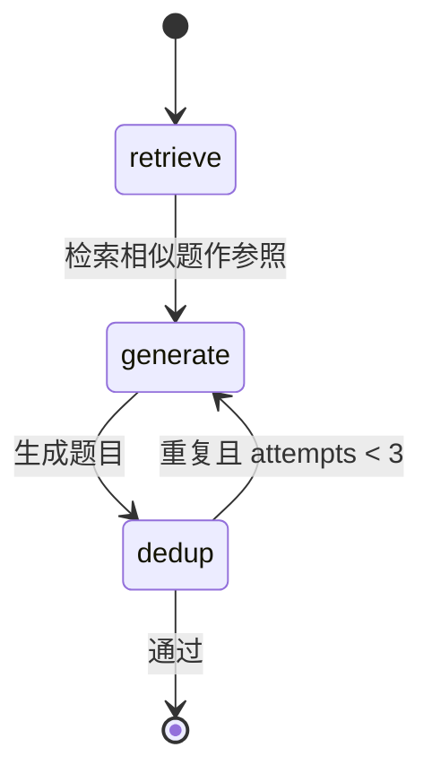
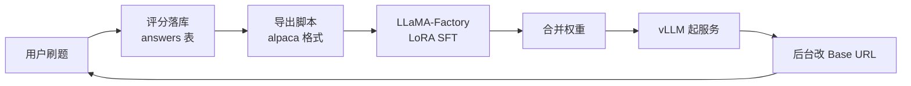

# 答辩 PPT 大纲

> **共 18 页**，建议 12–15 分钟讲完（正文 16 页 × 40 秒 + 演示与缓冲）。
> 每页给出：**标题 / 要点 / 配图 / 讲稿提示（含评委可能追问的问题）**。
>
> 讲稿提示里的「话术」是建议的口语表达，可直接改用。**凡是涉及数据的页，务必只讲有实物支撑的数字。**

---

## 第 1 页 · 封面

### 内容

**OfferMind —— 可观测 Agentic RAG 驱动的 AI 求职面试训练平台**

- 大模型部署与微调 · 课程设计 + 竞赛项目
- 成员：马乾恩 / 蒋志敏 / 李贤星
- 用户端（一期）· 计算机方向求职

### 配图

项目 Logo 或主界面截图（建议用**执行面板正在运行的画面**，一秒建立「可观测」的印象）。

### 讲稿提示

> 我是 XXX。我们的项目叫 OfferMind，是一个面向计算机方向求职者的 AI 面试训练平台。名字里 Offer 是求职目标，Mind 指智能体的决策与记忆内核。下面我用 15 分钟讲清楚三件事：**为什么做、做了什么、技术难在哪**。

**预期追问**：无（开场页）。

---

## 第 2 页 · 痛点：求职准备的三个环节都有缺口

### 内容

| 环节 | 现有做法 | 缺口 |
|---|---|---|
| **刷题** | 题库平台按标签刷，看别人题解 | 平台只给标准答案，**不评价自己的作答** |
| **简历** | 在线简历工具排版 | 只管排版，**不管内容与 JD 的匹配度** |
| **面试** | 找同学互面、看面经 | 对练成本极高，面完**没有结构化反馈** |

**直接用通用大模型能补一部分，但暴露四类问题**：

| 问题 | 表现 |
|---|---|
| 黑盒 | 看不到模型检索了什么、依据是什么 |
| 无参照 | 给的是通用知识，不是「这个岗位、这个难度」的参考答案 |
| 评分不可解释 | 说「7 分」，但不知道扣在哪 |
| 无追踪 | 每次对话一次性，没有画像、没有历史、没有复习 |

### 配图

左侧三个环节的流程图（简单箭头），右侧四个问题的图标列表。**不要用复杂的架构图**。

### 讲稿提示

> 我们做这个项目不是因为「大模型很火」，而是先有真实痛点。我给三个场景：我投后端岗，B+ 树索引这块比较虚，想练几道中级题，做完想知道自己差在哪 —— 现在的平台只告诉我标准答案。我要投某个 JD，不确定简历够不够格 —— 简历工具只帮我排版。我想模拟面试，但找不到人对练。
>
> 直接用 ChatGPT 行不行？能补一部分，但它是黑盒 —— 你看不到它检索了什么；它给的是通用答案，不是这个岗位的参照；它说「你这题 7 分」，但你不知道怎么改。

**预期追问**：「你们和市面上的 AI 面试产品有什么区别？」
→ 大部分 AI 面试产品是**一次性生成 N 轮问题**，不是真对话。我们的 HR 是一问一答、逐字流式的，而且会贴着你的简历深挖。这一点在第 11 页会展开。

---

## 第 3 页 · 定位与差异化

### 内容

**一句话定位**：不做「更好的通用问答」，做**一次完整的训练闭环**。

**三个关键词**：

| 关键词 | 含义 |
|---|---|
| **Agentic** | Agent 自主编排「检索 → 生成 → 校验 → 重试」，不是一次 LLM 调用 |
| **RAG** | 回答前先检索真实参照（题库），用检索结果约束生成 |
| **可观测** | 每一步（模型调用 / 向量检索）都以结构化事件实时推给用户 |

**四条闭环 + 贯穿能力**：

```
定向刷题 → 作答评测 → 错题沉淀 → 间隔复习
     ↑                              │
     └──── 能力画像持续更新 ←────────┘
                ↑
   简历诊断 → 模拟面试 → 面试报告 → 画像
```

**与已有方案的对比表**（4 行：通用刷题平台 / AI 简历工具 / AI 面试产品 / 直接问大模型）。

### 配图

闭环流程图（Mermaid `graph` 或手绘箭头图）。

### 讲稿提示

> 我们的定位不是「更好的 ChatGPT」，而是把求职准备的四个环节做成一个闭环。闭环的意思是：**刷题答错会进错题本，错题本按遗忘曲线安排复习，每次作答都会更新能力画像**。相邻模块之间数据是流通的。
>
> Agentic 的意思是：我们不是把问题丢给模型就完事 —— 出题要先检索避免重复、评分要先检索参考答案、面试要基于你的简历提问。这些都是 Agent 在编排。

---

## 第 4 页 · 总体架构

### 内容

**分层架构**（自上而下）：

```
接入层  Next.js 15 + React 19（功能页 + 管理后台 + 执行面板）
   ↓  HTTP + SSE 直连（CORS 放行）
API 层  FastAPI · 47 个端点 · 依赖注入（认证 / 运行时配置）
   ↓
服务层  业务编排 · 运行时配置登记表
   ↓
领域层  agent/（LangGraph 编排）  rag/（嵌入 / 精排 / 向量库 / BM25）
   ↓
数据层  repositories/（强制 user_id 隔离）
   ↓
存储层  PostgreSQL（事务主数据） · Qdrant（检索索引） · 本地模型（BGE-M3 + Reranker）
```

**三个设计原则**：

| 原则 | 好处 |
|---|---|
| 模块化单体（按领域分包） | 一期开发调试成本最低，包边界已划清可随时拆 |
| `agent` / `rag` 独立成包 | 离线脚本（微调导出、评测）能直接复用，不用复制 prompt |
| 事务数据与检索数据分离 | 向量库损坏可重建，不会丢业务数据 |

### 配图

**Mermaid `graph` 分层架构图**（用 [02-总体架构设计.md](./02-总体架构设计.md) §2.1 那张）。

### 讲稿提示

> 架构上有一个值得说的点：**前端是直连后端的，没走 Next.js 的 rewrites 代理**。这不是偷懒 —— 我们实测发现 Next 的 rewrite 会把整个 SSE 响应缓冲到请求结束，执行面板就拿不到「进行中」的分步事件，逐字流式也退化成一次性输出。这是我们踩过的坑之一。
>
> 另一个点是 `agent` 和 `rag` 是独立包，不依赖 Web 层。这样微调数据集导出脚本可以直接 import 线上的 prompt 模板 —— 这一点对「训推一致性」很关键，后面会讲。

**预期追问**：「为什么前端不用代理？」
→ 见上，讲缓冲那个坑。**这是加分回答，因为它证明你们不是照搬教程。**

---

## 第 5 页 · 技术栈与选型论证

### 内容

**核心选型表**（每项给「选定 + 一句话理由」）：

| 层面 | 选定 | 理由 |
|---|---|---|
| AI 编排 | **LangGraph** | 条件边能表达「出题 → 查重 → 不过则重生成」的循环；节点内可主动推事件 |
| 向量库 | **Qdrant** | 单容器即起、元数据过滤强 → 二期可换 Milvus |
| 后端 | **FastAPI** | 原生 async（LLM 全是 IO 密集）+ Pydantic 校验 + 内建 SSE 支持 |
| Embedding | **BGE-M3 本地** | 零边际成本 + 数据不出本机（简历属敏感数据） |
| 精排 | **bge-reranker-v2-m3 本地** | 同上；精排对最终质量提升明显 |
| 网关 | **LiteLLM** | 内建多部署路由 + 自动 fallback |
| 稀疏检索 | **进程内 BM25** | 题库规模小，省一个中间件；RRF 融合效果够 |
| 微调 | **LLaMA-Factory** | 一个 YAML 完成训练 + 导出合并权重一条命令 |

**两个明确排除项**：

| 排除 | 理由 |
|---|---|
| **Spring Boot / Java** | 核心依赖（LangGraph / sentence-transformers / LLaMA-Factory / vLLM）全是 Python 生态；跨语言意味着只能复制 prompt，而复制 prompt 正是「训推不一致」的根源 |
| **function calling** | DeepSeek 工具调用模式下 arguments 不保证合法 JSON（实测约三成失败）→ 改用 `response_format=json_object` |

### 配图

选型对比表格（直接投）。

### 讲稿提示

> 技术栈我准备了「为什么不用别的」的依据。挑两个说：
>
> 第一，**为什么放弃 Java**。我们一开始考虑过 Spring Boot，但发现核心依赖 —— LangGraph、sentence-transformers、LLaMA-Factory、vLLM —— 全是 Python 生态。跨语言的话，微调数据导出脚本没法直接 import 线上的 prompt，只能复制一份，而复制 prompt 就是「训推不一致」的根源。
>
> 第二，**为什么不用 function calling 做结构化输出**。这是我们踩的最深的一个坑：DeepSeek 在工具调用模式下不保证 arguments 是合法 JSON，模型只要在字符串里写了个未转义的引号，整段 JSON 就废掉，实测约三成概率。我们改用了 `response_format=json_object`，这是服务端约束解码，必然返回合法 JSON。这个第 9 页会详细讲。

**预期追问**：「为什么用 BGE-M3 而不是 OpenAI 的 embedding？」
→ 三个理由：**成本**（每次检索都要嵌入查询，调用频次极高，本地零边际成本）；**隐私**（简历是敏感数据，不能出本机）；**延迟**（本地推理没有网络往返）。代价是冷启动要加载 2GB+ 权重，所以我们做了后台预热。

---

## 第 6 页 · Agentic RAG：检索链路

### 内容

**向量库 Schema**：

| 项 | 值 |
|---|---|
| Collection | `question_bank` |
| 维度 / 距离 | 1024（BGE-M3）/ COSINE |
| **Point ID** | **= PostgreSQL 的 `question_id`** |
| Chunk 策略 | 一题一个 point，**无切分** |

**检索链路**（五步）：

```
查询 → 向量化（BGE-M3）→ 元数据过滤 → 稠密/稀疏/混合召回 → RRF 融合 → 精排 → top_k
```

**混合检索（已落地的核心成果）**：

| 模式 | 行为 | 适用 |
|---|---|---|
| `dense` | 只用 BGE-M3 稠密向量 | 语义相近的泛化查询 |
| `sparse` | 只用 BM25 关键词 | 精确术语、算法题名（`LRU`、`B+ 树`） |
| `hybrid` | 两路各取 top_k，**RRF 融合** | 通用场景 |

**RRF 为什么按名次而不按分数**：稠密路出的是余弦相似度（0–1），稀疏路出的是 BM25 分数（无上界），**量纲不可比**。加权求和需要先归一化，而归一化方式本身就是个不稳定超参。RRF 只用「排第几」，天然免调参（k=60）。

**候选池策略**（一个容易忽略的细节）：精排时稠密召回要取 `top_k * 2` —— 只给 top_k 条让精排重排，等于没有提升。

### 配图

**Mermaid `sequenceDiagram`** 检索链路（用 [05-Agentic-RAG设计.md](./05-Agentic-RAG设计.md) §3.2 那张），或简化为横向五步流程图。

### 讲稿提示

> 检索这块有个值得说的设计：**我们做了混合检索**，稠密向量加一路 BM25 稀疏检索，再用 RRF 融合。
>
> 为什么要加稀疏？因为纯语义检索对**算法题名和专有名词**是弱项。比如你查「LRU」，向量检索可能召回一堆「缓存淘汰策略」的泛化题，但漏掉题干里明确写着 LRU 那道 —— 因为语义空间里它们太近了。BM25 的字面匹配正好互补。
>
> 融合为什么用 RRF？因为两路的分数量纲完全不同 —— 余弦相似度是 0 到 1，BM25 分数没有上界。直接加权求和要先归一化，而归一化方式本身就得调参。RRF 只看名次，天然免调参。
>
> 另一个细节：精排的时候候选池要取 2 倍。只给 top_k 条让精排重排，等于白重排。
>
> 这三种模式**管理后台可以直接切**，改完即时生效 —— 演示的时候可以同一个问题切三种模式看召回差异。

**预期追问**：「RRF 的 k 为什么取 60？」
→ 这是 RRF 原论文的建议值。它的作用是**压低头部名次的权重差距** —— k 越小，第 1 名和第 2 名的得分差越大；k=60 让头部名次过渡平滑，避免单一检索路的第 1 名独裁。

**预期追问**：「为什么不用 Elasticsearch 做 BM25？」
→ 题库规模小（当前种子题 12 条 + 用户出题累积），进程内 `rank-bm25` 完全够用，省一个中间件的运维成本。**但这是权衡不是最优** —— 如果题库规模预期大幅增长，应该改用 Qdrant 原生的稀疏向量能力或接 ES，避免内存索引随数据线性增长。

---

## 第 7 页 · LangGraph 编排：9 张状态图

### 内容

**9 张图**：

| # | 图 | 结构 |
|---|---|---|
| 1 | `generate_question` | `START→retrieve→generate→dedup` + **条件回边** |
| 2 | `grade` | `START→retrieve→grade→END` |
| 3 | `followup` | `START→followup→END` |
| 4–6 | `parse_resume` / `parse_jd` / `diagnose` | 单链 |
| 7 | `interview_question` | 单链 |
| 8–9 | `interview_report` / `training_report` | 单链 |

**唯一的循环图（出题）**：



```python
def _route_after_dedup(state):
    if state.get("duplicate") and state.get("attempts", 0) < max_attempts:
        return "generate"     # 回边重生成
    return END
```

**一个刻意的例外**：面试对话**不用 StateGraph**，是带会话状态的异步生成器（每轮要把全量历史重拼进 messages，用图反而绕）。**两套机制共用同一份事件协议**，前端无需区分。

### 配图

出题图的状态图（上）+ 9 张图的清单表。**讲的时候只讲第 1 张，其余一笔带过。**

### 讲稿提示

> 我们用 LangGraph 显式建了 9 张状态图。选它而不是黑盒 Agent 框架，主要有两个原因：
>
> 第一，**条件边能表达循环**。出题这张图是全项目唯一的多跳图：生成完要查重，如果和题库里某道题相似度超过 0.9，就回到生成节点重新生成，最多 3 次。这条回边写成图拓扑，比写在函数里的 while 循环清楚得多 —— 重试次数是 state 字段、中间产物被自动丢弃、事件在节点内推。
>
> 第二，**节点内可以主动推事件**。这是可观测功能的技术前提 —— 节点执行到一半就能把「我开始了」「我做完了、耗时多少」推出去。
>
> 还有一个刻意的例外：**面试对话我们没用图**。因为面试是一问一答的连续对话，每轮要把全量历史重拼进 messages，用图表达反而绕。但它和其余 9 个模块**共用同一份事件协议**，所以前端不需要区分。

**预期追问**：「9 张图里有几张是多跳的？」
→ **只有 1 张**（出题）。其余 8 张都是单链（START → 一到两个节点 → END）。这说明本项目的 Agent 复杂度集中在出题环节（检索 + 生成 + 校验循环），其余环节以「检索 → 生成」或纯生成为主。**这个回答体现你们对自己的系统有清晰认识。**

---

## 第 8 页 · 四维可解释评分

### 内容

**评分量表**：

| 维度 | 权重 | 考察什么 |
|---|---|---|
| 正确性 | 0.40 | 结论是否正确、有无硬伤 |
| 完整性 / 深度 | 0.30 | 是否覆盖要点、能否深入机制 |
| 表达与结构 | 0.15 | 逻辑是否清晰、是否结构化表达 |
| 术语准确性 | 0.15 | 专业术语使用是否准确 |

**加权总分 = 0.40×正确性 + 0.30×完整性 + 0.15×表达 + 0.15×术语**（各维 0–5 分）

**输出结构**（每个维度必须带理由，**禁止裸分数**）：

```python
class GradeOutput(BaseModel):
    correctness: DimensionScore     # {score: int, reason: str}
    completeness: DimensionScore
    clarity: DimensionScore
    terminology: DimensionScore
    total_score: float
    strengths: str
    suggestions: str
    reference_answer: str
```

**两个附加价值**：

| 价值 | 说明 |
|---|---|
| **可解释** | 用户知道「扣在哪、怎么改」 |
| **可标注** | 有明确量表 → 人工能标 ground truth → 指标可量化（一致率 + MAE）→ **这是微调评测的前提** |
| **可对接** | 0–5 分恰好是 SM-2 间隔重复算法的输入量纲，**两套机制无缝对接** |

### 配图

四维雷达图 + 一段真实的评分 JSON 截图。

### 讲稿提示

> 评分我们坚持走四维 rubric，**每个维度必须给出理由，不允许返回一个裸分数**。因为用户需要知道的是「我扣在哪、怎么改」，而不是一个 7 分。
>
> 这个设计带来两个额外收益：
>
> 第一，**有明确量表就意味着人工能标注**。有了人工标注的 ground truth，指标才可量化。这也是我们做微调评测的前提 —— 后面会讲。
>
> 第二，**0 到 5 分恰好是 SM-2 间隔重复算法的输入量纲**。所以「评分」和「复习排期」这两套机制可以直接对接，不需要任何映射表。这是量表设计时就埋下的便利。

**预期追问（重要）**：「加权总分是服务端算的还是模型算的？」
→ **诚实回答**：目前是**模型自报**的，四维权重只写在 prompt 文本里，服务端不做加权校验。这是一个有意识的取舍 —— 省一次校验调用，代价是无法防御模型算错总分。**这是已知的设计边界**，修正方式是在评分节点里按四维重算总分并比对。
→ **不要含糊其辞或声称服务端算了。** 如果评委追问代码，含糊会被发现。

---

## 第 9 页 · 技术亮点：结构化输出的可靠性

> **这一页是整场答辩技术含量最高的一页，建议留足 1.5 分钟。**

### 内容

**问题**：DeepSeek 的 function calling 模式下，`arguments` **不保证是合法 JSON**。

```python
"采用"总分总"结构作答"     ← 内层引号没转义，整段 JSON 解析失败
```

**现象**：**约三成概率**拿到 `None`，上层报 `'NoneType' object has no attribute 'model_dump'`。报告类长文本尤其容易触发。

**根因**：这不是偶发抖动，是**长文本生成的固有风险** —— 文本越长、引号越多，出现未转义引号的概率越高。

**解法**：`response_format={"type": "json_object"}`

```python
class JsonSchemaLLM:
    def __init__(self, llm, schema):
        self._llm = llm.bind(response_format={"type": "json_object"})
        self._instructions = PydanticOutputParser(
            pydantic_object=schema).get_format_instructions()

    def invoke(self, messages):
        result = self._llm.invoke([*messages, HumanMessage(content=self._instructions)])
        return self._schema.model_validate_json(result.content)
```

**为什么这能解决**：`json_object` **不是「请求模型输出 JSON」，而是服务端约束解码** —— 在生成过程中就限制 token 选择，保证输出必然是合法 JSON。这是**解码层面的保证，不是提示词层面的请求**。

**代价与补偿**：`json_object` 要求 prompt 里出现 "json" 字样 → 把 Pydantic 的格式说明作为最后一条消息追加（说明文本天然含 "json"）。

**三层防护**：

| 层 | 作用 |
|---|---|
| 解码层 | `response_format=json_object` 保证是合法 JSON |
| 校验层 | Pydantic `model_validate_json` 校验字段齐备与类型 |
| 重试层 | 捕获 `ValidationError` 重试 1 次，仍失败抛明确错误 |

### 配图

左右对比：**function calling（坏 JSON 示例）** vs **json_object（约束解码）**。

### 讲稿提示

> 这一页是我们踩得最深、也最有收获的一个坑。
>
> 我们一开始用 function calling 做结构化输出 —— 让模型通过工具调用的方式返回评分 JSON。结果**大约三成概率会失败**，报 `NoneType has no attribute model_dump`。
>
> 查下来根因是：工具调用模式下，模型把参数写在 arguments 字符串里，而这个字符串**不保证是合法 JSON**。只要模型在某个字符串值里写了一个未转义的引号 —— 比如「采用"总分总"结构作答」—— 整段 JSON 就废了。而且这不是偶发抖动，是长文本生成的固有风险：文本越长越容易中招，我们的报告类任务尤其明显。
>
> 解法是改用 `response_format={"type": "json_object"}`。**关键区别在于：这不是「请求模型输出 JSON」，而是服务端约束解码** —— 在生成过程中就限制 token 的选择，保证输出必然是合法 JSON。我们从「靠提示词祈祷」换成了「从解码层保证」。
>
> 代价是 `json_object` 要求 prompt 里出现 "json" 字样，所以我们在最后追加了一条 Pydantic 的格式说明。
>
> 在这之上我们还加了三层防护：解码层保证是 JSON，Pydantic 校验保证字段对，失败重试 1 次处理偶发问题。

**预期追问**：「为什么不用 function calling 的严格模式 / strict schema？」
→ 当时的判断是：DeepSeek 端的工具调用在我们的实测中就是不可靠的，而 `response_format=json_object` 是服务端约束解码、行为确定。**这是一个基于实测的选择，不是基于文档的选择。**

---

## 第 10 页 · 可观测：产品的差异化卖点

> **这一页建议现场演示**（准备一段 15 秒的屏幕录制，避免现场网络问题）。

### 内容

**用户实际看到的样子**：

```
模型  generate:1       出题 · deepseek-v4-flash · 第 1 次尝试     2.3s ✓
检索  retrieve:向量化  向量化 · BGE-M3                            0.04s ✓
检索  retrieve:召回    向量召回 · 命中 5 条                        0.01s ✓
检索  retrieve:精排    精排 · bge-reranker-v2-m3 · 保留 5 条        0.18s ✓
检索  dedup:1         查重 · 最高相似度 0.93 · 阈值 0.9
                      · 判定：与题库重复，重新生成
模型  generate:2       出题 · deepseek-v4-flash · 第 2 次尝试     2.1s ✓
检索  dedup:2         查重 · 最高相似度 0.41 · 阈值 0.9 · 判定：通过
```

**事件协议**（固定 5 字段）：

```python
{"id": step_id, "type": kind, "status": "running" | "done",
 "payload": {...}, "duration_ms": int | None}
```

**三条设计原则**：

| 原则 | 反面做法（刻意避开） |
|---|---|
| 每一步都可见 | 只在最后返回结果 |
| **不暴露思维链** | 把模型的推理文本原样打给用户 |
| **同 id 原地替换** | 开始推一条、结束再推一条，面板里出现两行 |

**双流分工**（LangGraph 的两个流各管一件事）：

| 流 | 用途 |
|---|---|
| `custom` | 节点主动推的实时事件（含「进行中」）→ **直接转发** |
| `updates` | 每个节点执行完的 state 增量 → **只取最后一个含 `output` 的节点** |

**前端状态机的关键设计**：合并键是 **`{运行序号}:{节点 id}`** —— 不加序号的话，同一页面多次执行会互相覆盖轨迹。

### 配图

**执行面板的真实截图**（最重要）+ 事件格式代码块。

### 讲稿提示

> 可观测是我们最重要的产品差异化，不是运维附属品。
>
> 用户点了「出题」，界面上会逐步出现每一个步骤：向量化花了 40 毫秒、召回命中 5 条、精排保留 5 条、生成用了 2.3 秒、然后查重发现相似度 0.93 超过阈值 0.9，所以自动重新生成了一遍。
>
> 这里有个设计细节：**每个步骤只有一行**，从「进行中」原地变成「已完成 + 耗时」。实现方式是开始和结束推两条**同 id** 的事件，前端按 id 做替换。如果不这样，面板里每步会出现两行。
>
> 另外一点：**我们刻意不暴露模型的思维链**。推的是「做了什么、耗时多少」这些结构化字段，不是模型的推理文本 —— 那样既没意义也不安全。
>
> 技术上有个值得说的点：LangGraph 有两种流，我们用 `custom` 流拿实时事件、用 `updates` 流只取最终结果。**轨迹不从 updates 取**，因为两边都取会导致每条轨迹出现两次。
>
> 前端还有一个细节：合并键带**运行序号**。因为同一个页面上反复点「出题」，节点 id 都是 `generate:1`，不带序号的话第二次会把第一次的轨迹覆盖掉。

**预期追问**：「这些轨迹能回看吗？」
→ **诚实回答**：目前**不能持久化**。轨迹通过 SSE 实时推给前端，前端用 `sessionStorage` 保住了当前标签页，所以切路由、刷新都还在，但**关掉标签页或换设备就没了**。服务端有一张 `tool_traces` 表但**没有写入路径**。我们规划接 Langfuse 做轨迹归档和成本看板 —— 依赖已经装了，但还没接。

---

## 第 11 页 · 模拟面试：真对话而非一次性生成

### 内容

**与常见做法的区别**：

| | 常见做法 | **本项目** |
|---|---|---|
| 交互 | 一次性生成 N 轮问题 | **一问一答真对话** |
| 输出 | 整段返回 | **HR 回复逐字流式** |
| 提问依据 | 通用题库 | **基于你的简历深挖**（考察是否真参与过项目） |
| 反馈 | 笼统评语 | **结构化报告**（总分 / 逐轮评价 / 改进建议 / 能力雷达） |

**三合一入口**：`POST /interview/chat/stream`

| 参数 | 语义 |
|---|---|
| `session_id` 为空 | 开新面试 |
| `message` 非空 | 候选人发言 |
| `summarize=true` | 总结面试，生成报告 |

**对话类事件与步骤类事件走同一根流**，靠前端集合分流：

```ts
// token 是逐字分片，混进轨迹会刷屏
const CHAT_EVENTS = new Set(["token", "session", "hr_message"]);
```

**两个报告用不同的雷达维度**（刻意区分）：

| 报告 | 雷达四维 |
|---|---|
| 面试报告 | 技术深度 / 项目经验 / 表达沟通 / 问题解决 |
| 训练报告 | 正确性 / 完整性 / 表达 / 术语 |

### 配图

面试对话界面截图（气泡 + 右侧执行面板）+ 面试报告雷达图。

### 讲稿提示

> 模拟面试这块我们和常见做法不太一样。很多产品是**一次性生成 N 轮问题**，做完给你一个评语 —— 那不叫面试，那叫问卷。
>
> 我们做的是一问一答的真对话：HR 说一句，你回一句，HR 接着追问。想结束时点「总结面试」，系统拿整场对话生成报告。而且 HR 的回复是**逐字流式**出来的，像真的在打字。
>
> 提问是**贴着你上传的简历深挖**的，目的是考察你是不是真的参与过那个项目 —— 这是真实面试里最常见的验证手段。
>
> 技术上有个细节：一次 HR 回复会产生几十上百个 `token` 事件，如果它们混进执行面板，轨迹会被冲得看不见。所以前端有个集合把这几个事件分流到对话气泡，只把「模型调用」这类步骤事件留在面板里。**同一套事件机制同时服务两种截然不同的 UI。**
>
> 另外，面试报告和训练报告的雷达维度是**刻意不同**的 —— 面试考察的是综合表现（项目经验、沟通表达），刷题考察的是答题质量（正确性、术语准确）。复用同一套维度会让两者都失真。

---

## 第 12 页 · 错题本与间隔重复

### 内容

**SM-2 算法参数**：

| 参数 | 值 |
|---|---|
| `quality` 输入 | **直接取四维加权总分四舍五入** |
| 判定 | `< 3` 视为没记住 → 间隔重置为 1 天、重复次数归零 |
| 首次 / 二次间隔 | 1 天 / 6 天 |
| 之后间隔 | `round(上次间隔 × ease)`（指数增长） |
| ease 初始 / 下限 | 2.5 / **1.3** |
| 错题阈值 | 总分 `< 3.0` |
| 毕业要求 | **连续答对 2 次** |

**一个必须解释的设计（也是我们犯过的 bug）**：

> ❌ 如果「复习答对一次就移出错题本」——**待复习队列会永远是空的**。

推演：

```
待复习队列 = is_wrong=True AND review_due_at <= now
       ↓
答对一次就置 is_wrong=False
       ↓
第一次复习答对后，记录立刻退出队列
       ↓
SM-2 排出的后续节点（6 天、15 天、37 天）永远不会触发
       ↓
间隔重复退化成「复习一次就结束」，算法等于没实现
```

**解法**：改为**连续答对 2 次**才毕业。因为 SM-2 在 `quality < 3` 时会把重复次数清零，所以 `review_count` 字段天然等于「连续答对次数」。

### 配图

间隔重复时间轴示意图（1 天 → 6 天 → 15 天 → 37 天），配上「待复习」标签页的截图。

### 讲稿提示

> 错题本这块我们实现了完整的 SM-2 间隔重复算法 —— 这是 PRD 里没要求的，属于超出原范围的工作。
>
> 有一个设计值得说，因为**我们在这儿踩过坑**。一开始的逻辑是「复习答对一次就移出错题本」。结果待复习队列永远是空的。
>
> 为什么？因为待复习队列的查询条件是 `is_wrong = True`。答对一次就把 `is_wrong` 置成 False，那条记录立刻退出队列 —— 于是 SM-2 排出来的后续复习节点（6 天、15 天、37 天）永远不会被触发。**间隔重复退化成「复习一次就结束」，算法等于白实现。**
>
> 改成**连续答对 2 次**才毕业就好了。这里有个巧合：SM-2 在 quality 小于 3 的时候会把重复次数清零，所以我们的 `review_count` 字段天然就等于「连续答对次数」，不需要额外字段。
>
> 还有个对接上的便利：**四维评分是 0 到 5 分，SM-2 的输入 quality 也是 0 到 5** —— 所以两套机制直接对接，取加权总分四舍五入就行，不需要任何映射表。

**预期追问**：「为什么毕业要求是 2 次不是 3 次？」
→ 2 次是在「防止一次答对就毕业」与「不让用户觉得永远毕不了业」之间的折中。这个值定义为常量 `MASTERED_REVIEWS`，可以调整。

---

## 第 13 页 · 数据飞轮：让系统自己长出训练数据

> **这一页务必讲清「框架完成、数据待跑」，不要含糊。**

### 内容

**核心洞察**：每次评分落库的 `(题目, 参考答案, 用户作答, 四维评分)` **本身就是一条 SFT 样本**。用户每做一次评分，训练集就长一条。



**为什么选评分器做微调对象**（三条独有条件）：

| 条件 | 说明 |
|---|---|
| **有 ground truth** | 四维 rubric 是明确量表，人工能标，指标可量化 |
| **数据自己长出来** | 系统每次评分都写一条，无需额外采集 |
| **输出可校验** | 结构化 JSON，Pydantic 一验就知道对不对 |

> 「这是整个项目里**唯一能拿出「微调前 vs 微调后」对比表**的地方。」

**LoRA 配置要点**：

| 项 | 值 | 依据 |
|---|---|---|
| 底座 | Qwen2.5-1.5B-Instruct | 中文强、单卡可训、量化后能进消费卡 |
| `lora_rank` / `alpha` | 16 / 32 | 1.5B 模型 r=16 足够 |
| `lora_target` | **all** | 结构化输出任务上比只调 q_proj/v_proj 明显好 |
| `cutoff_len` | 4096 | 评分 prompt 通常 1500–2500 token |

**三个方法学设计（加分项）**：

| 设计 | 理由 |
|---|---|
| **prompt 逐字复用线上模板**（用 `import` 而非复制） | 训推不一致会让微调白做 —— 用引用让「不同步」在工程上不可能发生 |
| **评测默认不走向量检索** | 实验设计基本功：一次只改一个变量，否则指标提升无法归因 |
| **评测读数据库配置而非 `.env`** | 管理员改过模型的话 `.env` 已过期，拿它评测等于测了另一个模型 |

### 配图

数据飞轮闭环图 + **总分分布直方图**（说明「分布挤在中档 = 无区分度」这个自检机制）。

### 讲稿提示

> 课程主题是「部署与微调」，而项目原本这两块都是空的 —— 主生成模型 100% 走云端。我们补的方式是**数据飞轮**。
>
> 关键洞察是：**每次评分落库的数据，本身就是一条微调样本**。题目、参考答案、用户作答、四维评分 —— 这就是完整的输入输出对。所以我们**不需要另找数据集**，用户每做一次评分，训练集就长一条。
>
> 为什么挑评分器做微调对象？因为它有三个别处没有的条件：**有 ground truth**（四维量表人工能标）、**数据自己长出来**、**输出可校验**（结构化 JSON，Pydantic 一验就知道对不对）。这是整个项目里唯一能拿出「微调前后对比表」的地方。
>
> 方法上我们做了三个设计。**第一，导出的 prompt 逐字复用线上的模板** —— 不是复制一份文本，而是直接 `import` 线上模块。因为训推不一致是微调最容易犯的错：训练时看到的输入和推理时不一样，模型学的是另一件事，而且从 loss 曲线上完全看不出来。用引用比用约定可靠。**第二，评测默认不走向量检索** —— 因为线上评分会先检索参考答案，那是另一个变量，掺进来就分不清微调前后的差异是模型带来的还是检索带来的。**第三，评测读数据库里的配置而不是 `.env`** —— 因为管理员可能在后台改过模型，`.env` 那份已经过期，拿它评测等于测了另一个模型。

**预期追问（一定会问）**：「所以微调结果怎么样？提升了多少？」
→ **必须诚实回答**：
> 「**链路代码已经全部完成了** —— 数据导出脚本、评测脚本、LLaMA-Factory 训练配置、评测集标注模板都写好了，8 步执行清单也明确。但**实验本身还没跑**：SFT 数据集还没导出、人工标注评测集目前只有 2 条（设计目标是 100 条以上）、LoRA 还没训练，所以**目前没有微调前后的对比数据**。主要是缺 GPU 资源和人工标注的投入。
>
> 需要说明的是，项目里 `finetune/eval/` 下有两份 JSON，那是**演示 `--compare` 输出格式的占位产物**，不是实测结果 —— 其中 `test_after.json` 的指标和它自己的原始数据[数学上不自洽]，所以我们没有引用它。**我们不想拿占位数据当实验结论。**」

→ **这个回答的诚实度本身就是加分项。** 评委见过太多编造数据的项目。
→ 如果被问「为什么 `test_after.json` 不自洽」：它的 `rows` 里预测值全是 0，但指标却写着一致率 0.75、MAE 0.8 —— 同样的原始行不可能推出两套指标，所以它是按 README 的示例输出反推出来的格式样例。

---

## 第 14 页 · 部署与网关

### 内容

**目标架构**：

```
OfferMind 应用 →（OpenAI 兼容协议）→ LiteLLM 网关 → 本地 vLLM / 云端 API
```

**进程内 LiteLLM Router（已实现）**：

| 设计 | 说明 |
|---|---|
| **`LiteLLMChat` 薄适配器** | **LiteLLM 是原生 SDK 不是 langchain 组件**，所以只对齐真正用到的 `bind()` / `invoke()` / `astream()` 三个方法 —— 上层 `JsonSchemaLLM` **一行都不用改** |
| **路由与容错** | `primary` + `fallbacks` + `num_retries=2` + `timeout=120` |
| **配置写坏不拖垮服务** | 部署列表解析不出来时**静默回落直连** —— 管理员少写一个逗号，服务照常可用 |
| **配置热更新** | 4 个网关配置项来自管理后台；用**配置文本本身**做缓存键，值变了键就变 |

**vLLM 本地部署方案（脚本已就绪，尚未在真实 GPU 上落地）**：

| 档位 | 差异参数 | 显存（7B） |
|---|---|---|
| fp16 | `--dtype bfloat16` | 约 16GB |
| awq | `--quantization awq --dtype float16` | 约 6GB |
| gptq | `--quantization gptq --dtype float16` | 同量级 |

公共参数含 `--enable-prefix-caching` —— **对「system prompt + 评分量表前缀固定、只有尾部变化」的负载特别有效**。

**为什么用 vLLM 而非 transformers**：PagedAttention + 连续批处理把吞吐拉高一个数量级。

### 配图

部署架构图（应用 → 网关 → 本地/云端）+ 三档量化参数表。

### 讲稿提示

> 部署这块分两个部分，状态不一样，我分开说。
>
> **已经完成的是 LiteLLM 网关**，进程内运行。这里有个技术判断值得说：**LiteLLM 是原生 SDK，不是 langchain 组件**，返回对象和 langchain 的消息接口不兼容。有两条路：实现一个完整的 LangChain ChatModel 子类，或者写一个只对齐真实用法的薄适配器。我们选了后者 —— 因为上层真正用到的只有三个方法：`bind`、`invoke`、`astream`。这样**上层的结构化输出封装一行都不用改**，网关是纯插入式的。
>
> 网关里我最满意的一个设计是**容错**：配置来自管理后台的文本输入，管理员随时可能填错。所以解析失败时**静默回落到直连模式** —— 少写一个逗号，服务照常可用。配置错误不应该导致服务不可用。
>
> **还没落地的是本地 vLLM 部署**。启动脚本写好了，支持 FP16、AWQ、GPTQ 三档量化，也有配套的压测脚本，但**我们还没在真实 GPU 上起过服务，所以没有本地实测数据**。这也是我们规划里的第一优先级。

**预期追问**：「网关能按任务难度路由吗？」
→ **诚实回答**：数据模型里已经预留了 `tiers`（simple / complex）和 `weight` 字段，注释也写了「按任务难度分流时用」，但**当前 Router 只消费 `primary` 和 `fallbacks`，没有用 `tiers`**。所以「简单任务走本地、难任务走云端」这个能力**还没实现**，属于设计超前于实现。

---

## 第 15 页 · 实测数据

> **只讲有实物支撑的数字。这一页的分量在于「数据的可信度」而不是「数字好不好看」。**

### 内容

**已实测：云端 LLM 基线**

条件：模型 `deepseek-flash`，并发 4、总请求 8、prompt 200 字符、`max_tokens` 64
来源：`backend/benchmark/cloud-test.json`

| 指标 | 值 |
|---|---|
| 错误率 | **0.0%** |
| 吞吐（QPS） | **0.89 req/s** |
| 总延迟 P50 | **3741.6 ms** |
| 总延迟 P95 / P99 | 5451.7 ms / 5550.7 ms |
| **首 token 延迟 P50** | **2752.8 ms** |
| 首 token 延迟 P95 | 4278.4 ms |

**这组数字怎么读**：

| 观察 | 含义 |
|---|---|
| TTFT P50 = 2752.8 ms | **恰好卡在 PRD 要求的「首 token < 3s」门槛内**，余量很小 |
| **TTFT 占总延迟 P50 的 74%** | 大部分时间花在「等第一个 token」上 —— **这正是本地部署 + 前缀缓存最可能赢的地方** |
| P99 / P50 = 1.48 | 尾部放大近 1.5 倍，存在排队或网络抖动 |

**压测方法学的三个设计**（这才是这张表的可信度来源）：

| 设计 | 理由 |
|---|---|
| **固定 prompt 长度** | 不同输入长度的延迟没有可比性 |
| **区分 TTFT 与总延迟** | 首 token 决定体感，总时长决定吞吐，混在一起看不出问题 |
| **报 P50/P95/P99** | 只看均值会漏掉排队和限流的尾巴 |

**待实测的表格骨架**（现场展示但明确说是空的）：

| 档位 | 显存 | 总延迟 P50 | 首 token P50 | QPS | 评分质量 MAE |
|---|---|---|---|---|---|
| 云端基线 | — | 3741.6 ms | 2752.8 ms | 0.89 | 待实测 |
| vLLM FP16 | 待实测 | 待实测 | 待实测 | 待实测 | 待实测 |
| vLLM AWQ | 待实测 | 待实测 | 待实测 | 待实测 | 待实测 |

### 配图

基线数据表 + 一个简单的柱状对比图（只有云端一根柱子有数据）。

### 讲稿提示

> 这是我们已经实测的数据：云端 `deepseek-flash` 的基线。
>
> 我想重点讲**怎么读这组数字**，而不是数字本身。首 token 延迟 P50 是 2752 毫秒 —— **刚好卡在我们 PRD 要求的 3 秒门槛内，但余量很小**。更重要的是，**首 token 占了总延迟的 74%**，也就是说大部分时间花在「等第一个 token」上。这正好说明**本地部署最可能赢在哪**：没有网络往返、加上前缀缓存。
>
> 不过我也必须说明这个数据的局限：**只有 8 个请求，并发 4**，所以 P95 和 P99 的置信度有限，P99 基本就是第 8 个样本附近的值。它适合做**基线参考**，不足以作为容量结论。要正式引用的话需要加大请求数重跑。
>
> 压测脚本我们做了三个设计来保证数字可比：**固定 prompt 长度**（不同长度的延迟不可比）、**区分首 token 和总延迟**（一个决定体感、一个决定吞吐）、**报分位数而不只报均值**（均值正常但 P99 爆表，用户体验是偶尔卡死）。
>
> 右边这张本地量化的表**目前是空的** —— 本地部署还没落地，所以我不填数字。

**预期追问**：「QPS 只有 0.89，是不是太低了？」
→ **这是个好问题，正说明你们理解自己的数据**：
> 「0.89 是**在并发 4、单请求约 4.5 秒的条件下**的结果 —— 也就是说**吞吐是被单请求延迟限制的，不是被并发度限制的**。理论上并发提到 8，QPS 应该能接近翻倍。这也正是本地部署要解决的问题：降低单请求延迟，吞吐自然上去。
>
> 不过我们的样本量太小，这个推论需要重跑验证。」

---

## 第 16 页 · 工程踩坑记录

> **选 3 个讲，不要全讲。建议选坑 1（结构化输出）、坑 2（并发模型）、坑 4（SM-2 毕业规则）—— 它们分别代表「外部依赖的坑」「并发的坑」「自己设计的坑」。**

### 内容

**9 个坑，每个按「现象 → 根因 → 解法 → 防回归」记录**：

| # | 坑 | 本质 |
|---|---|---|
| 1 | DeepSeek function calling 的 JSON 不合法（约三成失败） | 误判了模型的输出保证级别 |
| 2 | **并发构造 HF 模型得到半初始化实例**（`Cannot copy out of meta tensor`，坏实例被缓存后**永久生效**） | 单例的并发安全 |
| 3 | Next.js rewrites 缓冲整个 SSE 响应 | 中间层不透明的缓冲行为 |
| 4 | SM-2「答对一次就毕业」让待复习队列永远为空 | 两个机制共享字段的隐式耦合 |
| 5 | `Base.metadata.create_all` 不给已有表加列 | 对 ORM 工具语义的误解 |
| 6 | 评分必须带 `question_id`，缺失时宁可不落库 | 数据关联正确性优先 |
| 7 | 第一个管理员的鸡生蛋问题 | 权限系统的自举 |
| 8 | Windows 下 `localhost` 解析到 IPv6 导致静默超时 20 秒 | 网络层的静默等待 |
| 9 | 训推不一致（用 `import` 而非复制来防住） | 两处代码需保持一致 |

**坑 2 的细节**（最有技术含量）：

```python
# 预热线程与第一个真实请求同时进 _load()
# → 并发构造同一个 HF 模型 → 半初始化实例
# → 所有调用报 "Cannot copy out of meta tensor; no data!"
# → 坏实例被缓存到模块级 _instance → 之后永久生效
```

解法：**类内双重检查锁 + 模块级单例锁**，且**刻意不用 `lru_cache`**（它不加锁，两个线程会各构造一份，多占 2GB 显存）。

### 配图

9 个坑的表格（投屏用），讲的时候高亮其中 3 行。

### 讲稿提示

> 实施过程中我们记录了 9 个坑，每个都写了「现象、根因、解法、防回归」。我挑三个说。
>
> **第一个是并发构造模型。** 我们启动时有个后台线程预热 BGE-M3 和 reranker，结果它和第一个真实请求会同时进入模型的加载函数。不加锁的话两边都会构造一份模型，而**并发构造同一个 HuggingFace 模型会得到半初始化实例** —— 之后所有调用都报 `Cannot copy out of meta tensor`。最严重的是，坏实例被缓存到模块级变量后**永久生效**，重启才好。解法是双重检查锁。这里有个反直觉的点：我们**刻意不用 `lru_cache`** —— 它虽然是线程安全的，但**不加构造锁**，两个线程还是会各构造一份，在 2GB 的模型上就是白占 2GB 显存。
>
> **第二个是 SSE 被代理缓冲。** 我们一开始用 Next.js 的 rewrites 把 API 请求代理到后端，结果执行面板在请求期间一动不动，结束后所有事件一次性全出现。原因是 rewrite 是服务端代理，它会**先把整个响应读完再转发**。SSE 的全部价值就在「产生一条推一条」，被缓冲之后和普通响应没区别。改成前端直连 + 后端 CORS 就好了。
>
> **第三个是间隔重复的毕业规则**，前面第 12 页讲过，是待复习队列永远是空的。根因是两个机制共享了 `is_wrong` 这个字段，改了一方的行为没检查另一方的消费方式。
>
> 这些坑的共同点是：**都不是设计阶段能想到的** —— 必须跑起来才会暴露。

---

## 第 17 页 · 工作量与成果

### 内容

**代码规模**：

| 项 | 数值 |
|---|---|
| 后端 | **71 个文件 / 约 6,000 行** |
| 前端 | **30 个文件 / 约 4,760 行** |

**系统规模**：

| 项 | 数值 |
|---|---|
| 有效 API 端点 | **47 个**（含 **9 个 SSE 流式端点**） |
| 数据表 | **11 张** |
| LangGraph 状态图 | **9 张** |
| 本地模型 | 2 个（BGE-M3 + bge-reranker-v2-m3） |
| 运行时配置项 | **12 项** |
| 离线脚本 | **3 个**（压测 / 微调导出 / 评分器评测） |
| 部署脚本 | 2 份（Linux + Windows） |

**超出原计划完成的部分**（PRD 未要求或列为非目标）：

| 项 | 说明 |
|---|---|
| **管理员端** | PRD 明确列为一期**非目标**，实际完整实现（含题库管理同步向量库） |
| **混合检索** | PRD 只提到单路向量，实际实现了 BM25 + RRF 融合 + 三模式可切换 |
| **间隔重复（SM-2）** | PRD 未要求，完整实现含 ease 动态调整与连续答对毕业规则 |
| **历史记录 + 页面状态保持** | PRD 未详细要求，完整实现 |

**文档产出**：技术方案 16 篇 + 答辩 PPT 大纲 1 份 + PRD + 选题报告。

### 配图

工作量统计的信息图（几张大数字卡片）。

### 讲稿提示

> 工作量方面：后端 71 个文件约 6000 行，前端 30 个文件约 4760 行，**47 个有效 API 端点**，其中 9 个是流式端点。11 张数据表，9 张 LangGraph 状态图。
>
> 我想特别提一下**超出原计划的部分**。PRD 里明确写了「管理员端」是一期非目标，但我们实际上把它完整做了 —— 包括用户管理、题库管理（增删改会同步向量库）、以及模型与检索的运行时配置。**因为题库质量直接决定 RAG 的效果，没有后台就没法运营。**
>
> 另外 **混合检索** PRD 里只提了单路向量，我们实现了 BM25 稀疏路加 RRF 融合；**间隔重复** PRD 完全没要求，我们实现了完整的 SM-2。

---

## 第 18 页 · 设计边界与规划

> **这一页是整场答辩的收尾，决定了评委对你们「是否清醒」的判断。不要跳过。**

### 内容

**当前设计边界**（选几条讲）：

| 边界 | 影响 | 补齐路径 |
|---|---|---|
| 三张表建了但无读写路径（`training_sessions` / `tool_traces` / `resumes`） | 轨迹不持久化、训练会话聚合未落地、简历未归档 | Langfuse 归档 / 训练会话管理 / 简历存 MinIO |
| **画像不被 Agent 读取** | 出题不会参考用户薄弱点，只做到「记录与展示」 | 画像自动更新 + 注入 prompt |
| 三个知识库**只有题库库落地** | 面经库零代码；简历库未进向量库 | RAG 面经企业库 |
| 四维权重**只写在 prompt 里**，服务端不校验 | 无法防御模型算错总分 | 服务端按四维重算比对 |
| 无 checkpointer / 无 ReAct 工具循环 | Agent 是确定性流水线，不具备自主选工具能力 | 管理端智能助手（第一个 ReAct 落点） |
| 限流 / 配额 / 内容安全 / 合规未实现 | 无法面向真实用户开放 | P2 |
| **依赖清单缺 4 个包** | 换机器 `pip install -e .` 后跑不起来 | 补进 `pyproject.toml` |
| `/health/ready` 不检查依赖 | 就绪探针名不副实 | 接入 DB / Qdrant 连通性检查 |

**演进规划（P0 四项）**：

| # | 项 | 性质 |
|---|---|---|
| 1 | 微调数据补齐与训练 | **执行**（代码件已完成） |
| 2 | 本地 vLLM 部署落地 | **执行**（脚本已就绪） |
| 3 | Langfuse 轨迹归档 + 成本看板 | 开发 |
| 4 | 修依赖清单 | 开发（改动量极小） |

**一句话总结**：

> 架构与代码件是完整的，**缺口集中在需要外部资源（GPU、人力标注）才能推进的实验上**。

### 配图

一张简单的「设计边界 → 补齐路径」映射图，或 P0 四项的卡片。

### 讲稿提示

> 最后我想诚实地讲一下**当前做到哪一步**。
>
> 有三个知识库是 PRD 规划的，我们**落地了一个**（题库库）；面经企业库还没开始，简历也不是以向量库的形式用的 —— 是直接当字符串塞进 prompt 的。
>
> 能力画像是 PRD 的核心设计之一，但我们目前**只做到了记录和展示**，还没有让它反哺出题。也就是说，系统不会因为你上次答错了 B+ 树，下次就多给你出索引相关的题。**这是我们最重要的一个未闭环环节。**
>
> 四维评分的加权总分目前是**模型自报**的，服务端不做校验 —— 这是个有意识的取舍，代价是无法防御模型算错总分。
>
> 微调和本地部署这两块，**代码件全部完成、脚本就绪，但实验本身还没跑**，主要缺 GPU 资源和人工标注的投入。
>
> 另外有几个工程卫生问题，比如依赖清单少了 4 个包，换台机器按文档装环境会跑不起来 —— 这类问题我知道了就会去修。
>
> **总结一句：我们的架构与代码件是完整的，缺口集中在需要外部资源才能推进的实验上。** 这也是为什么规划里的 P0 四项，有三项是「执行」而不是「开发」。

**预期追问**：「你觉得这个项目最大的问题是什么？」
→ 最好的回答是**具体且不回避**：
> 「最大的问题是**能力画像没有闭环**。PRD 把它设计成核心差异化 —— 系统应该越用越懂你，根据你的薄弱点个性化出题。但我们只实现了写入和展示，没有让它回流到生成环节。这就让「长期能力画像」变成了一个用户自己看的展示面板，而不是真正驱动系统的用户模型。这是我们下一步的第一优先级。」

---

## 附：答辩策略建议

### 时间分配（12–15 分钟）

| 页 | 建议时长 | 说明 |
|---|---|---|
| 1–3 | 1.5 min | 痛点与定位，节奏可以快 |
| 4–5 | 2 min | 架构与选型 |
| **6–8** | **3 min** | RAG + 编排 + 评分（技术核心） |
| **9** | **1.5 min** | 结构化输出（技术亮点，留足时间） |
| **10** | **1.5 min** | 可观测（**建议现场演示**） |
| 11–12 | 2 min | 面试 + 错题本 |
| 13 | 1.5 min | 数据飞轮（**务必讲清状态**） |
| 14–15 | 2 min | 部署 + 实测数据 |
| 16 | 1.5 min | 踩坑（选 3 个讲） |
| 17 | 1 min | 工作量 |
| **18** | **1.5 min** | 设计边界与规划（**不要压缩**） |

### 三条通用建议

| # | 建议 |
|---|---|
| 1 | **凡是数据，必讲口径**。说「首 token 2752 毫秒」时一定要带上「并发 4、8 个请求、prompt 200 字符」。只说数字显得外行，带上口径显得专业 |
| 2 | **凡是规划，必讲现状**。说「我们要接 Langfuse」时先说「现在轨迹刷新就丢」。评委会因此认为你们清楚自己的位置 |
| 3 | **诚实比完美加分**。微调数据不存在、本地部署没落地、加权总分是模型自报的 —— 这些都直说。**评委见过太多编数据的项目，诚实反而是差异化** |

### 准备好这几个必答问题

| 问题 | 回答要点 |
|---|---|
| **微调效果怎么样？** | 见第 13 页讲稿提示。核心：代码件完成、实验未跑、不引用占位数据 |
| **和市面上的 AI 面试产品有什么区别？** | 真对话（不是一次性生成 N 轮）+ 逐字流式 + 贴着简历深挖 + 结构化报告 |
| **本地部署比云端快吗？** | 见第 15 页。核心：无网络往返 + 前缀缓存，TTFT 最可能赢；但我没有本地数据 |
| **为什么不用 Java？** | 核心依赖全是 Python 生态；跨语言会破坏训推一致性 |
| **加权总分谁算的？** | **模型自报**，服务端不校验 —— 这是已知设计边界，不是「服务端算的」 |
| **9 张图有几张是多跳的？** | **只有 1 张**（出题），其余 8 张是单链 —— 体现对系统的清晰认识 |
| **为什么不用 function calling？** | 见第 9 页。实测约三成失败，改用服务端约束解码 |
| **最大的问题是什么？** | 见第 18 页。能力画像没有闭环 —— 具体、不回避 |
| **轨迹能回看吗？** | **不能持久化**。sessionStorage 只保住当前标签页；`tool_traces` 表空置；规划接 Langfuse |

---

**相关文档**：[README.md](./README.md) ｜ [00-项目概述.md](./00-项目概述.md) ｜ [13-设计边界与演进规划.md](./13-设计边界与演进规划.md)
